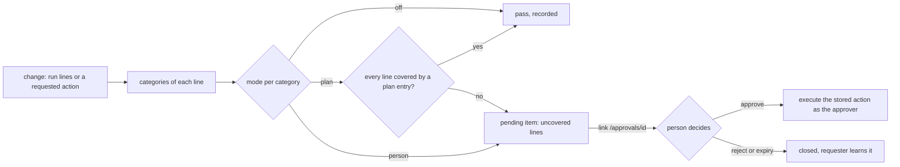

# Approvals an agent asks for, and a person gives from one link

**TLDR.** A coding agent can deploy, write secrets and change an application's registry rows through its own
credential. The actions that today need a person (a manual deploy of a protected environment, an access change that
waits, a console grant that waits, issuing keys) have no path where the agent asks and the person answers. Four designs
were compared. The maintainers chose **(b)**, an explicit one-off approval request in Control that opens on one console page,
and **(d)**, an approval plan bound to content hashes and approved before the deploy, in the console or by a GitHub
review of a mapped person. They are two kinds of evidence for one gate. Each environment chooses a mode per change
category (`off`, `plan`, `person`, and `refuse` for what a non-person may not do at all), plus a few settings of its
own; there is no installation level yet. **The design principle: to any customer's approval requirement the answer is
"yes, it is configurable".** Every decision below is a default, and "Settings" names the setting that makes each
alternative possible, where it lives and what it costs. The step plan (10 PRs, about 45–55 h of agent time) is at the
end. Nothing is built yet.

## Problem

An agent works in a session that cannot click. The person who drives it mostly reads a phone. When the agent needs an
action only a person may take, the person should get **one link that opens straight on that action**, see what it
does, and approve or refuse it with one tap. The agent then learns the outcome without a person relaying it.

This is not only about deploys. The same need covers credentials, grants, secrets and registry changes of protected
environments.

## What needs a person today (inventory, verified at `origin/main` 528eb6993)

"A person" means `isPerson` (`packages/control/src/iam.ts:130-133`): a `user` principal with no OAuth claims and no
link claims. The command-line client's device-grant token is therefore **not** a person, nor is an MCP token, a
service principal's `px_` key or a builder key. A `px_` key **bound to the person who issued it** is one: its token has
`ptype: user` and no OAuth or link claim, and Control counts such a bearer on purpose (`iam.ts:128`, `human.ts:95`). So
it passes every row below marked "person", except approving: approvals also require the console itself
(`requireHumanApprover`, `packages/control/src/approval/human.ts:22-28`), a session with no `Authorization` header.
IAM's person-only flows require a session as well (`packages/iam/src/device.ts:44`, `admin/grant-requests.ts:79`).

The inventory was taken at `528eb6993`. The cited files are unchanged at `c8d214ed0`, except for one unrelated hunk in
`diff.ts`.

### Control

| Action                                                                               | Rule today                                                                                                                                                                            | Evidence                                                                                                                                                                                                  |
| ------------------------------------------------------------------------------------ | ------------------------------------------------------------------------------------------------------------------------------------------------------------------------------------- | --------------------------------------------------------------------------------------------------------------------------------------------------------------------------------------------------------- |
| Manual deploy of a protected environment                                             | Only a person, and only a full ref or a 40-hex SHA that is not a workspace branch. Checked when the run is created and again when it starts. A push to the trigger ref still deploys. | `human.ts:59-94`, `requirePersonForProtectedDeploy` `human.ts:96-99`, called from `createManualRun` `packages/control/src/api/runs.ts:208-213`; restart check `packages/control/src/run-lifecycle.ts:730` |
| Approving a parked run                                                               | Person in the console with `access.approve` at the coordinates. The decision names the candidate and baseline digests.                                                                | `completeApprovalUseCase` `packages/control/src/approval/api.ts:73-114`                                                                                                                                   |
| Which runs park                                                                      | A protected environment, and a line of a category the environment chose (ADR-0083; defaults = ADR-0050's closer-review reasons).                                                      | `waitsForApproval` `packages/control-contract/src/approval-view.ts:56-59`, `changeCategories` `:26-50`                                                                                                    |
| Protection flag and approval categories                                              | Person in the console, `access.approve`.                                                                                                                                              | `setEnvironmentProtectionUseCase` `approval/api.ts:121-123`                                                                                                                                               |
| Deleting a protected environment or an app that has one                              | Person in the console, `access.approve`.                                                                                                                                              | `requireHumanForProtectedDelete` `human.ts:34-43`; `registry/apps.ts:93`, `registry/environments.ts:179`                                                                                                  |
| Trigger ref, domain, public origin of a protected (or starts-protected) environment  | Person; clearing stays open to a key.                                                                                                                                                 | `human.ts:130-169`, called from `registry/environments.ts:49-62`                                                                                                                                          |
| App source and build fields (`apps.update`) when the app has a protected environment | Person.                                                                                                                                                                               | `requirePersonToRedirect` `human.ts:106-113`, `registry/apps.ts:59-64,134-136`                                                                                                                            |
| GitHub source connections                                                            | Person.                                                                                                                                                                               | `requireHuman` `packages/control/src/github/connections/context.ts:24-27`                                                                                                                                 |
| Builder pairing and connection approval                                              | Person.                                                                                                                                                                               | `packages/control/src/api/builder-pairing.ts:22,39`, `builder-connections.ts:23`                                                                                                                          |
| App secrets and vault values (`apps.secrets.*`, `vault.*`), token key rotation       | `secret.manage` only. **No person, no wait, also on a protected environment.** The CLI's `operate` preset carries `secret.manage`.                                                    | `packages/control/src/control-rpc.ts:359,370-376,393-399`; `packages/control-contract/src/cli-access.ts:37`                                                                                               |
| Variables, environment put (non-protected fields), suspend/resume                    | `app.manage` only.                                                                                                                                                                    | `control-rpc.ts:349,362-365,381-387`                                                                                                                                                                      |
| Data operations: maintenance modes, side restore, recovery                           | `data.manage` at the coordinates only, no person.                                                                                                                                     | `startDataOperationUseCase` `control-rpc.ts:835-845`, `recoverDataOperationUseCase` `:849-853`                                                                                                            |
| Namespaces (create, adopt, update, remove, release claims), mail gate                | `namespace.manage` / `mail.manage`, global. No person. No CLI preset carries them.                                                                                                    | `control-rpc.ts:404-429,468-485`; `cli-access.ts:30-33`                                                                                                                                                   |

ADR-0083 already names the gap for registry writes: variables, secrets and domains have no run to park, so they do not
wait, and its Alternatives defer gating them until there is a pending registry write of their own.

### IAM

| Action                                                                                  | Rule today                                                                                                                                            | Evidence                                                                                                                                             |
| --------------------------------------------------------------------------------------- | ----------------------------------------------------------------------------------------------------------------------------------------------------- | ---------------------------------------------------------------------------------------------------------------------------------------------------- |
| Console grants (`grants.*`, `appPeople.grant/revoke`) at an app whose grants wait       | Become a grant request. An administrator of the app who is **not the requester**, as a person in a session, decides it. Requests expire after 7 days. | `packages/iam/src/admin/rpc.ts:104-124`, `admin/grant-requests.ts:71-79,96-98`; `GRANT_REQUEST_TTL_SECONDS` `packages/iam-contract/src/index.ts:195` |
| API keys (`apiKeys.provision/rotate/revoke`), workload and membership keys, share links | `iam.admin`. **A `px_` key with `iam.admin` may do it; no person needed.** The provisioning key does it (`fabrika control key issue`).                | `admin/rpc.ts:173-205`; `packages/cli/src/control.ts:205-214`                                                                                        |
| Promoting a principal, terminals, brand, password policy, second-factor reset           | `iam.admin`.                                                                                                                                          | `admin/rpc.ts:75-78,248,279-300`                                                                                                                     |
| User administration (`iam.users.manage`), `appPeople.*`, scope-value lookups            | A person in a session only, never a key.                                                                                                              | `admin/user-admin.ts:18-21`, `admin/app-people.ts:59-65`, `admin/scope-values.ts:43`                                                                 |
| Approving a CLI device grant                                                            | A signed-in person on IAM's `/oauth/device` page, who picks a lifetime of 1 h, 24 h or 7 days, capped at the IAM session.                             | `packages/iam/src/oauth-device-page.ts:44-70`                                                                                                        |
| Approving a builder device key (ADR-0042)                                               | A person in a session, internal, active, never a key's token.                                                                                         | `packages/iam/src/device.ts:40-55`                                                                                                                   |

### What an agent holds

- **The device grant (RFC 8628)** gives the agent a standing, narrowed credential: a preset (`read`, `deploy`,
  `operate`, `create`) at one app (`cli-access.ts:34-41`), for an hour, a day or a week. Its token is never a person,
  so every row above marked "person" refuses it. The start already answers `verification_uri_complete` with the code
  in it (`packages/iam/src/oauth-device.ts:159`), and the page pre-fills the code from it (`oauth-device-page.ts:45-47`).
  So **"the agent gets a credential of its own from one link" already exists**: the person taps the link, confirms
  the code, picks a lifetime and approves (two form posts). The attempt lives five minutes
  (`OAUTH_DEVICE_ATTEMPT_TTL_SECONDS`, `oauth-device.ts:32`).
- **A run records `oauth:<person id>`** for a delegated token (`runActor`, `packages/control/src/api/runs.ts:240-244`).
  Nothing records which client or agent acted. The agent task keys spec (`docs/specs/agent-task-keys.md`) adds an
  `act` claim for that. Only its slice 1 is scheduled.
- **A parked run already has a link**: `<console>/approvals/<run id>`, which `get_deployment` hands the MCP agent
  (`packages/control/src/api/workspaces.ts:608-613`), and the dashboard route `/approvals/:id`
  (`packages/dashboard/src/routes/approvals/detail.tsx:33`). Grant requests have no page of their own: they are listed
  on `/approvals` (`routes/approvals/index.tsx:18-23,79`).
- **A parked run never expires.** No sweep or timer moves `awaiting_approval`. Only a decision
  (`packages/control/src/db/runs.ts:408-436`) or a cancellation (`:485-514`) does; `cron.ts` sweeps pending and running
  runs only.

### The gaps this draft addresses

1. An agent cannot start a deploy of a protected environment and hand the person a link to approve it (the request
   behind this draft). It gets a 403 (`human.ts:72-78`).
2. Secrets, variables and data operations on a protected environment apply at once for any key that holds the action.
   Nothing can make them wait.
3. An agent cannot ask for a grant, a key or another credential at all. It has no IAM administration, and it should
   not have any.
4. A change the person already reviewed with its pull request still waits for a second click at deploy.

## The designs

The same five questions apply to each design:

- **Binding.** Is the approval tied to the exact action, so the agent cannot get a different one approved (no
  confused deputy)?
- **Expiry.**
- **Replay.**
- **Audit.**
- **Outcome.** How does the agent learn it?

### (a) One-action tokens through the device flow (RAR-style)

The agent starts a device authorization with an RFC 9396 `authorization_details` entry, for example
`{type: "fabrika.deploy", app, env, commit}` or `{type: "fabrika.key", app, actions, expiresIn}`. IAM's consent page
renders it. The person approves. The agent's poll gets an access token that carries the detail and nothing else. The
agent presents that token to Control's ordinary procedure. Control checks that the detail matches the call and spends
it once.

- **On the phone.** The link pre-fills the code (exists). Tap "Continue", read "Deploy commit `abc1234` to
  `notes@prod`", tap "Approve". IAM has no access diff of the deploy: Control computes it only after it reads the
  commit (`readAccessSnapshot`, ADR-0050 §1). So the person approves a commit, not what it changes, unless IAM calls
  Control for a preview, which makes a cycle IAM does not have today.
- **Binding.** The detail is signed into the token. Control must compare every field with the request. Every procedure
  that accepts such a token needs its own comparison, and one forgotten field is a confused deputy.
- **Expiry.** The attempt lives five minutes (`oauth-device.ts:32`), too short for a phone notification read later. A
  longer one weakens RFC 8628's assumption that the person is at the screen now.
- **Replay.** Control needs a spent-token table (one row per `jti`), because the token is a bearer the agent holds.
- **Audit.** IAM records the consent, Control records the call. Two rows in two services, joined by the token id.
- **Outcome.** The agent learns that the person approved by polling. Whether the action then succeeds, it learns from
  the action's own answer.
- **What it breaks.** Every human-only rule today says the person acts in the console, and `isPerson` refuses an OAuth
  token by design. (a) turns an approval into a credential the agent carries. It also adds a token claim
  (`authorization_details`) to `@fabrika/auth-core`. That claim reaches only installation resources, never an
  application (an application row cannot admit the `oauth` caller), so ADR-0062's protocol window is not touched. But
  each kind needs a type definition, a consent renderer in IAM and a check in Control.
- **Effort.** About 10–14 h of agent time for deploys and keys, plus a consent renderer per action kind.
- **Never through it.** The same list as for (b) and (d) ("Actions never approved through a request or a plan").

### (b) An explicit one-off approval request in Control (chosen for single actions)

The agent, with the credential it already holds, asks Control for an action. Control stores the request, **inert and
exact**, and answers with an id and a console link. The person opens the link, signed in to the console. The page shows
exactly the stored request. "Approve" runs the **same use case the person would run by hand**, with the person as the
actor and the requester recorded beside them. The agent reads the request's state.

Two shapes, by owner. An ADR-0083 rule already holds here: the service that writes the change keeps the request.

1. **A deploy is its own request: the run.** On a protected environment, a manual run from a non-person is no longer
   refused. It must name a 40-hex commit (`createManualRun` already takes `commitSha`, `runs.ts:206-231`) that is
   **merged**: reachable from the environment's trigger ref, or from the app's default branch when the trigger ref is a
   pattern (decision D7; the setting `deployRequestCommits` allows any commit). It parks in
   `awaiting_approval` **whatever its lines**, with a park reason `requested`, after its snapshot is classified. The
   existing approval page, its digest binding, its lease and its audit row apply unchanged. The page adds who asked
   (the person and the client or agent), the commit, its message and a compare link against the commit the environment
   runs. A run that does not belong to a person still never deploys a workspace branch (`human.ts:86-91`).
2. **Any other action is an `approval_requests` row** in the service that writes the change. In Control: secrets and
   variables of a protected environment, its trigger ref, domain and public origin, `apps.update` source fields, and
   data operations, and keys issued to someone other than the agent, which Control executes through IAM ("Credentials
   for someone else", below). In IAM, for grants, it extends `grant_requests` (ADR-0083 §4) with a requester that is not
   an administrator. The row holds the kind, the canonical input, its SHA-256, the
   coordinates, the requester (principal, OAuth client, task id once `act` exists), `pending | approved | rejected |
   expired | executed | failed`, the result and `expires_at`. A secret value in a request is sealed in the vault under
   the request's own purpose. The page shows its name, never the value. On approval the value moves to the secret's
   own purpose. On rejection or expiry it is deleted.

- **On the phone.** One link, `https://<console>/approvals/<id>`. If the person is not signed in, the proxy sends them
  through IAM's sign-in and back to the link. One page, mobile-first: "Agent `<client>` acting for `<person>` asks to
  deploy `abc1234` ('fix invoice rounding') to `notes@prod`, which runs `def5678`. 3 commits, compare. Access: no
  change / these lines." Two buttons. For a secret: "asks to set secret `STRIPE_KEY` of `notes@prod` (value hidden)".
- **Binding.** The approver acts on the stored row and nothing else. The page posts the request id and the digest it
  showed (as `approvals.complete` posts the two digests today, `approval/api.ts:77-79`). A row changed since it was
  read refuses with 409. Rows are never edited: a different action is a new request. At decision time the use case
  re-checks the **requester's right to ask** (the action itself, such as `deploy.trigger` or `secret.manage`, or a new
  `access.request` at the app for grants and keys, which an agent cannot execute itself) and the **approver's right to
  execute** (as `grantRequests.decide` does). The action executes with the approver's authority, never more than the
  approver holds now.
- **Expiry.** 24 h by default for a request and for a parked run (decision D3; the setting `requestTtlHours`, 1–168).
  Today a parked run waits forever. An expired request cannot be approved and leaves the list.
- **Replay.** The decision is one conditional update, `pending` → `approved` under a fresh decision id, with the
  effect written in the same transaction or fenced on the same lease (the pattern of ADR-0083 §4 and
  `approveParkedRun`). A second tap, a second approver or a repeated POST changes nothing.
- **Audit.** The request writes `<kind>.request`, with the requester. The approval writes the action's own record
  under the approver, naming the request id and the requester, in the change's own transaction (IAM's rule; in
  Control the existing `access.approve` row for runs).
- **Outcome.** The create call answers `{ id, url, state }`. The agent reads `approvals.requests.get(id)` (or
  `runs.get` and MCP `get_deployment` for a deploy, which already carry the link). For a deploy, "approved" is only a
  step: the agent keeps following the run to `succeeded` or `failed`. A CLI `--wait` and an MCP tool wrap the polling.
  Fabrika sends no notification: the agent hands the link to the person through its own channel. A later push or
  e-mail from the console is additive (below).
- **Who may approve whom.** Approving takes a person in the console with the action's approval right
  (`access.approve` at the coordinates for Control, the app's IAM administration for IAM). **The person may approve
  their own agent's request, grants and keys included** (decision D2): the agent asked through a delegated credential,
  and the person deciding on the page is the step ADR-0083's "not the requester" rule exists to force. ADR-0083's
  four-eyes rule stays for a person's own console grant. A team that wants a second person for agent requests too sets
  `requesterMayApprove: false`. IAM reads it from the same row Control already writes for the grant gate
  (`app_grant_approvals`, ADR-0083 §4), so IAM keeps deciding its own requests.
- **Effort.** Deploy shape: 3–4 h. Generic Control requests and the page: 5–7 h. IAM requests for agents: 3–4 h. In
  total about 11–15 h, plus a framework-free console change with screenshots.

### (c) CIBA-style backchannel, and other variants

- **CIBA** (OpenID Client-Initiated Backchannel Authentication) is (a) with a push. The agent names the person
  (`login_hint`) and a `binding_message`. The authorization server notifies the person's device, and the agent polls
  or is pinged. It removes the code from (a) but keeps all of (a)'s problems: the approval happens in IAM, without
  Control's diff, and ends as a bearer token in the agent's hands. It also needs a notification channel to the person
  that the console does not have. ADR-0088's Web Push is for applications, not the console. Not recommended. Its one
  useful idea, the **binding message** shown on both sides, (b) gets for free: the request id is in the link and in
  the agent's answer.
- **A standing pre-approval** ("this agent may deploy prod for the next 4 h"). It is what the device grant's `deploy`
  preset plus a relaxed protected-environment rule would be. It defeats the reason for protection, so it is not
  proposed.
- **A notification hop**, added to (b) later. IAM can already send e-mail. When the console becomes installable, Web
  Push (ADR-0088's model: the push says only that something waits, and the page reads it under the session) can tell
  the person that a request waits. It is additive and needs no change to (b)'s object.
- **Agent task keys** (`docs/specs/agent-task-keys.md`) are complementary. Their budgets and target make many actions
  safe without any approval, and their `act` claim is the requester attribution (b) wants. (b) does not depend on
  them: before `act` exists, the request records the OAuth client id from the token.

### (d) An approval plan, approved with the pull request, matched at deploy

The person approves **changes**, not deploys: "role `sales` gains `invoices.delete`", "endpoint `POST /api/export`
opens to `team`", "migration `0042_add_index.sql` with checksum `sha256:…`". Each approval is stored as a plan entry of
the environment. At deploy, Control classifies the run as today (`classifyAccess`,
`packages/control/src/approval/diff.ts:122`). A run that would wait publishes without a click when **every line that
would make it wait is covered by a plan entry**. Otherwise it parks, and the approval page shows only the uncovered
lines (the difference).

#### What an entry binds to: content, never a pull request number

A pull request number, a branch and even a head SHA say nothing about what deploys later. An entry binds to the
**content of one subject** of the access snapshot, in the shape the classifier already keys it by:

- **The subject.** A line's `rule` and `subject` (`AccessChangeDto`, `packages/control-contract/src/index.ts:734-754`):
  a role, an endpoint by id, a table, a CSP directive, a site of a staged-kit deviation.
- **Its before and after.** The SHA-256 of the subject's canonical fragment in the baseline the reviewer was shown, and
  in the candidate. For example, the role's action set and `via`, or the endpoint's row with its audience.
- **SQL and migrations.** Their content hashes already exist. Each migration file is one entry by its checksum (the
  snapshot's `migrations`, the runner's `migrationChecksum`). Each server-module SQL statement is one entry by its
  `digest` (`SqlStatementEntry`, `packages/control/src/approval/snapshot.ts:22-26`; recorded since #404). A statement
  is matched by file and text, never by line, as `diff.ts` matches it.

A later push that changes any approved subject produces a different after-hash, so the old entry no longer covers it,
and the line waits. Nothing the reviewer did not see can ride in on an entry.

**Plans that add up.** Entries compose as a chain. PR 1 approves `sales: A → B`. PR 2 approves `B → C`. A deploy whose
baseline holds `A` and whose candidate holds `C` is covered when a chain of approved transitions leads from the
baseline's fragment to the candidate's. A deploy whose baseline is something else (someone narrowed `sales` on prod in
between) is not covered, and that line waits. This transition binding is the default (decision D6). The setting
`planBinding: after-state` binds only the after-hash instead ("`sales` holding `C` is approved, whatever it held"): it
covers more deploys, but it approves a widening relative to a baseline the reviewer never saw.

#### Which approvals count

- **A console approval of a plan**, by a person (`requireHumanApprover`) with `access.approve` at the environment.
  Today's approval page, fed from a commit that is not deployed: the same compare the "access diff as a GitHub check"
  spec computes for a pull request head (`docs/specs/access-diff-as-a-github-check.md`). The check run links to it.
- **A GitHub review of a mapped person** (decision D5; `planEvidence: console` turns it off). It counts only when the
  review is `APPROVED`, its author's GitHub account is linked to a fabrika person who holds `access.approve` at the
  environment, and the author is not the pull request's author or a bot or App account. A review stands only for the
  fragments of the commit it reviewed (`commit_id`). A later push needs a new review, whatever GitHub's "dismiss stale
  approvals" setting is.
  - **The mapping.** IAM links a GitHub account to a principal. The person signs in to GitHub once from the console
    (the App's user authorization), and IAM stores the numeric GitHub user id (a login can be renamed). IAM has no such
    link today. An unlinked reviewer's approval counts for nothing.
  - **How Control finds the reviews.** No new webhook is needed. When a deploy of a protected environment carries lines
    no console entry covers, Control asks GitHub which merged pull requests the deployed range contains, and reads
    their reviews. It reads the snapshot at each qualifying review's `commit_id` (one archive pass) and turns the review
    into plan entries before it decides. The App's existing `pull_requests: write` permission covers the reads
    (`packages/github-app/src/manifest.ts:31`).
  - **What it costs.** A few authenticated GitHub calls and one archive read per such deploy. It works only for a
    repository behind a GitHub App connection; an anonymous public source has no reviews to read. Linking needs the
    App's user-authorization callback URL, which the manifest does not set today (`manifest.ts:22-33`). An existing
    App gets it once in its GitHub settings, an operator step to document.
- **Never**: an agent's own review, a review by the pull request's author, an approval through a delegated token or key
  (the `isPerson` rule).

#### Expiry, revocation, consumption

- Each entry belongs to one environment, has an `expires_at` (30 days by default) and can be revoked by a holder of
  `access.approve` there. Every write is audited.
- An entry is **consumed** when a run whose publication it covered succeeds. Otherwise a widening that was approved,
  shipped and narrowed again could come back later without anyone seeing it.
- A change of the protection flag or the categories (`protection_revision`) leaves plans valid. They approve content,
  and the categories decide only what needs approval.

#### What a migration approved ahead of time does not cover

The approval covers the **text** of the migration: checksum, statements, the `deletes-data` classification. It does not
cover effects that depend on production data:

- how many rows a statement deletes or rewrites;
- whether a new `UNIQUE` or `NOT NULL` fails on existing rows;
- how long a lock holds;
- a backfill's run time.

So a plan never removes the protections that run at deploy:

- the backup before a data-changing migration (`unheldDataChanges`, ADR-0070 §8);
- the refusal of an edited applied migration (`AppliedMigrationsChanged`);
- the runner's own checksum check.

A migration that fails on production data fails the run as today. A future dry run against a restored copy could add
evidence, but that is not part of (d).

#### Where (d) replaces and where it complements

- **Replaces** the second click at deploy, for changes reviewed with their pull request. The push to the trigger ref
  deploys, and every covered line goes through. This is most of the day-to-day friction of protected environments.
- **Does not replace (b)**:
  - one-off actions that have no pull request: keys and other credentials, grants, secrets, variables, data
    operations;
  - the agent asking to deploy a specific commit of a protected environment, which is a run request;
  - the fallback for a deploy carrying lines outside the plan, which is today's parked-run approval showing only the
    difference.
- **Makes (a) unnecessary.** Nothing in (a) is covered by neither (b) nor (d).

- **Effort.** Console plans: plan entries, a fragment-hash function next to `snapshotDigest` (`snapshot.ts:211-219`),
  coverage in the gate, consumption at publication, and a plan page fed from a commit compare. About 6–8 h. GitHub
  reviews as evidence: account linking in IAM (4–6 h) and the review lookup at deploy (3–4 h). None of it needs the
  GitHub check spec (not built: no `pull_request` handling exists in `packages/control/src/github/triggers/`). That
  spec would add the access diff on the pull request itself, so a reviewer sees what they approve.

## Approval modes as configuration: one gate underneath

Teams work differently. Some deploy by hand and approve. Some approve in pull requests and want the deploy to only
compare. Some approve nothing. So (b) and (d) are not two systems with their own switches. They are two **sources of
evidence** for one gate, and the configuration chooses, per environment and per category, which evidence the gate
accepts.

### The model

- **A gated change** is anything the gate judges: a deploy run's lines (as today), or one action of a non-person
  caller (a secret write, a key, a requested run). Each has one or more **categories**: ADR-0083's thirteen, plus the
  non-deploy ones this draft adds (below).
- **A mode per category** says what lets a change of that category through:
  - `off`: nothing is needed; the change applies at once and is recorded.
  - `plan`: a covering plan entry (d) **or** a person's decision on the pending item (b's page, reached by its link).
    A change the plan does not cover waits for the person, and only the uncovered lines are shown.
  - `person`: only a person's decision on this pending item. A plan never counts. This suits `deletes-data`, where the
    effect depends on production rows.
  - `refuse`: a non-person may not do it at all, not even by asking. This is today's behaviour for a protected
    environment's manual deploy and registry fields. It applies only to the categories of a non-person's action (the
    table below), not to deploy lines.

  The modes are ordered `off < plan < person < refuse`. A change waits until the evidence satisfies the strictest mode
  among its categories. Under `off`, the action runs with the **requester's** own authority, so `off` never lets an
  agent do what its credential cannot. For example, `credentials: off` lets a key that already holds `iam.admin` issue
  keys, and gives an agent without it nothing.
- **The pending item** is one shape with one lifecycle, link, expiry and audit: `pending → approved | rejected |
  expired`, then `executed | failed`. Control keeps one for what Control writes. For a deploy, the item references the
  parked run, whose digest binding stays as it is. IAM keeps one for grants (ADR-0083's `grant_requests`), because IAM
  writes grants and Control must not decide them. The console lists both on `/approvals`, and every item has its own
  `/approvals/<id>` link. "Manual approval" and "link approval" are therefore the same thing: a person deciding a
  pending item. The link only opens it directly.
- **Who may start a protected deploy** is part of the same configuration, not a separate rule. `deploy-request` is a
  category whose line is "a non-person started this run". With `person` (the default), an agent's run parks and the
  person gets the link. With `off`, an agent deploys like a person. With `refuse`, the run is refused as today, for
  teams that want only pushes and people.
- **One function decides.** It sits in `@fabrika/control-contract`, next to `changeCategories` and replacing
  `waitsForApproval` (`approval-view.ts:56`):
  `gate(changes, policy, plan) → pass | { wait: uncoveredLines, strictest }`. Control's park decision and the request
  path call it, and the console renders from it. Nothing else decides whether a change waits.

### Categories beyond the deploy

The deploy categories stay as ADR-0083 defines them. The new ones are actions with no run:

| Category         | Covers                                                                                                                    | Default on a protected environment |
| ---------------- | ------------------------------------------------------------------------------------------------------------------------- | ---------------------------------- |
| `deploy-request` | A manual run started by a non-person, of a merged commit (`deployRequestCommits`)                                         | `person`                           |
| `secrets`        | `apps.secrets.put/delete`, `vault.set/rotate/delete`, `rotateTokenKey` by a non-person                                    | `person` (D8)                      |
| `variables`      | `apps.variables.put/delete` by a non-person                                                                               | `person` (D8)                      |
| `data`           | `data.start` (maintenance modes, side restore), `data.recover` by a non-person                                            | `person` (D8)                      |
| `registry`       | Trigger ref, domain, public origin, `apps.update` source fields by a non-person (today a 403, `human.ts:106-113,130-169`) | `person`                           |
| `agent-grants`   | A grant an agent asks for at the app                                                                                      | `person`                           |
| `credentials`    | A key an agent asks for, issued to someone other than the agent (below)                                                   | `person`                           |
| `grants`         | ADR-0083's existing category: a person's own console grant. `plan` does not apply: a grant has no pull request.           | `off` (as today)                   |

Each category is enforced only from the PR that adds the requests it waits in: `deploy-request` from step 3; `secrets`,
`variables`, `data` and `registry` from step 5; `agent-grants` from step 6; `credentials` from step 7. Until then
everything behaves as today: a non-person's secret, variable and data write applies at once, and its registry write is
refused (decision D8). The hole is closed by routing these writes through requests, never by refusing them
outright.

**Who is a non-person here.** The gate treats as a person only a person acting in a console session, the rule of
`requireHumanApprover`. Every bearer counts as a non-person, a person's own `px_` key included, so an agent handed that
key cannot pass the gate as its owner. Today such a key passes the protected-environment checks of `human.ts`. Under
the gate, its protected manual deploy parks for approval instead of running, a chosen change in behaviour from step 3.

**`plan` applies only to deploy lines.** No plan entry can cover a request of these categories, so saving `plan` for
one of them is refused with a 400.

A person acting directly in the console is their own evidence for these: their act is the decision, as today. The one
exception stays as it is: a person's own deploy still shows its lines for approval, because clicking "Deploy" is not
reading the diff.

### The environment level, and what an installation level adds later

- **The environment** holds its mode per category and the settings below. It is stored, like ADR-0083's choice, as its
  difference from the defaults, so a category a later release adds applies to every environment that did not set it.
  It changes through `apps.environments.protect` under the same rules: a person in the console, `access.approve`, the
  deployment lease and an audit row. The settings live with the protection flag in `app_envs` and in
  `app_env_protection`, so a recreated environment keeps them, as it keeps the flag (ADR-0050 §4).
- `protected` stays the master switch. An unprotected environment has every category `off`.
- **No installation level yet** (decision D9). It would add, later:
  - **defaults** for environments that set nothing, separately for protected and unprotected ones;
  - **a floor per category** that no environment can go below, read at once without a rewrite when it rises. A company
    that requires "credentials always need a person" would set it once, and could gate unprotected environments too.

  Its cost is about 2–3 h: a one-row table in Control, the console's settings, and the floor in `gate()`. Nothing in
  the environment level has to change for it.

### Settings

Every setting is on the environment, changed only by a person in the console with `access.approve`. Defaults are the
decided answers. The alternative of each answer is the other value.

| Setting                         | Lives in                                                                | Default                                     | Alternatives                                                                 | Cost                                                                                                            |
| ------------------------------- | ----------------------------------------------------------------------- | ------------------------------------------- | ---------------------------------------------------------------------------- | --------------------------------------------------------------------------------------------------------------- |
| `protected`                     | `app_envs.protected` (exists)                                           | `prod` protected (ADR-0050 §4)              | any environment                                                              | exists                                                                                                          |
| Mode per category               | `app_envs.approval_policy`, the successor of `approval_categories`      | the tables above and below                  | `off`, `plan`, `person`, `refuse` per category                               | step 2                                                                                                          |
| `deployRequestCommits`          | `app_envs`                                                              | `merged` (D7)                               | `any`: an unmerged commit may be requested, still never a workspace ref      | one GitHub compare per request; an anonymous public source spends the shared 60-an-hour limit                   |
| `requesterMayApprove`           | `app_envs`, mirrored to IAM's `app_grant_approvals` with the grant gate | `true` (D2), grants and keys included       | `false`: a second person decides an agent's request                          | one column each side; IAM keeps its own decision                                                                |
| `requestTtlHours`               | `app_envs`                                                              | 24 (D3), for requests and parked runs       | 1–168                                                                        | one column and a maintenance sweep                                                                              |
| `planEvidence`                  | `app_envs`                                                              | `console+github` (D5)                       | `console`                                                                    | account linking in IAM, the review lookup at deploy, the App's callback URL on an existing App                  |
| `planBinding`                   | `app_envs`                                                              | `transition` (D6)                           | `after-state`                                                                | none beyond (d)                                                                                                 |
| `planTtlDays`                   | `app_envs`                                                              | 30                                          | 1–365                                                                        | one column                                                                                                      |
| `credentials` mode and delivery | the mode per category; delivery is fixed                                | `person`, encrypted to the agent's key (D4) | `refuse` (no keys through requests); `off` (only a requester that may issue) | step 7; a sealed-plaintext delivery for agents without a key pair is possible later (about 1 h) but not offered |

### Composition examples

| Team                                        | `prod`                                                                                                                | `stage`                |
| ------------------------------------------- | --------------------------------------------------------------------------------------------------------------------- | ---------------------- |
| Deploys by hand and approves (today's flow) | Deploy categories `person`; the rest at the defaults                                                                  | Unprotected: all `off` |
| Approves in pull requests                   | Code and permission categories `plan`; `deletes-data` `person`; `secrets`, `credentials`, `registry`, `data` `person` | `off`                  |
| Agent-driven, person on a phone             | Deploy categories `plan`; `deploy-request` `person`; everything else `person`; plans approved from the console        | `deploy-request` `off` |
| No approvals                                | Unprotected, or every category `off`                                                                                  | `off`                  |

The second row is the combination the design started from: plan approval for code and permissions, link approval for credentials.

### The safe default for a new installation

- `prod` is protected (ADR-0050 §4).
- ADR-0050's seven closer-review categories are `plan`. That is the same as today when no plan exists, because the
  pending item is today's approval.
- The permission categories and `grants` stay `off` (ADR-0083).
- `deploy-request`, `secrets`, `variables`, `data`, `registry`, `agent-grants` and `credentials` are `person`.
- The settings take the defaults in the table above.

Today an agent's secret, variable or data write on a protected environment applies at once. With these defaults it
waits for a person, from step 5 on (D8). That is a chosen change in behaviour. A team that wants today's
behaviour sets those categories to `off`.

### Always a person, whatever the mode

These are not categories. No mode or plan (nor, later, an installation floor) applies to them, and no request can name them:

- Changing the approval configuration itself: the protection flag, the modes and the settings (and, later, the
  installation's defaults and floor). A mode that an agent could set to `off` would gate nothing.
- Deciding a pending item, and approving or revoking a plan entry.
- Deleting a protected environment (`requireHumanForProtectedDelete`).
- Installation administration in IAM: promotion, `iam.admin` grants, terminals, signing and vault keys, the
  provisioning key, the second-factor reset.
- Source connections and builder pairing (a browser flow anyway).

Everything else may be `off` if a team chooses it. That includes deploys and secrets: protection is the team's choice,
as ADR-0083 already decided.

### Rollout on an existing installation

- `app_envs.approval_categories` (the list of added and removed categories) gains a successor column holding a mode
  per category, written beside the old column. Old values convert one to one: an added category becomes `person`, or
  `plan` for a closer-review one; a removed category becomes `off`; null stays null, which means the defaults.
- The old column keeps its meaning, so a Control rolled back reads it as before. A classification stores its policy
  only when it differs from the defaults, as `StoredClassification.categories` does today.
- The settings are new nullable columns; null reads as the default.
- **Parked runs start to expire** (step 3). A run parked before the upgrade gets its expiry when the sweep first sees
  it (that time plus `requestTtlHours`), so nothing parked earlier expires at the first sweep. This is a chosen change
  in behaviour, beside D8.
- **A person's own `px_` key stops passing the protected-environment checks** (step 3): its manual deploy parks with a
  link instead of running.
- No generated file and no environment variable changes. One operator step, for `planEvidence: console+github` only:
  an existing GitHub App gets the user-authorization callback URL in its GitHub settings, which is documented in
  `docs/reference/`. Without it, reviews count for nothing and console approvals still work.

### Effort

The policy model, the conversion, the settings and the console's settings page take about 5–6 h. The gate function
replaces `waitsForApproval` in the same PR as the model. A later installation level adds about 2–3 h.

## Credentials for someone else

The agent's own credential comes from the device flow, which already works from one link. A key for someone else (a CI
system's `px_` key, for example) goes through a request whose result only the agent can read (decision D4):

1. The agent makes a key pair and sends the public key (a P-256 or X25519 JWK) with the request: the app, the exact
   actions, the label and the expiry, at most 30 days (`MAX_KEY_LIFETIME_SECONDS`). Its thumbprint is part of the
   request's digest, and the page shows it, so the agent can print the same value beside the link.
2. On approval, Control calls IAM's key issuance through its IAM gateway with the approver's console token, so IAM
   checks the approver's `iam.admin` as it does today. IAM encrypts the plaintext to the public key (JWE, `ECDH-ES` with
   `A256GCM`) before it answers. The plaintext never leaves IAM in the clear: not to the approver's browser, and not to
   Control's database.
3. Control keeps the JWE on the request until the agent fetches it once, or until the request expires. Then it is
   deleted. IAM's audit row records the key under the approver, naming the request and the requester.

Cost: about 4–5 h (IAM's encryption to a supplied key, the request kind, the agent's fetch, the CLI's key pair).
`credentials: refuse` turns it off.

## Actions never approved through a request or a plan

The "always a person" list above holds whatever the mode. Beyond it, no request may name these:

- Approving itself: `approvals.complete`, `apps.environments.protect` (the flag and the categories), deciding grant
  requests. An agent never asks for approval rights.
- Installation administration: `principals.promote`, `iam.admin` grants, terminals, brand, password policy,
  second-factor reset, bootstrap admins, IAM or Control signing and vault keys, the provisioning key.
- Source connections and builder pairing: they need a browser with GitHub or the builder anyway.
- Namespace removal and claim release: ADR-0034 frees resources that the next app could adopt with their old secrets.
- Reading data content (`data.content.read`): an approval would deliver production content to the agent.
- Anything that returns a secret to the agent in a form Control could read. A key for someone else goes back only
  encrypted to the agent's own public key (above).

A request of such a kind is refused when it is created (400 naming the kind), not at approval.

## Comparison

| Topic                                        | (a) RAR device tokens                                      | (b) Approval request                                                | (c) CIBA                    | (d) Approval plan                                                       |
| -------------------------------------------- | ---------------------------------------------------------- | ------------------------------------------------------------------- | --------------------------- | ----------------------------------------------------------------------- |
| On the phone                                 | Code page, then consent in IAM; no access diff of a deploy | One console page with the exact action and the access diff; one tap | A notification, then as (a) | Nothing for covered changes; the parked difference as today otherwise   |
| Binding                                      | Fields signed into a token; each procedure compares them   | Stored row plus its digest; the approver acts on the row            | As (a)                      | Fragment hashes before and after; SQL and migration checksums           |
| Expiry                                       | 5 min attempt (too short)                                  | 24 h request (D3, configurable)                                     | Set by the server           | 30 days per entry; consumed on publication                              |
| Replay                                       | A spent-`jti` table in Control                             | A conditional state change in the change's transaction              | As (a)                      | Consumption at publication                                              |
| Audit                                        | IAM consent plus Control call                              | Request row plus the action's record naming the request             | As (a)                      | Plan write plus publication naming the entries                          |
| Agent learns                                 | Polls the token, then the call's answer                    | Polls the request or run (already linked)                           | Ping or poll                | The run's status                                                        |
| Fits `isPerson` and "approve in the console" | No: the approval becomes a bearer credential               | Yes                                                                 | No                          | Yes (console approval); a GitHub review counts only for a linked person |
| Effort (agent hours)                         | 10–14                                                      | 12–15                                                               | (a) plus a channel          | 6–8 console; 7–10 more for GitHub reviews                               |
| Risk                                         | High: a new token kind; the approval leaves the console    | Low: reuses runs, grant requests and leases                         | High                        | Medium: coverage logic must never cover a line it should not            |

## Recommendation and steps

The maintainers chose (b) and (d) on one gate with four modes (D1 and D10). (a)
and (c) are not built. The device flow stays what it is: how an agent gets its own standing, narrowed credential, from
one link.

Small PRs, each one reviewer round and CI. Hours are elapsed agent time, mostly review rounds and CI:

| #  | PR                                                                                                                                                                                                                                                                                                                                                                                         | Hours |
| -- | ------------------------------------------------------------------------------------------------------------------------------------------------------------------------------------------------------------------------------------------------------------------------------------------------------------------------------------------------------------------------------------------ | ----- |
| 1  | **ADR.** Rewrite ADR-0050 §4–5 and ADR-0083 in place: the gate with modes per category and the environment settings; a non-person's manual run of a merged commit parks; approval requests as the pending registry write ADR-0083 deferred; self-approval of an agent's request; the always-a-person list. Docs only.                                                                      | 1     |
| 2  | **The policy and the gate.** `app_envs.approval_policy` and the settings (both migration sets, and `app_env_protection`), the conversion from `approval_categories`, `gate()` replacing `waitsForApproval`, the four modes, and the console's settings page. The new categories exist but are inert. With no plan, behaviour is unchanged.                                                 | 5–6   |
| 3  | **An agent's deploy of a protected environment parks.** `protectedRunCause` and the restart check (`run-lifecycle.ts:730`) admit a non-person run of a merged 40-hex commit (`deployRequestCommits`), which parks with reason `requested`. Record the OAuth client on the run. Parked runs expire after `requestTtlHours`. `fabrika control deploy` prints the link, and `--wait` follows. | 4–5   |
| 4  | **The approval page for a requested run.** Who asked (person and client), the commit, its message, the compare link and the access lines, laid out for a phone. Before/after screenshots.                                                                                                                                                                                                  | 2–3   |
| 5  | **Control approval requests.** `approval_requests` (both migration sets), `approvals.requests.create/get/list/decide`; a non-person's secret, vault, variable, data and registry write on a protected environment becomes a request. Sealed secret values. One page, its link and the agent's polling. **From this PR on, D8 holds.**                                                      | 6–7   |
| 6  | **IAM requests from an agent.** `grant_requests` gains a requester that is not an administrator, and `access.request` at the app, reached through Control's IAM gateway with the agent's credential. `requesterMayApprove` is mirrored to IAM.                                                                                                                                             | 3–4   |
| 7  | **Credentials for someone else.** The request kind, IAM's encryption to the agent's public key, the one-time fetch, and the CLI's key pair.                                                                                                                                                                                                                                                | 4–5   |
| 8  | **(d) console plans.** Plan entries with the transition binding (and `after-state`), fragment hashes, coverage in the gate, consumption at publication, `planTtlDays`, and a plan page fed from a commit compare.                                                                                                                                                                          | 6–8   |
| 9  | **GitHub account linking in IAM.** The App's user authorization, the stored GitHub user id, unlinking, and the reference doc's operator step for an existing App.                                                                                                                                                                                                                          | 4–6   |
| 10 | **GitHub reviews as plan evidence.** The review lookup at deploy, the snapshot at the review's commit, `planEvidence`.                                                                                                                                                                                                                                                                     | 3–4   |

Total: about 38–49 h, call it 45–55 h with the slack of ten review rounds. Steps 2–4 alone deliver the request behind
this draft: an agent deploys `prod` and sends the person a link. Order: 1 → 2 → 3 → 4, then 5 → 6 → 7, and 8 → 9 → 10.
The two tracks after step 2 are independent. Optional and not counted: the GitHub check spec, which shows the access
diff on the pull request; and the installation level (2–3 h).

Waits on a maintainer: none of these PRs changes deploy configuration, so each merges after an approved round and green
CI. The App callback URL of step 9 is an operator step on each existing installation that wants GitHub reviews to
count.

## Decided defaults

These are the maintainers' answers, proposed as defaults. They become binding when step 1 rewrites the ADRs; until then
this file stays an idea.

| Decision group         | Decision                                                                                                                                      | Default here                                                   | Setting for the alternative                                        |
| ---------------------- | --------------------------------------------------------------------------------------------------------------------------------------------- | -------------------------------------------------------------- | ------------------------------------------------------------------ |
| Path                   | D1: (b) and (d), as recommended                                                                                                               | both, on one gate                                              | modes per category (`off`, `plan`, `person`, `refuse`)             |
| Path                   | D7: only merged commits may be requested for deploy                                                                                           | `deployRequestCommits: merged`                                 | `any`; `deploy-request: refuse` for no agent deploys at all        |
| Modes                  | D10: build all four modes (`off`, `plan`, `person`, `refuse`) now; D9: no installation level yet                                              | environment settings only                                      | an installation level later (defaults and floor, 2–3 h)            |
| Secrets and data       | D8: `person` for secrets, vault and data operations, app variables included; close the hole only with requests; nothing changes before step 5 | `secrets`, `variables`, `data`: `person`, enforced from step 5 | the same categories `off` (today's behaviour) or `refuse`          |
| Who approves, expiry   | D2: a person may always approve their own agent's request, grants and keys included; D3: 24 h, configurable                                   | `requesterMayApprove: true`, `requestTtlHours: 24`             | `requesterMayApprove: false`; 1–168 h                              |
| Keys for others        | D4: keys for someone else through a request whose result is encrypted to the agent's public key                                               | `credentials: person`, JWE to the agent's key                  | `credentials: refuse`; `off` for a requester that may issue anyway |
| Plan and pull requests | D5: a GitHub review of a mapped person also counts; D6: the plan binds the before → after transition; both configurable                       | `planEvidence: console+github`, `planBinding: transition`      | `planEvidence: console`; `planBinding: after-state`                |
