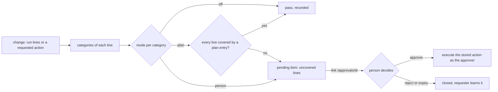

# Approvals an agent asks for, and a person gives from one link

**TLDR.** A coding agent can deploy, write secrets and change an application's registry rows through its own
credential. The actions that today need a person (a manual deploy of a protected environment, an access change that
waits, a console grant that waits, issuing keys) have no path where the agent asks and the person answers. Four designs
were compared. The maintainers chose **(b)**, an explicit one-off approval request in Control that opens on one console page,
and **(d)**, an approval plan bound to content hashes and approved before the deploy in the console (a GitHub review
of a linked person can count too, once the access diff is on the pull request). They are two kinds of evidence for one gate. Each environment chooses a mode per change
category (`off`, `plan`, `person`, and `refuse` for what a non-person may not do at all), plus a few settings of its
own; there is no installation level yet. Two presets are first-class: **strict**, the default, where a person
approves what an agent asks for, and **permissive**, where an agent configures and deploys with no approval. **The design principle: to any customer's approval requirement the answer is
"yes, it is configurable".** Every decision below is a default, and "Settings" names the setting that makes each
alternative possible, where it lives and what it costs. The step plan (13 PRs, about 85–105 h of agent time, plus 11–15 h for
GitHub reviews once the access-diff check exists; the first three, about 18–22 h, deliver an agent's deploy approved
from one link) is at the end. Nothing is built yet.

## Problem

An agent works in a session that cannot click. The person who drives it mostly reads a phone. When the agent needs an
action only a person may take, the person should get **one link that opens straight on that action**, see what it
does, and approve or refuse it with one tap. The agent then learns the outcome without a person relaying it.

This is not only about deploys. The same need covers credentials, grants, secrets and registry changes of protected
environments.

## What needs a person today (inventory, verified at `origin/main` 528eb6993)

"A person" means `isPerson` (`packages/control/src/iam.ts:130-133`): a `user` principal with no OAuth claims and no
link claims. The command-line client's device-grant token is therefore **not** a person, nor is an MCP token, a
service principal's `px_` key or a builder key. A `px_` key **bound to the person who issued it** is one: its token has
`ptype: user` and no OAuth or link claim, and Control counts such a bearer on purpose (`iam.ts:128`, `human.ts:95`). So
it passes every row below marked "person", except approving: approvals also require the console itself
(`requireHumanApprover`, `packages/control/src/approval/human.ts:22-28`), a session with no `Authorization` header.
IAM's person-only flows require a session as well (`packages/iam/src/device.ts:44`, `admin/grant-requests.ts:79`).

The inventory was taken at `528eb6993`. The cited files are unchanged at `c8d214ed0`, except for one unrelated hunk in
`diff.ts`.

### Control

| Action                                                                               | Rule today                                                                                                                                                                            | Evidence                                                                                                                                                                                                  |
| ------------------------------------------------------------------------------------ | ------------------------------------------------------------------------------------------------------------------------------------------------------------------------------------- | --------------------------------------------------------------------------------------------------------------------------------------------------------------------------------------------------------- |
| Manual deploy of a protected environment                                             | Only a person, and only a full ref or a 40-hex SHA that is not a workspace branch. Checked when the run is created and again when it starts. A push to the trigger ref still deploys. | `human.ts:59-94`, `requirePersonForProtectedDeploy` `human.ts:96-99`, called from `createManualRun` `packages/control/src/api/runs.ts:208-213`; restart check `packages/control/src/run-lifecycle.ts:730` |
| Approving a parked run                                                               | Person in the console with `access.approve` at the coordinates. The decision names the candidate and baseline digests.                                                                | `completeApprovalUseCase` `packages/control/src/approval/api.ts:73-114`                                                                                                                                   |
| Which runs park                                                                      | A protected environment, and a line of a category the environment chose (ADR-0083; defaults = ADR-0050's closer-review reasons).                                                      | `waitsForApproval` `packages/control-contract/src/approval-view.ts:56-59`, `changeCategories` `:26-50`                                                                                                    |
| Protection flag and approval categories                                              | Person in the console, `access.approve`.                                                                                                                                              | `setEnvironmentProtectionUseCase` `approval/api.ts:121-123`                                                                                                                                               |
| Deleting a protected environment or an app that has one                              | Person in the console, `access.approve`.                                                                                                                                              | `requireHumanForProtectedDelete` `human.ts:34-43`; `registry/apps.ts:93`, `registry/environments.ts:179`                                                                                                  |
| Trigger ref, domain, public origin of a protected (or starts-protected) environment  | Person; clearing stays open to a key.                                                                                                                                                 | `human.ts:130-169`, called from `registry/environments.ts:49-62`                                                                                                                                          |
| App source and build fields (`apps.update`) when the app has a protected environment | Person.                                                                                                                                                                               | `requirePersonToRedirect` `human.ts:106-113`, `registry/apps.ts:59-64,134-136`                                                                                                                            |
| GitHub source connections                                                            | Person.                                                                                                                                                                               | `requireHuman` `packages/control/src/github/connections/context.ts:24-27`                                                                                                                                 |
| Builder pairing and connection approval                                              | Person.                                                                                                                                                                               | `packages/control/src/api/builder-pairing.ts:22,39`, `builder-connections.ts:23`                                                                                                                          |
| App secrets and vault values (`apps.secrets.*`, `vault.*`), token key rotation       | `secret.manage` only. **No person, no wait, also on a protected environment.** The CLI's `operate` preset carries `secret.manage`.                                                    | `packages/control/src/control-rpc.ts:359,370-376,393-399`; `packages/control-contract/src/cli-access.ts:37`                                                                                               |
| Variables, environment put (non-protected fields), suspend/resume                    | `app.manage` only.                                                                                                                                                                    | `control-rpc.ts:349,362-365,381-387`                                                                                                                                                                      |
| Data operations: maintenance modes, side restore, recovery                           | `data.manage` at the coordinates only, no person.                                                                                                                                     | `startDataOperationUseCase` `control-rpc.ts:835-845`, `recoverDataOperationUseCase` `:849-853`                                                                                                            |
| Namespaces (create, adopt, update, remove, release claims), mail gate                | `namespace.manage` / `mail.manage`, global. No person. No CLI preset carries them.                                                                                                    | `control-rpc.ts:404-429,468-485`; `cli-access.ts:30-33`                                                                                                                                                   |

ADR-0083 already names the gap for registry writes: variables, secrets and domains have no run to park, so they do not
wait, and its Alternatives defer gating them until there is a pending registry write of their own.

### IAM

| Action                                                                                  | Rule today                                                                                                                                            | Evidence                                                                                                                                             |
| --------------------------------------------------------------------------------------- | ----------------------------------------------------------------------------------------------------------------------------------------------------- | ---------------------------------------------------------------------------------------------------------------------------------------------------- |
| Console grants (`grants.*`, `appPeople.grant/revoke`) at an app whose grants wait       | Become a grant request. An administrator of the app who is **not the requester**, as a person in a session, decides it. Requests expire after 7 days. | `packages/iam/src/admin/rpc.ts:104-124`, `admin/grant-requests.ts:71-79,96-98`; `GRANT_REQUEST_TTL_SECONDS` `packages/iam-contract/src/index.ts:195` |
| API keys (`apiKeys.provision/rotate/revoke`), workload and membership keys, share links | `iam.admin`. **A `px_` key with `iam.admin` may do it; no person needed.** The provisioning key does it (`fabrika control key issue`).                | `admin/rpc.ts:173-205`; `packages/cli/src/control.ts:205-214`                                                                                        |
| Promoting a principal, terminals, brand, password policy, second-factor reset           | `iam.admin`.                                                                                                                                          | `admin/rpc.ts:75-78,248,279-300`                                                                                                                     |
| User administration (`iam.users.manage`), `appPeople.*`, scope-value lookups            | A person in a session only, never a key.                                                                                                              | `admin/user-admin.ts:18-21`, `admin/app-people.ts:59-65`, `admin/scope-values.ts:43`                                                                 |
| Approving a CLI device grant                                                            | A signed-in person on IAM's `/oauth/device` page, who picks a lifetime of 1 h, 24 h or 7 days, capped at the IAM session.                             | `packages/iam/src/oauth-device-page.ts:44-70`                                                                                                        |
| Approving a builder device key (ADR-0042)                                               | A person in a session, internal, active, never a key's token.                                                                                         | `packages/iam/src/device.ts:40-55`                                                                                                                   |

### What an agent holds

- **The device grant (RFC 8628)** gives the agent a standing, narrowed credential: a preset (`read`, `deploy`,
  `operate`, `create`) at one app (`cli-access.ts:34-41`), for an hour, a day or a week. Its token is never a person,
  so every row above marked "person" refuses it. The start already answers `verification_uri_complete` with the code
  in it (`packages/iam/src/oauth-device.ts:159`), and the page pre-fills the code from it (`oauth-device-page.ts:45-47`).
  So **"the agent gets a credential of its own from one link" already exists**: the person taps the link, confirms
  the code, picks a lifetime and approves (two form posts). The attempt lives five minutes
  (`OAUTH_DEVICE_ATTEMPT_TTL_SECONDS`, `oauth-device.ts:32`).
- **A run records `oauth:<person id>`** for a delegated token (`runActor`, `packages/control/src/api/runs.ts:240-244`).
  Nothing records which client or agent acted. The agent task keys spec (`docs/specs/agent-task-keys.md`) adds an
  `act` claim for that. Only its slice 1 is scheduled.
- **A parked run already has a link**: `<console>/approvals/<run id>`, which `get_deployment` hands the MCP agent
  (`packages/control/src/api/workspaces.ts:608-613`), and the dashboard route `/approvals/:id`
  (`packages/dashboard/src/routes/approvals/detail.tsx:33`). Grant requests have no page of their own: they are listed
  on `/approvals` (`routes/approvals/index.tsx:18-23,79`).
- **A parked run never expires.** No sweep or timer moves `awaiting_approval`. Only a decision
  (`packages/control/src/db/runs.ts:408-436`) or a cancellation (`:485-514`) does; `cron.ts` sweeps pending and running
  runs only.

### The gaps this draft addresses

1. An agent cannot start a deploy of a protected environment and hand the person a link to approve it (the request
   behind this draft). It gets a 403 (`human.ts:72-78`).
2. Secrets, variables and data operations on a protected environment apply at once for any key that holds the action.
   Nothing can make them wait.
3. An agent cannot ask for a grant, a key or another credential at all. It has no IAM administration, and it should
   not have any.
4. A change the person already reviewed with its pull request still waits for a second click at deploy.

## The designs

The same five questions apply to each design:

- **Binding.** Is the approval tied to the exact action, so the agent cannot get a different one approved (no
  confused deputy)?
- **Expiry.**
- **Replay.**
- **Audit.**
- **Outcome.** How does the agent learn it?

### (a) One-action tokens through the device flow (RAR-style)

The agent starts a device authorization with an RFC 9396 `authorization_details` entry, for example
`{type: "fabrika.deploy", app, env, commit}` or `{type: "fabrika.key", app, actions, expiresIn}`. IAM's consent page
renders it. The person approves. The agent's poll gets an access token that carries the detail and nothing else. The
agent presents that token to Control's ordinary procedure. Control checks that the detail matches the call and spends
it once.

- **On the phone.** The link pre-fills the code (exists). Tap "Continue", read "Deploy commit `abc1234` to
  `notes@prod`", tap "Approve". IAM has no access diff of the deploy: Control computes it only after it reads the
  commit (`readAccessSnapshot`, ADR-0050 §1). So the person approves a commit, not what it changes, unless IAM calls
  Control for a preview, which makes a cycle IAM does not have today.
- **Binding.** The detail is signed into the token. Control must compare every field with the request. Every procedure
  that accepts such a token needs its own comparison, and one forgotten field is a confused deputy.
- **Expiry.** The attempt lives five minutes (`oauth-device.ts:32`), too short for a phone notification read later. A
  longer one weakens RFC 8628's assumption that the person is at the screen now.
- **Replay.** Control needs a spent-token table (one row per `jti`), because the token is a bearer the agent holds.
- **Audit.** IAM records the consent, Control records the call. Two rows in two services, joined by the token id.
- **Outcome.** The agent learns that the person approved by polling. Whether the action then succeeds, it learns from
  the action's own answer.
- **What it breaks.** Every human-only rule today says the person acts in the console, and `isPerson` refuses an OAuth
  token by design. (a) turns an approval into a credential the agent carries. It also adds a token claim
  (`authorization_details`) to `@fabrika/auth-core`. That claim reaches only installation resources, never an
  application (an application row cannot admit the `oauth` caller), so ADR-0062's protocol window is not touched. But
  each kind needs a type definition, a consent renderer in IAM and a check in Control.
- **Effort.** About 10–14 h of agent time for deploys and keys, plus a consent renderer per action kind.
- **Never through it.** The same list as for (b) and (d) ("Actions never approved through a request or a plan").

### (b) An explicit one-off approval request in Control (chosen for single actions)

The agent, with the credential it already holds, asks Control for an action. Control stores the request, **inert and
exact**, and answers with an id and a console link. The person opens the link, signed in to the console. The page shows
exactly the stored request. "Approve" runs the **same use case the person would run by hand**, with the person as the
actor and the requester recorded beside them. The agent reads the request's state.

Two shapes, by owner. An ADR-0083 rule already holds here: the service that writes the change keeps the request.

1. **A deploy is its own request: the run.** On a protected environment, a manual run from a non-person is no longer
   refused. It must name a 40-hex commit (`createManualRun` already takes `commitSha`, `runs.ts:206-231`) that is
   **merged**: reachable from the environment's trigger ref, or from the app's default branch when the trigger ref is a
   pattern (decision D7; the setting `deployRequestCommits` allows any commit). It parks in
   `awaiting_approval` **whatever its lines**, with a park reason `requested`, after its snapshot is classified. The
   existing approval page, its digest binding, its lease and its audit row apply unchanged. The page adds who asked
   (the person and the client or agent), the commit, its message and a compare link against the commit the environment
   runs. A run that does not belong to a person still never deploys a workspace branch (`human.ts:86-91`).
2. **Any other action is an `approval_requests` row in Control**, IAM-owned actions included. The agent reaches only
   Control's `/api/rpc`, which admits the command-line client's OAuth token. The console's IAM gateway
   (`/iam/admin/rpc`) admits only `human` and `machine` callers (`packages/control/fabrika.service.ts:73-74`), and IAM's
   `/admin/*` refuses a token that is not a session's (`packages/iam/src/admin/router.ts:114`). So an agent has no path
   to IAM, and opening one would expose IAM's whole administration to agent tokens. Control therefore stores the
   request. On approval, Control calls IAM through the existing gateway **with the approver's console token**, so IAM
   checks the approver as it does today. Where an app's grants wait (ADR-0083), IAM then turns that call into its own
   grant request for a second administrator. The row holds:
   - the kind and the canonical input with its SHA-256;
   - the **before-state** the action depends on (below);
   - the coordinates;
   - the requester: principal, OAuth client id and OAuth grant id from the verified token (`OAuthTokenClaims`,
     `packages/auth-core/src/token.ts:175-183`), and the task id once `act` exists;
   - the state, the decision, the result and the absolute deadline.

   A secret value in a request is sealed in the vault under the request's own purpose. The page shows its name and a
   **fingerprint** (the length and the first 8 hex characters of its SHA-256), which the agent prints beside the link,
   so the person can tell that the value they approve is the one the agent sent. On approval the value moves to the
   secret's own purpose. On rejection or expiry it is deleted.

- **On the phone.** One link. A parked run keeps `https://<console>/approvals/<run id>`, and a request gets
  `https://<console>/approvals/requests/<id>`, so the two kinds of id never collide. If the person is not signed in,
  the proxy sends them through IAM's sign-in and back to the link. One page, mobile-first: "Agent `<client>` acting for
  `<person>` asks to deploy `abc1234` ('fix invoice rounding') to `notes@prod`, which runs `def5678`. 3 commits,
  compare. Access: no change / these lines." Two buttons. For a secret: "asks to set secret `STRIPE_KEY` of
  `notes@prod`, 41 characters, fingerprint `3f9a…`". Text the agent wrote (a commit message, an OAuth client's name)
  is escaped and marked as the agent's. The link is a read-only GET; only the page's POST decides, and the proxy's
  session admission already refuses a cross-site POST (`packages/proxy-core/src/authorize.ts:352`).
- **Binding.** The approver acts on the stored row and nothing else. The page posts the request id and the digest it
  showed (as `approvals.complete` posts the two digests today, `approval/api.ts:77-79`). Rows are never edited: a
  different action is a new request. A request also binds **what it acts on**, not only its parameters, because the
  same parameters can reach a different target later:
  - a registry write binds the environment's `generation` and the stored value or its ref digest;
  - an `apps.update` stores a patch with the expected before-value of each field, and the page shows before → after;
  - an `apps.environments.put` binds the provider target and artifact it would replace;
  - a restore binds the serving object and the object list (`startRestore` reads them when it runs,
    `packages/control/src/data-operations.ts:397-410`).

  At execution, under the environment's lease, Control compares the bound before-state with the current one. A
  mismatch closes the request `stale`, and the agent asks again.
- **The requester.** The requester's right to ask is checked **when the request is created**, from the requester's own
  token: the action itself (`deploy.trigger`, `secret.manage`, `data.manage`), or a new `access.request` at the app for
  grants and keys, which the agent cannot execute itself. Control has no primitive that evaluates another principal's
  authority later: `auth.can` reads only the caller's token, and a device-grant token may be gone an hour after the
  request. So the deadline bounds how long the check stays relevant. The approver's right to execute is checked at
  decision time, and the action executes with the approver's authority.
- **Expiry.** Every pending item has an **absolute deadline**, set when it is created: 24 h by default (decision D3;
  `requestTtlHours`, 1–168). A parked run gets the same deadline; today it waits forever.
  - The deadline is checked in the decision's own conditional write (`pending` and deadline not passed). The sweep
    only cleans up; it authorizes nothing.
  - An approval does not expire. An approved request executes when its turn comes, and an approved run when the queue
    picks it up.
  - If the approved run is classified again and its digests change (a lost compare-and-swap), it parks as a new pending
    item with a fresh deadline, as today's approval stands only for its digests (`approves`,
    `packages/control/src/approval/publish.ts:448-452`).
  - A policy made stricter after an approval applies at execution: `gate()` runs again, and a change that now needs
    more evidence parks again.
- **Execution and crash safety.** A lease makes Control's own writes atomic, but not a provider's or IAM's. On Zerops a
  secret write goes to the Zerops service first and to Control's row after (`packages/control/src/api/vault.ts:51-60`,
  `secretTarget` `:203-212`), and IAM's key issuance commits in IAM. So an approved request moves through
  `approved → executing (operation id) → executed | failed | unknown`, and the operation id is recorded before any
  external effect:
  - a provider secret put is idempotent by name and value, so `unknown` retries it;
  - IAM's key issuance takes the request id as its idempotency key. A retry revokes a key an earlier attempt issued
    and recorded nowhere, the `keep` pattern of workload keys (`packages/iam/CLAUDE.md`, "`workloads.issueKey` never
    revokes the key the caller names as active");
  - a data operation records its own steps already (ADR-0069), so the request records the operation id and follows it.
- **Replay.** The decision is one conditional update, `pending` → `approved` under a fresh decision id. A second tap, a
  second approver or a repeated POST changes nothing.
- **Audit.** The durable evidence is the request row itself: requester, approver, decision id and times, written in
  the same transition as the state change. The domain audit records (`auth.audit`) are delivered as today: after the
  commit in Control (`approval/api.ts:102-113`), and fire-and-forget in IAM (`packages/iam/src/rpc.ts:268-275`). So
  the audit log is not the record of authority; the request row is.
- **Outcome.** The create call answers `{ id, url, state }`. The agent reads `approvals.requests.get(id)`, or
  `runs.get` for a deploy, which gains the approval URL in step 3. MCP's `get_deployment` serves only workspace runs
  today (`packages/control/src/api/workspaces.ts:596-605`). For a deploy, "approved" is only a step: the agent keeps
  following the run to `succeeded` or `failed`. A CLI `--wait` and an MCP tool wrap the polling. Fabrika sends no
  notification: the agent hands the link to the person through its own channel. A later push or e-mail from the
  console is additive (below).
- **Who may approve whom.** Approving takes a person in the console with the action's approval right
  (`access.approve` at the coordinates for Control, the app's IAM administration for IAM). **The person may approve
  their own agent's request, grants and keys included** (decision D2). A team can tighten it per category with two
  settings, and a stricter one among a change's categories wins:
  - `requesterMayApprove: false`: someone other than the requester's person decides. Which person stands behind a
    request is known for an OAuth token (its subject) and for a self-bound key (its issuer). A service key's request
    has no human owner, and no verified token names the key's issuer, so `false` there fails closed (ADR-0083 §8):
    nobody approves it, and anyone with the approval right may refuse it.
  - `approvers: 2`: two different people decide, each on the same digest. The item stays `pending` after the first
    approval, and a rejection by either closes it. It applies to requests, parked runs and plan entries alike.

  ADR-0083's own gate stays as it is: an agent's grant is executed as the approver's console grant, so where the app's
  `grants` category waits, IAM opens its grant request for a second administrator on top of the request's approval.
- **A second factor on deciding.** ADR-0050 names the gap: the approval proves a signed-in user, and an agent that
  drives the person's signed-in browser can approve. The setting `stepUp` per category but `grants` (`none` or
  `webauthn`) makes the decision carry a WebAuthn assertion bound to it. IAM keeps the person's passkeys. The approval
  page calls Control's `approvals.challenge` or `approvals.requests.challenge`, and Control calls IAM over its IAM client
  for a single-use challenge, bound to the item's kind, id and digest and to the decision; the page posts the assertion
  with the decision, and Control has IAM verify it with the approver's console token and accepts the decision only when
  it verifies (ADR-0050 §5). Changing a `webauthn` category's settings in the weaker direction, or turning protection
  off, takes a passkey too. No console token claim and no proxy change: the proxy's token cache would deliver a
  refreshed token late, and the `amr` claim's parser refuses any value but a terminal's. It is `webauthn` for
  `credentials` by default and `none` elsewhere. A person with no passkey cannot decide such an item, and the page says
  how to register one.
- **Effort.** See the step plan; its per-step breakdown replaces the earlier 11–15 h.

### What the gate must cover: every write path, not a list of fields

A category list misses writes, and each miss is a way around D8. Writes that reach a protected environment but fell
outside the earlier list:

- **The all-environments layer.** `apps.secrets.put`, `vault.*` and `apps.variables.*` with `env: null` write the
  layer every environment inherits, `prod` included (`packages/control/src/db/registry.ts:1048-1055,1173-1180`;
  `appSecretPurpose`, `packages/control/src/secret-resolver.ts:29-31`). Such a write counts as a write to every
  protected environment of the app, and the strictest mode among them applies. The page names them all.
- **Other `apps.environments.put` fields.** The cross-origin list, the provider target, the artifact and the namespace
  stay open to a key on a protected environment today (`packages/control/src/api/registry/environments.ts:45-120`;
  only the trigger ref, domain and public origin are guarded). `prepareRegistration` creates provider services. They
  join `registry`.
- **Suspend and resume** (`app.manage`, `packages/control/src/control-rpc.ts:362-365`) and **the backup schedule**
  (`data.backups.setSchedule`, `control-rpc.ts:515`, use case `:791-793`), which can switch off a protected
  environment's backups. They join `data`.
- **Direct IAM writes.** A `px_` key holding `iam.admin` issues keys and administers the installation without any
  person (`packages/iam/src/admin/rpc.ts:173-205`; `resolveAdmin` accepts the key, `admin/router.ts:136-159`). Control's
  requests do not touch that path. So the `credentials` mode is enforced in IAM's own use cases too. Installation
  administration keeps today's rule (see "Always a person, whatever the mode").
  - Control mirrors the environment's `credentials` mode to IAM beside the grant gate, stricter side first, as
    ADR-0083 §4 writes `app_grant_approvals`.
  - A key at an app that spans environments takes the strictest of them.
  - Two exceptions remain. The provisioning key keeps Control's own issuance (workload, membership and connector
    keys). The bootstrap REST path `POST /admin/api-keys` keeps the first machine caller.
  - **Found on the way:** `apiKeys.provision` sets no 30-day ceiling (`packages/iam/src/admin/api-keys.ts:108-131`),
    while `issueKey` does (`packages/iam/src/issue.ts:92`). A provisioned key may never expire. The credentials step
    enforces the ceiling there too.

So the gate is enforced per procedure. Every mutation of Control's router and of IAM's `/admin/rpc` is either gated by
a category or listed as exempt with its reason. A table test over both routers fails when a new mutation is neither,
the way `admin-rpc-gates.test.ts` already lists IAM's exceptions.

**What the guarantee covers.** The gate decides what the platform's APIs do. On Cloudflare, a deploy's executor runs
with the account's credentials beside the repository's code (`packages/runner-container/src/runner.ts:459-466,611`;
backlog 86), so code in a deployed commit can still reach the account. That is a known limitation of ADR-0048, which
the gate does not close. Closing it needs credential isolation in the runner first.

### (c) CIBA-style backchannel, and other variants

- **CIBA** (OpenID Client-Initiated Backchannel Authentication) is (a) with a push. The agent names the person
  (`login_hint`) and a `binding_message`. The authorization server notifies the person's device, and the agent polls
  or is pinged. It removes the code from (a) but keeps all of (a)'s problems: the approval happens in IAM, without
  Control's diff, and ends as a bearer token in the agent's hands. It also needs a notification channel to the person
  that the console does not have. ADR-0088's Web Push is for applications, not the console. Not recommended. Its one
  useful idea, the **binding message** shown on both sides, (b) gets for free: the request id is in the link and in
  the agent's answer.
- **A standing pre-approval** ("this agent may deploy prod for the next 4 h"). It is what the device grant's `deploy`
  preset plus a relaxed protected-environment rule would be. It defeats the reason for protection, so it is not
  proposed.
- **A notification hop**, added to (b) later. IAM can already send e-mail. When the console becomes installable, Web
  Push (ADR-0088's model: the push says only that something waits, and the page reads it under the session) can tell
  the person that a request waits. It is additive and needs no change to (b)'s object.
- **Agent task keys** (`docs/specs/agent-task-keys.md`) are complementary. Their budgets and target make many actions
  safe without any approval, and their `act` claim is the requester attribution (b) wants. (b) does not depend on
  them: before `act` exists, the request records the OAuth client id from the token.

### (d) An approval plan, approved with the pull request, matched at deploy

The person approves **changes**, not deploys: "role `sales` gains `invoices.delete`", "endpoint `POST /api/export`
opens to `team`", "migration `0042_add_index.sql` with checksum `sha256:…`". Each approval is stored as a plan entry of
the environment. At deploy, Control classifies the run as today (`classifyAccess`,
`packages/control/src/approval/diff.ts:122`). A run that would wait publishes without a click when **every line that
would make it wait is covered by a plan entry**. Otherwise it parks, and the approval page shows only the uncovered
lines (the difference).

#### What an entry binds to: content, never a pull request number

A pull request number, a branch and even a head SHA say nothing about what deploys later. An entry binds to the
**content of one subject** of the access snapshot, in the shape the classifier already keys it by:

- **The subject.** A line's `rule` and `subject` (`AccessChangeDto`, `packages/control-contract/src/index.ts:734-754`):
  a role, an endpoint by id, a table, a CSP directive, a site of a staged-kit deviation.
- **Its before and after.** The SHA-256 of the subject's canonical fragment in the baseline the reviewer was shown, and
  in the candidate. For example, the role's action set and `via`, or the endpoint's row with its audience.
- **SQL and migrations.** Their content hashes already exist. Each migration file is one entry by its checksum (the
  snapshot's `migrations`, the runner's `migrationChecksum`). Each server-module SQL statement is one entry by its
  `digest` (`SqlStatementEntry`, `packages/control/src/approval/snapshot.ts:22-26`; recorded since #404). A statement
  is matched by file and text, never by line, as `diff.ts` matches it.

A later push that changes any approved subject produces a different after-hash, so the old entry no longer covers it,
and the line waits. Nothing the reviewer did not see can ride in on an entry.

**Not every line has an identity yet.** A plan entry needs a structured identity per rule, never the line's words:

- Every SQL-statement line has the same subject, the application, and the same rule, `application.sql-statement`
  (`compareSqlStatements`, `packages/control/src/approval/diff.ts:928-944`). Its entry identity must add the file and
  the statement's digest.
- A database-code line also depends on the access views that newly decide it (`compareDatabaseCode`,
  `diff.ts:898-903`), so its fragment hash covers those views too.

Each supported rule gets its identity and complete dependency hash in step 9. A line of a rule without one stays
uncovered and waits for a person. Coverage fails closed.

**Plans that add up.** Entries compose as a chain. PR 1 approves `sales: A → B`. PR 2 approves `B → C`. A deploy whose
baseline holds `A` and whose candidate holds `C` is covered when a chain of approved transitions leads from the
baseline's fragment to the candidate's. A deploy whose baseline is something else (someone narrowed `sales` on prod in
between) is not covered, and that line waits. This transition binding is the default (decision D6). The setting
`planBinding: after-state` binds only the after-hash instead ("`sales` holding `C` is approved, whatever it held"): it
covers more deploys, but it approves a widening relative to a baseline the reviewer never saw.

#### Which approvals count

- **A console approval of a plan**, by a person (`requireHumanApprover`) with `access.approve` at the environment.
  Today's approval page, fed from a commit that is not deployed: the same compare the "access diff as a GitHub check"
  spec computes for a pull request head (`docs/specs/access-diff-as-a-github-check.md`). The check run links to it.
- **A GitHub review of a mapped person** (decision D5, off by default: `planEvidence: console+github` turns it on, and
  it is built only after the access-diff GitHub check, so the reviewer sees the access lines they approve). It counts only when the
  review is `APPROVED`, its author's GitHub account is linked to a fabrika person who holds `access.approve` at the
  environment, and the author is not the pull request's author or a bot or App account. A review stands only for the
  fragments of the commit it reviewed (`commit_id`). A later push needs a new review, whatever GitHub's "dismiss stale
  approvals" setting is.
  - **The mapping.** IAM links a GitHub account to a principal. The person signs in to GitHub once from the console
    (the App's user authorization), and IAM stores the numeric GitHub user id (a login can be renamed). One GitHub
    account links to at most one principal. The link's state is one-use, bound to the console session, with PKCE, so
    nobody can link their GitHub account to another person's principal. IAM has no such link today. An unlinked
    reviewer's approval counts for nothing.
  - **What the App lacks for it.** The manifest sets no user-authorization callback URL (`manifest.ts:22-33`), and the
    manifest exchange keeps only the App key and the webhook secret, never a client secret
    (`packages/github-app/src/manifest.ts:13-16`). Linking needs both. An existing App gets them once in its GitHub
    settings, and the client secret goes into Control's vault: an operator step to document.
  - **How Control finds the reviews.** No new webhook is needed. When a deploy of a protected environment carries lines
    no console entry covers, Control asks GitHub which merged pull requests the deployed range contains, and reads
    their reviews. The App's existing `pull_requests: write` permission covers the reads
    (`packages/github-app/src/manifest.ts:31`).
  - **What a review approves.** The transition from the pull request's **base** commit to the reviewed `commit_id`.
    Control reads both snapshots (two archive passes) and derives the entries from that diff. Under the default
    transition binding, a review covers a deploy only when the environment's baseline matches the base's fragment, or
    a chain of other entries leads there.
  - **Evidence is stored, not re-read.** An imported review becomes evidence rows: the repository id, the review id,
    the base and reviewed commits, the reviewer's linked principal and the review's time. Consuming or revoking an
    entry leaves a tombstone keyed by the review id, so the same review is never imported again.
  - **When it counts for nothing.** A dismissed review, a reviewer unlinked or without `access.approve` at the time of
    the deploy, and a later review by the same person that requests changes all count for nothing. So does a GitHub
    API failure, in which case the lines wait (fail closed).
  - **What it costs.** A few authenticated GitHub calls and two archive reads per reviewed pull request, only on
    deploys with uncovered lines. It works only for a repository behind a GitHub App connection; an anonymous public
    source has no reviews to read.
- **Never**: an agent's own review, a review by the pull request's author, an approval through a delegated token or key
  (the `isPerson` rule).
  An agent that holds its person's own GitHub token can still submit a review GitHub attributes to that person; no
  GitHub signal tells the two apart. A team that turns GitHub reviews on accepts that.

#### Expiry, revocation, consumption

- Each entry belongs to one environment, has an `expires_at` (30 days by default) and can be revoked by a holder of
  `access.approve` there. Every write is audited.
- An entry is **consumed at the publication** it covered, in the publication's compare-and-swap. Otherwise a widening
  that was approved, shipped and narrowed again could come back later without anyone seeing it.
- A change of the protection flag or the categories (`protection_revision`) leaves plans valid. They approve content,
  and the categories decide only what needs approval.

#### What a migration approved ahead of time does not cover

The approval covers the **text** of the migration: checksum, statements, the `deletes-data` classification. It does not
cover effects that depend on production data:

- how many rows a statement deletes or rewrites;
- whether a new `UNIQUE` or `NOT NULL` fails on existing rows;
- how long a lock holds;
- a backfill's run time.

So a plan never removes the protections that run at deploy:

- the backup before a data-changing migration (`unheldDataChanges`, ADR-0070 §8);
- the refusal of an edited applied migration (`AppliedMigrationsChanged`);
- the runner's own checksum check.

A migration that fails on production data fails the run as today. A future dry run against a restored copy could add
evidence, but that is not part of (d).

#### Where (d) replaces and where it complements

- **Replaces** the second click at deploy, for changes reviewed with their pull request. The push to the trigger ref
  deploys, and every covered line goes through. This is most of the day-to-day friction of protected environments.
- **Does not replace (b)**:
  - one-off actions that have no pull request: keys and other credentials, grants, secrets, variables, data
    operations;
  - the agent asking to deploy a specific commit of a protected environment, which is a run request;
  - the fallback for a deploy carrying lines outside the plan, which is today's parked-run approval showing only the
    difference.
- **Makes (a) unnecessary.** Nothing in (a) is covered by neither (b) nor (d).

- **Effort.** See steps 9–11 of the plan. Console plans (step 9) do not need the access-diff GitHub check
  (`docs/specs/access-diff-as-a-github-check.md`; not built, no `pull_request` handling exists in
  `packages/control/src/github/triggers/`). GitHub reviews (steps 10–11) wait until it is built, because ADR-0050
  rejected a review as approval while the reviewer cannot see the access diff.

## Approval modes as configuration: one gate underneath

Teams work differently. Some deploy by hand and approve. Some approve in pull requests and want the deploy to only
compare. Some approve nothing. So (b) and (d) are not two systems with their own switches. They are two **sources of
evidence** for one gate, and the configuration chooses, per environment and per category, which evidence the gate
accepts.

### The model

- **A gated change** is anything the gate judges: a deploy run's lines (as today), or one action of a non-person
  caller (a secret write, a key, a requested run). Each has one or more **categories**: ADR-0083's thirteen, plus the
  non-deploy ones this draft adds (below).
- **A mode per category** says what lets a change of that category through:
  - `off`: nothing is needed; the change applies at once and is recorded.
  - `plan`: a covering plan entry (d) **or** a person's decision on the pending item (b's page, reached by its link).
    A change the plan does not cover waits for the person, and only the uncovered lines are shown.
  - `person`: only a person's decision on this pending item. A plan never counts. This suits `deletes-data`, where the
    effect depends on production rows.
  - `refuse`: a non-person may not do it at all, not even by asking. This is today's behaviour for a protected
    environment's manual deploy and registry fields. It applies only to the categories of a non-person's action (the
    table below), not to deploy lines.

  The modes are ordered `off < plan < person < refuse`. A change waits until the evidence satisfies the strictest mode
  among its categories. Under `off`, the action runs with the **requester's** own authority, so `off` never lets an
  agent do what its credential cannot. For example, `credentials: off` lets a key that already holds `iam.admin` issue
  keys, and gives an agent without it nothing.
- **The pending item** is one shape with one lifecycle, link, expiry and audit: `pending → approved | rejected |
  expired`, then `executed | failed`. Control keeps one for what Control writes. For a deploy, the item references the
  parked run, whose digest binding stays as it is. IAM keeps one for grants (ADR-0083's `grant_requests`), because IAM
  writes grants and Control must not decide them. The console lists both on `/approvals`, and every item has its own
  `/approvals/<id>` link. "Manual approval" and "link approval" are therefore the same thing: a person deciding a
  pending item. The link only opens it directly.
- **Who may start a protected deploy** is part of the same configuration, not a separate rule. `deploy-request` is a
  category whose line is "a non-person started this run". With `person` (the default), an agent's run parks and the
  person gets the link. With `off`, an agent deploys like a person. With `refuse`, the run is refused as today, for
  teams that want only pushes and people.
- **One function decides.** It sits in `@fabrika/control-contract`, next to `changeCategories` and replacing
  `waitsForApproval` (`approval-view.ts:56`):
  `gate(changes, policy, plan) → pass | { wait: uncoveredLines, strictest } | refuse`. Control's park decision and
  the request path call it, and the console renders from it. Nothing else decides whether a change waits.
- **Not every mode fits every category.** `plan` applies only to deploy lines, the categories a pull request can carry.
  `refuse` applies only to a non-person's action. `grants` takes `off` or `person`. Saving any other pair is refused
  with a 400, so the gate never meets a mode it cannot decide.

### Categories beyond the deploy

The deploy categories stay as ADR-0083 defines them. The new ones are actions with no run:

| Category         | Covers                                                                                                                                                                                                  | Default on a protected environment |
| ---------------- | ------------------------------------------------------------------------------------------------------------------------------------------------------------------------------------------------------- | ---------------------------------- |
| `deploy-request` | A manual run started by a non-person, of a merged commit (`deployRequestCommits`)                                                                                                                       | `person`                           |
| `secrets`        | `apps.secrets.put/delete`, `vault.set/rotate/delete`, `rotateTokenKey` by a non-person, the all-environments layer included                                                                             | `person` (D8)                      |
| `variables`      | `apps.variables.put/delete` by a non-person, the all-environments layer included                                                                                                                        | `person` (D8)                      |
| `data`           | `data.start` (maintenance modes, side restore), `data.recover`, suspend and resume, the backup schedule, by a non-person                                                                                | `person` (D8)                      |
| `registry`       | Trigger ref, domain, public origin, `apps.update` source fields (today a 403, `human.ts:106-113,130-169`); the cross-origin list, provider target, artifact and namespace (open today); by a non-person | `person`                           |
| `agent-grants`   | A grant an agent asks for at the app                                                                                                                                                                    | `person`                           |
| `credentials`    | A key an agent asks for, issued to someone other than the agent (below)                                                                                                                                 | `person`                           |
| `grants`         | ADR-0083's existing category: a person's own console grant. `plan` does not apply: a grant has no pull request.                                                                                         | `off` (as today)                   |

Each category is enforced only from the PR that adds the requests it waits in: `deploy-request` from step 3; `secrets`,
`variables`, `data` and `registry` from step 5b; `agent-grants` from step 6; `credentials` from step 7b. Until then
everything behaves as today: a non-person's secret, variable and data write applies at once, and its registry write is
refused (decision D8). The hole is closed by routing these writes through requests, never by refusing them
outright.

**Who is a non-person here.** The gate treats as a person only a person acting in a console session, the rule of
`requireHumanApprover`. Every bearer counts as a non-person, a person's own `px_` key included, so an agent handed that
key cannot pass the gate as its owner. Today such a key passes the protected-environment checks of `human.ts`. Under
the gate, its protected manual deploy parks for approval instead of running, a chosen change in behaviour from step 3.

**`plan` applies only to deploy lines.** No plan entry can cover a request of these categories, so saving `plan` for
one of them is refused with a 400 (the mode matrix above).

A person acting directly in the console is their own evidence for these: their act is the decision, as today. The one
exception stays as it is: a person's own deploy still shows its lines for approval, because clicking "Deploy" is not
reading the diff.

### The environment level, and what an installation level adds later

- **The environment** holds its mode per category and the settings below. It is stored, like ADR-0083's choice, as its
  difference from the defaults, so a category a later release adds applies to every environment that did not set it.
  It changes through `apps.environments.protect` under the same rules: a person in the console, `access.approve`, the
  deployment lease and an audit row. The settings live with the protection flag in `app_envs` and in
  `app_env_protection`, so a recreated environment keeps them, as it keeps the flag (ADR-0050 §4).
- `protected` stays the master switch. An unprotected environment has every category `off`.
- **No installation level yet** (decision D9). It would add, later:
  - **defaults** for environments that set nothing, separately for protected and unprotected ones;
  - **a floor per category** that no environment can go below, read at once without a rewrite when it rises. A company
    that requires "credentials always need a person" would set it once, and could gate unprotected environments too.

  Its cost is about 2–3 h: a one-row table in Control, the console's settings, and the floor in `gate()`. Nothing in
  the environment level has to change for it.

### Settings

Every setting is on the environment, changed only by a person in the console with `access.approve`. Defaults are the
decided answers. The alternative of each answer is the other value. Each setting lands with the step that first uses
it, never ahead of it. Every setting but `protected` and the modes is a key of one JSON column,
`app_envs.approval_settings`, so a new setting adds a key, not a column.

| Setting                         | Lives in                                                              | Default                                        | Alternatives                                                                 | Cost                                                                                                             |
| ------------------------------- | --------------------------------------------------------------------- | ---------------------------------------------- | ---------------------------------------------------------------------------- | ---------------------------------------------------------------------------------------------------------------- |
| `protected`                     | `app_envs.protected` (exists)                                         | `prod` protected (ADR-0050 §4)                 | any environment                                                              | exists                                                                                                           |
| Mode per category               | `app_envs.approval_policy`, the successor of `approval_categories`    | the tables above and below                     | `off`, `plan`, `person`, `refuse` per category                               | step 2                                                                                                           |
| `deployRequestCommits`          | `app_envs`                                                            | `merged` (D7)                                  | `any`: an unmerged commit may be requested, still never a workspace ref      | one GitHub compare per request; an anonymous public source spends the shared 60-an-hour limit                    |
| `requesterMayApprove`           | `app_envs`, per category; Control enforces it when an item is decided | `true` (D2), grants and keys included          | `false`: someone other than the requester's person decides                   | a key (step 4)                                                                                                   |
| `requestTtlHours`               | `app_envs`                                                            | 24 (D3), for requests and parked runs          | 1–168                                                                        | a key and a maintenance sweep                                                                                    |
| `planEvidence`                  | `app_envs`                                                            | `console` (D5)                                 | `console+github`, once steps 10–11 are built                                 | steps 10–11 after the access-diff check; the App's callback URL and client secret on an existing App             |
| `approvers`                     | `app_envs`, per category                                              | 1                                              | 2: two different people decide                                               | partial approvals on requests (step 4), parked runs (step 3) and plan entries (step 9)                           |
| `stepUp`                        | `app_envs`, per category                                              | `webauthn` for `credentials`, `none` elsewhere | `webauthn` or `none` for any category but `grants`                           | step 7a: passkeys in IAM and the bound assertion Control has IAM verify                                          |
| `planBinding`                   | `app_envs`                                                            | `transition` (D6)                              | `after-state`                                                                | none beyond (d)                                                                                                  |
| `planTtlDays`                   | `app_envs`                                                            | 30                                             | 1–365                                                                        | a key                                                                                                            |
| `credentials` mode and delivery | the mode per category; delivery is fixed                              | `person`, encrypted to the agent's key (D4)    | `refuse` (no keys through requests); `off` (only a requester that may issue) | step 7b; a sealed-plaintext delivery for agents without a key pair is possible later (about 1 h) but not offered |
| `credentialCeiling`             | `app_envs`                                                            | `requester`                                    | `approver`: up to the approver's own rights, with a warning on the page      | a key (step 7b)                                                                                                  |

### Composition examples

| Team                                        | `prod`                                                                                                                | `stage`                |
| ------------------------------------------- | --------------------------------------------------------------------------------------------------------------------- | ---------------------- |
| Deploys by hand and approves (today's flow) | Deploy categories `person`; the rest at the defaults                                                                  | Unprotected: all `off` |
| Approves in pull requests                   | Code and permission categories `plan`; `deletes-data` `person`; `secrets`, `credentials`, `registry`, `data` `person` | `off`                  |
| Agent-driven, person on a phone             | Deploy categories `plan`; `deploy-request` `person`; everything else `person`; plans approved from the console        | `deploy-request` `off` |
| No approvals                                | Unprotected, or every category `off`                                                                                  | `off`                  |

The second row is the combination the design started from: plan approval for code and permissions, link approval for credentials.

### The safe default for a new installation

- `prod` is protected (ADR-0050 §4).
- Six of ADR-0050's seven closer-review categories are `plan`. That is the same as today when no plan exists, because
  the pending item is today's approval. The seventh, `deletes-data`, is `person`: what it deletes depends on production
  rows that a pull request's reviewer never sees (see "What a migration approved ahead of time does not cover").
- The permission categories and `grants` stay `off` (ADR-0083).
- `deploy-request`, `secrets`, `variables`, `data`, `registry`, `agent-grants` and `credentials` are `person`.
- The settings take the defaults in the table above.

Today an agent's secret, variable or data write on a protected environment applies at once. With these defaults it
waits for a person, from step 5b on (D8). That is a chosen change in behaviour. A team that wants today's
behaviour sets those categories to `off`.

### Always a person, whatever the mode

These are not categories. No mode or plan (nor, later, an installation floor) applies to them, and no request can name them:

- Changing the approval configuration itself: the protection flag, the modes and the settings (and, later, the
  installation's defaults and floor). A mode that an agent could set to `off` would gate nothing.
- Deciding a pending item, and approving or revoking a plan entry.
- Deleting a protected environment (`requireHumanForProtectedDelete`).
- Installation administration in IAM: promotion, `iam.admin` grants, terminals, signing and vault keys, the
  provisioning key, the second-factor reset. No request or plan can name it. It keeps today's rule: a session where it
  needs one today, and a `px_` key holding `iam.admin` where today's code accepts one, because a person chose to give
  that key `iam.admin`. A strict installation does not give an agent such a key.
- Source connections and builder pairing (a browser flow anyway).

Everything else may be `off` if a team chooses it. That includes deploys and secrets: protection is the team's choice,
as ADR-0083 already decided.

### Two presets: strict and permissive

Some teams want a person to approve what an agent does; others give their agents full access, as they already do with
their cloud accounts. Both are first-class. A preset is only a set of modes and settings that the modes page writes in
one step, per environment. Neither is a special case in the code, and every value stays editable afterwards.

- **Strict, the default** for a new installation and for an environment that becomes protected: the safe default
  above. A team tightens it further per category with `requesterMayApprove: false`, `approvers: 2` and `stepUp`.
- **Permissive**: an agent configures, deploys, writes secrets and runs data operations through the API with no
  approval. Every category is `off`, `stepUp` is `none` and `deployRequestCommits` is `any`. The environment stays
  protected, so its access lines are still classified and recorded, and going back to strict is one step. In IAM, an
  agent's key that a person gave `iam.admin` administers the installation as today, and `credentials: off` lets it
  issue keys.

Under the permissive preset nothing waits, so the agent never needs to approve anything. An agent deciding a pending
item is not offered: under strict it would void the approval. What permissive still leaves to a person is the list
above: choosing the preset and the other approval settings, deleting a protected environment, and source
connections. Under `off` an agent acts with its own credential's authority and nothing more. Without an installation
level (D9) a preset is applied per environment; the later installation level would make a preset the default for new
environments.

### Rollout on an existing installation

- `app_envs.approval_categories` (the list of added and removed categories) gains a successor column holding a mode
  per category, written beside the old column. Old values convert one to one: an added category becomes `person`, or
  `plan` for a closer-review one other than `deletes-data`; a removed category becomes `off`; null stays null, which
  means the defaults.
- The old column keeps its meaning, so a Control rolled back reads it as before. A classification stores its policy
  only when it differs from the defaults, as `StoredClassification.categories` does today.
- The settings are one nullable JSON column, `app_envs.approval_settings`, holding only what differs from the defaults;
  null reads as the defaults.
- **Parked runs start to expire** (step 3). A run parked before the upgrade gets its expiry when the sweep first sees
  it (that time plus `requestTtlHours`), so nothing parked earlier expires at the first sweep. This is a chosen change
  in behaviour, beside D8.
- **A person's own `px_` key stops passing the protected-environment checks** (step 3): its manual deploy parks with a
  link instead of running.
- No generated file and no environment variable changes. One operator step, for `planEvidence: console+github` only:
  an existing GitHub App gets the user-authorization callback URL and a client secret in its GitHub settings, which is
  documented in `docs/reference/`. Without it, reviews count for nothing and console approvals still work.
- **A person who decides a `credentials` item needs a passkey** (step 7a). Registering one is a one-time step in the
  console.

### Effort

The policy model, the conversion, the gate with its mode matrix, the console's settings page and the router table test
are step 2, about 6–8 h. A later installation level adds about 2–3 h.

## Credentials for someone else

The agent's own credential comes from the device flow, which already works from one link. A key for someone else (a CI
system's `px_` key, for example) goes through a request whose result only the agent can read (decision D4):

1. The agent makes a key pair and sends the public key (a P-256 or X25519 JWK) with the request: the app, the exact
   actions, the label and the expiry, at most 30 days (`MAX_KEY_LIFETIME_SECONDS`). The public key's thumbprint is part
   of the request's digest and never changes after creation. The page shows it, so the agent can print the same value
   beside the link.
2. **The key is no wider than the requester.** By default (`credentialCeiling: requester`) the request may name only
   actions the requester itself holds at the app, checked from its token when the request is created. Without a
   ceiling, the approver's rights would bound the key (IAM's delegation rule, `packages/iam/src/issue.ts`), and an
   agent holding only `deploy` could get a `secret.manage` key with one tap. `approver` lifts the ceiling, and the
   page then warns which actions exceed the requester's.
3. On approval, Control calls IAM's key issuance through its IAM gateway with the approver's console token, so IAM
   checks the approver's `iam.admin` as it does today. The request id is the idempotency key (see "Execution and crash
   safety"). IAM enforces the 30-day ceiling on this path too. IAM encrypts the plaintext to the public key (JWE,
   `ECDH-ES` with `A256GCM`) before it answers. The plaintext never leaves IAM in the clear: not to the approver's
   browser, and not to Control's database.
4. Control keeps the JWE on the request until the requester fetches it once, or until the request expires. Only the
   requester's own principal and OAuth client may fetch it, and only the private key opens it. Then it is deleted.
   IAM's audit row records the key under the approver, naming the request and the requester.
5. The CLI keeps the private key in memory only while `--wait` runs, and never writes it to disk. A key not fetched by
   the deadline is revoked. A lost delivery (the CLI exited, the private key is gone) is never recovered: the person
   revokes the key, and the agent asks again.

Cost: step 7b, about 6–8 h. `credentials: refuse` turns it off.

## Actions never approved through a request or a plan

The "always a person" list above holds whatever the mode. Beyond it, no request may name these:

- Approving itself: `approvals.complete`, `apps.environments.protect` (the flag and the categories), deciding grant
  requests. An agent never asks for approval rights.
- Installation administration: `principals.promote`, `iam.admin` grants, terminals, brand, password policy,
  second-factor reset, bootstrap admins, IAM or Control signing and vault keys, the provisioning key.
- Source connections and builder pairing: they need a browser with GitHub or the builder anyway.
- Namespace removal and claim release: ADR-0034 frees resources that the next app could adopt with their old secrets.
- Reading data content (`data.content.read`): an approval would deliver production content to the agent.
- Anything that returns a secret to the agent in a form Control could read. A key for someone else goes back only
  encrypted to the agent's own public key (above).

A request of such a kind is refused when it is created (400 naming the kind), not at approval.

## Comparison

| Topic                                        | (a) RAR device tokens                                      | (b) Approval request                                                | (c) CIBA                    | (d) Approval plan                                                       |
| -------------------------------------------- | ---------------------------------------------------------- | ------------------------------------------------------------------- | --------------------------- | ----------------------------------------------------------------------- |
| On the phone                                 | Code page, then consent in IAM; no access diff of a deploy | One console page with the exact action and the access diff; one tap | A notification, then as (a) | Nothing for covered changes; the parked difference as today otherwise   |
| Binding                                      | Fields signed into a token; each procedure compares them   | Stored row plus its digest; the approver acts on the row            | As (a)                      | Fragment hashes before and after; SQL and migration checksums           |
| Expiry                                       | 5 min attempt (too short)                                  | 24 h request (D3, configurable)                                     | Set by the server           | 30 days per entry; consumed on publication                              |
| Replay                                       | A spent-`jti` table in Control                             | A conditional state change in the change's transaction              | As (a)                      | Consumption at publication                                              |
| Audit                                        | IAM consent plus Control call                              | Request row plus the action's record naming the request             | As (a)                      | Plan write plus publication naming the entries                          |
| Agent learns                                 | Polls the token, then the call's answer                    | Polls the request or run (already linked)                           | Ping or poll                | The run's status                                                        |
| Fits `isPerson` and "approve in the console" | No: the approval becomes a bearer credential               | Yes                                                                 | No                          | Yes (console approval); a GitHub review counts only for a linked person |
| Effort (agent hours)                         | 10–14                                                      | 53–70 (steps 3–8, every write path and step-up)                     | (a) plus a channel          | 13–17 console (step 9); 11–15 more for GitHub reviews (steps 10–11)     |
| Risk                                         | High: a new token kind; the approval leaves the console    | Low: reuses runs, grant requests and leases                         | High                        | Medium: coverage logic must never cover a line it should not            |

## Recommendation and steps

The maintainers chose (b) and (d) on one gate with four modes (D1 and D10). (a)
and (c) are not built. The device flow stays what it is: how an agent gets its own standing, narrowed credential, from
one link.

Small PRs, each one reviewer round and CI. Hours are elapsed agent time, mostly review rounds and CI. Each step lists
its parts with their share:

| #  | PR                                                                                                                                                                                                                                                                                                                                                                                                                                                                                                                                                                                                                                                                                                                                                                                               | Hours |
| -- | ------------------------------------------------------------------------------------------------------------------------------------------------------------------------------------------------------------------------------------------------------------------------------------------------------------------------------------------------------------------------------------------------------------------------------------------------------------------------------------------------------------------------------------------------------------------------------------------------------------------------------------------------------------------------------------------------------------------------------------------------------------------------------------------------ | ----- |
| 1  | **ADRs.** Rewrite in place: ADR-0050 §4–5 (the gate and its modes, a non-person's run of a merged commit parks, the absolute deadline, every bearer is a non-person, `stepUp`, the two presets, GitHub reviews only after the access-diff check) 0.5 h; ADR-0083 (the categories beyond the deploy, approval requests as the pending registry write it deferred, `requesterMayApprove` and `approvers` beside its own grant gate) 0.5 h; ADR-0042 rule 12 (a builder key's protected deploy follows `deploy-request` instead of a refusal) 0.25 h; review 0.25 h. Docs only.                                                                                                                                                                                                                     | 1.5   |
| 2  | **The policy and the gate, inert.** `app_envs.approval_policy` in both migration sets and `app_env_protection`, and the conversion from `approval_categories` 2 h; `gate()` with `pass`, `wait` and `refuse` and the mode matrix, replacing `waitsForApproval` 1.5–2 h; the console's modes page 1.5–2 h; the strict and permissive presets on it 0.5–1 h; the table test over Control's router and IAM's `/admin/rpc` (every mutation gated or exempt with a reason) 1–2 h. No setting yet; behaviour unchanged.                                                                                                                                                                                                                                                                                | 7–9   |
| 3  | **An agent's deploy of a protected environment, approved from one link.** `protectedRunCause` and the restart check (`run-lifecycle.ts:730`) admit a non-person's run of a commit, which parks with reason `requested`; `deployRequestCommits` with `merged` and `any` 2 h; every bearer counts as a non-person 0.5 h; the absolute deadline checked in the decision's write, the sweep, `requestTtlHours` 1.5 h; `approvers` on a parked run (partial approvals on its digests) 1 h; the phone page (requester, commit, escaped agent text, compare, access lines; screenshots) 2–3 h; `runs.get` gains the link, `fabrika control deploy` prints it, `--wait` and an MCP tool 1.5 h; tests of the sign-in return, the refused cross-site POST, the escaped text and the read-only GET 0.5–1 h. | 9–11  |
| 4  | **The request store.** `approval_requests` in both dialects with the state machine (`executing`, `unknown`, `stale`) 2.5 h; the requester's identity and its check at creation, `access.request` 1 h; the before-state binding 1 h; the durable decision, its deadline, `requesterMayApprove` and `approvers` 2–2.5 h; create, get, list and decide, the page and the agent's polling 2–3 h; the refused kinds 0.5 h; tests 0–1.5 h. No write routes to it yet.                                                                                                                                                                                                                                                                                                                                  | 9–12  |
| 5a | **Local registry writes become requests.** Secrets, vault and variables with sealed values and the fingerprint 2–3 h; the all-environments layer counted as every protected environment 1 h; the registry fields (trigger ref, domain, public origin, cross-origins) and `apps.update` as a patch with before-values 2 h; suspend, resume and the backup schedule 1 h; tests 0–1 h. The categories stay inert until 5b.                                                                                                                                                                                                                                                                                                                                                                          | 6–8   |
| 5b | **Writes with an external effect.** A Zerops secret: unseal, provider put under an operation id, idempotent retry from `unknown` 2–3 h; `apps.environments.put` of the target, artifact and namespace through `prepareRegistration`, bound to its before-state 2 h; data operations and the restore bound to the serving object and object list 2 h; crash-recovery tests on both providers 2–3 h. **From this PR on, D8 holds.**                                                                                                                                                                                                                                                                                                                                                                | 8–10  |
| 6  | **An agent's grant.** The request kind, executed through Control's IAM gateway with the approver's token; where the app's grants wait, IAM's own grant request follows 2–3 h; page and tests 1 h.                                                                                                                                                                                                                                                                                                                                                                                                                                                                                                                                                                                                | 3–4   |
| 7a | **WebAuthn step-up on deciding.** Passkeys in IAM, both dialects, with the registration ceremony 3 h; a challenge bound to the item and its verification through Control's IAM client 2–3 h; `stepUp` per category, Control's check on deciding a request, a parked run or a plan entry, and the console's prompt 1.5–2 h; tests 1.5–2 h.                                                                                                                                                                                                                                                                                                                                                                                                                                                        | 8–10  |
| 7b | **Credentials for someone else.** IAM's encryption to the agent's key 1.5 h; idempotency by request id (the `keep` pattern) 1.5 h; `credentialCeiling` 1 h; the one-time fetch and the revocation of an unfetched key 1 h; the CLI's in-memory key pair and `--wait` 1 h; tests 0–2 h. The `credentials` category switches on here, behind step 7a's default.                                                                                                                                                                                                                                                                                                                                                                                                                                    | 6–8   |
| 8  | **IAM's direct path.** Control mirrors the `credentials` mode to IAM, stricter side first, failing closed 2 h; IAM's use cases enforce it for a machine key 1–1.5 h, installation administration unchanged; the two exceptions and the 30-day ceiling on `apiKeys.provision` 1 h; tests 0–2 h.                                                                                                                                                                                                                                                                                                                                                                                                                                                                                                   | 4–6   |
| 9  | **(d) console plans.** Each supported rule's identity and dependency hash (a SQL statement by file and digest, database code with its access views) 4–5 h; entries, the transition binding, `after-state` and the chain 3–4 h; coverage in the gate and consumption in the publication's compare-and-swap 2–3 h; `planTtlDays`, revocation and `approvers` on an entry 1.5 h; the plan page from a commit compare 2–3 h; tests 0.5 h.                                                                                                                                                                                                                                                                                                                                                            | 13–17 |
| 10 | **GitHub account linking**, after the access-diff GitHub check is built. The App's client secret in Control's vault, its callback URL and the operator step in `docs/reference/` 1.5 h; the one-use state bound to the session, with PKCE 2 h; the unique numeric id and unlinking 1.5 h; the console 1 h; tests 0–2 h.                                                                                                                                                                                                                                                                                                                                                                                                                                                                          | 6–8   |
| 11 | **GitHub reviews as plan evidence** (`planEvidence: console+github`). From the deployed range to merged pull requests to reviews 1.5 h; the base and reviewed snapshots and their entries 2 h; durable evidence rows and tombstones 1 h; the fail-closed cases (dismissed, unlinked, no `access.approve`, API failure) 1.5–2.5 h.                                                                                                                                                                                                                                                                                                                                                                                                                                                                | 5–7   |

Total of steps 1–9: about 75–97 h, call it 85–105 h with the slack of review rounds. Steps 10–11 add 11–15 h, and wait
for the access-diff GitHub check, which is not counted here. Steps 1–3 alone deliver the request behind this draft: an
agent deploys `prod` and sends the person a link, about 18–22 h. Order: 1 → 2 → 3; then 4 → 5a → 5b → 6, and
7a → 7b → 8 after 4; and 9, then 10 → 11 once the check is built. The tracks after step 2 are independent. Optional and
not counted: the installation level (2–3 h).

Behaviour that changes on an existing installation, each from the step named: a person's own `px_` key stops passing
the protected-environment checks, and parked runs start to expire (step 3); a non-person's secret, variable, data and
registry write on a protected environment waits for a person (step 5b); deciding a `credentials` item takes a passkey
(step 7b, by step 7a's default); a machine key holding `iam.admin` that issues keys meets the `credentials` mode
(step 8).

Waits on a maintainer: none of these PRs changes deploy configuration, so each merges after an approved round and green
CI. The App's callback URL and client secret of step 10 are an operator step on each existing installation that wants
GitHub reviews to count.

## Decided defaults

These are the maintainers' answers, proposed as defaults. They become binding when step 1 rewrites the ADRs; until then
this file stays an idea.

| Decision group         | Decision                                                                                                                                                        | Default here                                                       | Setting for the alternative                                          |
| ---------------------- | --------------------------------------------------------------------------------------------------------------------------------------------------------------- | ------------------------------------------------------------------ | -------------------------------------------------------------------- |
| Path                   | D1: (b) and (d), as recommended                                                                                                                                 | both, on one gate                                                  | modes per category (`off`, `plan`, `person`, `refuse`)               |
| Path                   | D7: only merged commits may be requested for deploy                                                                                                             | `deployRequestCommits: merged`                                     | `any`; `deploy-request: refuse` for no agent deploys at all          |
| Modes                  | D10: build all four modes (`off`, `plan`, `person`, `refuse`) now; D9: no installation level yet                                                                | environment settings only                                          | an installation level later (defaults and floor, 2–3 h)              |
| Secrets and data       | D8: `person` for secrets, vault and data operations, app variables included; close the hole only with requests; nothing changes before step 5b                  | `secrets`, `variables`, `data`: `person`, enforced from step 5b    | the same categories `off` (today's behaviour) or `refuse`            |
| Who approves, expiry   | D2: a person may approve their own agent's request, grants and keys included, and a team can tighten it; D3: 24 h, configurable                                 | `requesterMayApprove: true`, `approvers: 1`, `requestTtlHours: 24` | `requesterMayApprove: false` or `approvers: 2` per category; 1–168 h |
| Keys for others        | D4: keys for someone else through a request whose result is encrypted to the agent's public key                                                                 | `credentials: person`, JWE to the agent's key                      | `credentials: refuse`; `off` for a requester that may issue anyway   |
| Plan and pull requests | D5: a GitHub review of a linked person may count, built after the access-diff GitHub check; D6: the plan binds the before → after transition; both configurable | `planEvidence: console`, `planBinding: transition`                 | `planEvidence: console+github`; `planBinding: after-state`           |

After a review of this draft the maintainers also decided:

| Decision group         | Decision                                                                                                       | Default here                                      | Setting for the alternative                                                   |
| ---------------------- | -------------------------------------------------------------------------------------------------------------- | ------------------------------------------------- | ----------------------------------------------------------------------------- |
| Who approves           | D11: keep D2; a team may require someone other than the requester's person, or two people, per category        | `requesterMayApprove: true`, `approvers: 1`       | `requesterMayApprove: false`; `approvers: 2`                                  |
| Plan and pull requests | D12: plans approved in the console by default; GitHub reviews only after the access-diff GitHub check is built | `planEvidence: console`                           | `console+github` (steps 10–11)                                                |
| Settings               | D13: build `planBinding: after-state`, `deployRequestCommits: any`, `planTtlDays` and the chain of entries now | as in "Settings"                                  | none                                                                          |
| Deciding               | D14: a WebAuthn step-up on deciding, per category                                                              | `stepUp: webauthn` for `credentials`, else `none` | `webauthn` or `none` per category                                             |
| Grants and keys        | D15: grants and keys through requests (steps 6 and 7b), not a link to a prefilled console form                 | requests                                          | `agent-grants` or `credentials`: `refuse`                                     |
| Presets                | D16: a strict and a permissive preset, both first-class; strict is the default                                 | strict                                            | permissive: every category `off`, `stepUp: none`, `deployRequestCommits: any` |
