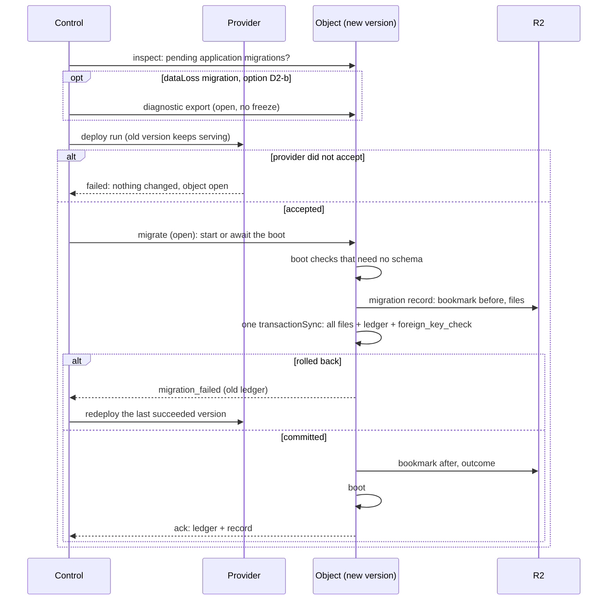

# A deploy with a pending migration, without a read-only window

An amendment draft to [ADR-0069](../decisions/0069-control-reaches-an-application-environments-object.md) §3 ("The
migration phase"), [ADR-0070](../decisions/0070-data-protection-of-an-application-environment-on-cloudflare.md) §8
("Before a migration") and [ADR-0050](../decisions/0050-approved-access.md) ("The platform backs the data up before
such a migration runs"). Cloudflare only; Zerops is unchanged. Once it is approved, these three ADRs are rewritten in
place and this file is deleted.

## TLDR

- On Cloudflare, the read-only window before a migration protects one thing: the consistency of a dump that takes
  several requests. Old and new code never run against one object together. The cold start already migrates before
  the new code serves.
- Proposal: no `read-only` and no pre-migration dump. The new version migrates on its cold start, with all pending
  files in one SQLite transaction. Just before that transaction it records a point-in-time-recovery bookmark in R2, and
  that bookmark is the restore point. If the migration fails, nothing is applied, and Control redeploys the last
  version that succeeded.
- What a bookmark cannot replace: reading the old data without touching the serving object, a copy that outlives the
  object or the account, and retention past 30 days. Neither does today's dump replace the last two: it lies in the
  same account's R2, and it is also kept 30 days.
- The user decides four things (below): the flow itself, what a `dataLoss` migration also gets, what happens after a
  migration committed but the new version did not boot, and the automatic rollback deploy. The recommended defaults
  cost about 7–10 h of agent time, review included, plus one live probe.

## What the read-only window protects today

Today's flow (ADR-0069 §3, ADR-0070 §8, `packages/control/src/data-operations.ts` `migrateStep`): `read-only` at a
fresh generation → a consistent backup in passes → its rehearsal (an import into `rehearsal`) → the run's own deploy →
`POST /__fabrika/ops/migrate` → `open` at a new generation. If a deploy or a migration fails, the object stays
restricted until an operator recovers it.

The three concerns are different.

### Backup consistency

This is the only thing the window is needed for. A dump spans many requests: `begin`, then 8 MiB parts in bounded
steps, then `complete` (ADR-0070 §2). A write between two steps would mix states, so a consistent dump needs a mode
that writes nothing for the whole export. The time this takes grows with the database's size. Measured live, a 909-byte
dump took 14 s including the rehearsal, and tens of MB are unmeasured. That is the read-only window.

A bookmark has no such need. `getCurrentBookmark()` names one exact point in the object's history, however large the
database is, in one call.

### The non-atomic code deploy

On Cloudflare the application's code and its database live in one Durable Object (ADR-0065), and only one instance of
that object holds its storage:

- **Old code against the new schema** does not happen inside one object. A code update replaces the object's instance.
  An event still running on the replaced instance gets an exception the moment it reads or writes storage (Cloudflare,
  Durable Objects known issues: "A Durable Object may be replaced in the event of a network partition or a software
  update"). The old code therefore never sees the new schema. It still happens in one case, whatever the window: a
  _rollback deploy_ after a migration committed. The runner tolerates a ledger that is ahead of the code
  (`packages/db/src/sqlite-migrate.ts`, `verify`), so the old version boots over the new schema.
- **New code against the old schema** does not happen either. In `open`, the new version's first event runs
  `migrateSqlite` inside `blockConcurrencyWhile` before the application boots (`packages/app/src/cloudflare/application.ts`,
  `bootApplication`). Every other event waits for it. Today's restricted cold start, which refuses to migrate until
  Control sends `migrate`, gives the same guarantee with 503s instead of waiting.
- **A partly applied migration** does happen today, and the window does not prevent it. `migrateSqlite` runs each file
  in its own `transactionSync`. If file _k_ of _n_ fails, files 1…_k_−1 stay applied. The new code then cannot boot,
  and the old code is no longer deployed. The restricted mode only makes sure nobody writes until an operator steps in.

The window does not protect against the deploy's non-atomicity. One transaction does.

### `dataLoss` migrations

For a migration that the classifier cannot show keeps every stored value (ADR-0050), the window guarantees a dump of
exactly the state the migration started from. A bookmark taken right before the migration's transaction is the same
point, and it is more exact: it needs no freeze, because nothing else runs inside `blockConcurrencyWhile`.

The two still differ in how they can be used, not in which point they name. A dump can be read without touching the
serving object, by download or by `fabrika data dump --sql`. A bookmark can be read only through a side restore
(ADR-0070 §9). See [what a bookmark cannot replace](#what-a-bookmark-cannot-replace).

Today's side restore does not use the pre-migration dump either. It takes a fresh consistent backup of the current
state, imports it into the clone, and rewinds the original with point-in-time recovery. The pre-migration dump is
used only by an operator who downloads it.

## Migrations in one SQLite transaction

**Proposal.** `migrateSqlite` runs every pending file of both bundles (`fabrika`, then `app`) and their ledger rows in
one outer `transactionSync`. It ends with `PRAGMA foreign_key_check`, which throws if it returns any row. A failure
rolls back the whole set, so the database stays at the old ledger.

The limits:

| Limit                | What it means                                                                                                                                                                                                                                                                                                                                                                                                                                                                  | Status                                                                                                                                             |
| -------------------- | ------------------------------------------------------------------------------------------------------------------------------------------------------------------------------------------------------------------------------------------------------------------------------------------------------------------------------------------------------------------------------------------------------------------------------------------------------------------------------ | -------------------------------------------------------------------------------------------------------------------------------------------------- |
| DDL                  | SQLite's DDL is transactional: `CREATE`, `ALTER`, `DROP` and their data roll back together. `VACUUM`, `ATTACH` and `PRAGMA journal_mode` cannot run inside a transaction, and `PRAGMA foreign_keys` is a no-op there. The object's `sql.exec` refuses `BEGIN` and `SAVEPOINT` text anyway. None of these belongs in an application migration.                                                                                                                                  | SQLite documentation; `sql.exec` per Cloudflare's storage API page. Whether the SQLite classifier refuses them is unchecked.                       |
| `transactionSync`    | It must be synchronous, and only synchronous storage calls take part in it. The runner already runs synchronously once its hashes are computed. Nesting (the outer transaction around today's per-file ones) is not documented. Either drop the inner calls, or prove nesting in workerd.                                                                                                                                                                                      | Documented: synchronous only. Nesting is not documented.                                                                                           |
| `defer_foreign_keys` | A deferred violation surfaces only when the event ends, and the object resets (ADR-0070 constraints, probe 8). The closing `PRAGMA foreign_key_check` turns it into a clean rollback inside the transaction.                                                                                                                                                                                                                                                                   | Probe 8 dry run; the check is new.                                                                                                                 |
| Time                 | `blockConcurrencyWhile` has a 30 s timeout and resets the object when it is exceeded (Cloudflare state API). workerd also resets an object whose transaction runs for about 30 s. Today the bound applies to each file; with one transaction, it applies to the whole pending set. A reset before the commit discards the transaction, so the object comes back at the old ledger, and the next event tries again. A migration that cannot fit loops until Control rolls back. | The 30 s figure is documented. That a reset rolls back is expected from SQLite and unprobed here. Rows per second inside an object are unmeasured. |
| Size                 | No per-transaction limit is published. The isolate's 128 MB applies to JavaScript, not to SQLite pages. The object holds at most 10 GB.                                                                                                                                                                                                                                                                                                                                        | Unmeasured.                                                                                                                                        |
| KV storage           | On a SQLite-backed object, the KV API lives in the same database and joins the same transaction. Migrations write no KV. Point-in-time recovery rewinds SQL and KV together, so the import marker and the restore sentinel in KV are rewound too.                                                                                                                                                                                                                              | Documented ("both the object's stored SQL data and stored key-value data").                                                                        |

**What a large migration does instead.** A data migration that does not fit 30 s becomes a schema migration plus a
backfill job that works in batches (expand, backfill, contract over two deploys). Today's per-file bound already
demands this for one large file. The skill's migration reference should say so; the checker cannot measure it.

**Boot before migrating.** `bootApplication` loads the application module before it migrates. The proposal moves
every boot check that does not read the migrated schema (the contract digest, the variables, the bindings, the
handler binding) in front of the migration too. A boot that fails after the migration has committed then becomes
rare. Which of `boot()`'s steps read the database is unchecked.

## A bookmark as the restore point

**Proposal.** In the same `blockConcurrencyWhile`, the new version's first boot that finds a pending migration:

1. reads `getCurrentBookmark()`;
2. writes `__fabrika/ops/<object>.migration.json` to the environment's bucket by a conditional put: the bookmark, the
   ledger digest before the migration, the pending files with their checksums, and the time. R2 is not rewound, which
   is why the record goes there and not into SQLite or KV (the reason ADR-0069 §3 keeps the maintenance state in R2).
   If the put fails, nothing migrates and the object answers 503, as it does for an unreadable state at a cold start;
3. runs the one transaction;
4. adds the bookmark after the commit, and the outcome, to the same record.

Control reads the record through `migrate`. In `open` that request starts or awaits the boot and answers the new
ledger (`OpsMigrateAck`). The answer gains the record, additively. Control copies the record into its operation
before it reports the run. Nothing else can write between step 1 and step 3, because `blockConcurrencyWhile` admits
no other event. Restoring to that bookmark therefore loses no write that the old version committed.

The restore itself is the existing side restore (ADR-0070 §9), with T set to the bookmark. It already accepts a time,
and a bookmark from `getBookmarkForTime` is only approximate. It needs a way to take the recorded bookmark directly. That
is a small addition to `prepare`.

### What a bookmark cannot replace

| Need                                                                            | Pre-migration dump (today)                                                                           | Bookmark                                                                                                                                                                                                           |
| ------------------------------------------------------------------------------- | ---------------------------------------------------------------------------------------------------- | ------------------------------------------------------------------------------------------------------------------------------------------------------------------------------------------------------------------ |
| The exact state before the migration                                            | yes, after a freeze                                                                                  | yes, without a freeze                                                                                                                                                                                              |
| Reading old rows without touching the serving object                            | yes: download, `fabrika data dump --sql`                                                             | no: a side restore freezes and repoints the serving object. The pointer deploy took 72 s live, and the whole restore 6.5 min. The restore's own consistent backup is a read-only window, now paid only on recovery |
| Retention                                                                       | 30 days by design. The R2 lifecycle rule is not written yet, so dumps outlive it today (backlog 237) | 30 days, fixed by Cloudflare, no longer                                                                                                                                                                            |
| Surviving the object's deletion (a `deleteAll()`, a deleted class or namespace) | yes, while the bucket survives                                                                       | unknown for `deleteAll()`, since the documentation does not say. Gone with a deleted class                                                                                                                         |
| A copy off Cloudflare, or surviving the account's loss                          | no: the same account's R2. Yes only once someone downloads it                                        | no                                                                                                                                                                                                                 |
| Consistency across objects                                                      | one object per dump                                                                                  | one object per bookmark. Only the serving object migrates, so one is enough. Neither rewinds R2 file bytes (the 30-day tombstones cover both alike), IAM scopes, mail sent or calls made to other systems          |
| Proven restorable                                                               | yes: rehearsed by an import before the deploy                                                        | the side restore's happy path ran live on 2026-11-20. Its failure boundaries are unprobed (probe 7)                                                                                                                |

The gaps that matter are the first "no" and the last row. The daily consistent backup covers the off-object copy, up
to a day old. Only an export that leaves the account would give a copy off Cloudflare, and nothing builds that today.

## The old version serves until the new one has migrated

On one object, two versions do not serve at the same time, and gradual deployments do not change that: they assign a
whole object to one version. "The old version keeps serving" therefore means:

1. The old version serves, writes included, until the provider has accepted the new version. Nothing is restricted
   before the deploy. A failed provision, a failed upload or a lost lease leaves the old version open and untouched.
   That was the case of the 20-minute read-only incident, which this flow removes on its own. T1422's reopen still
   matters for the operations that keep a window: daily backups and side restores.
2. The code update replaces the instance. A request still running on the old instance fails if it touches storage,
   as it does on every deploy today.
3. The new version's first event takes the bookmark and migrates. Every other event waits in the object's queue
   instead of getting a 503, for the migration's time: at most about 30 s, usually milliseconds for DDL.
4. The new version boots and serves.

The only gap is step 2 plus step 3, the same gap as any deploy plus the migration's own time. A real overlap, with the
old version serving writes while the new one migrates, needs one of two things. One is a second copy of the data that
receives those writes, which is a clone plus a replay. The other is migrations the old code tolerates, sent to the old
version before the deploy, which needs a new protocol, and `dataLoss` migrations break it. Both are rejected below.

## The resulting flow



| Failure                                                  | Database                  | Outcome                                                                                                                                    |
| -------------------------------------------------------- | ------------------------- | ------------------------------------------------------------------------------------------------------------------------------------------ |
| Provision or deploy fails before the provider accepts it | old                       | Nothing happens. The run fails and the object stays open                                                                                   |
| The migration record cannot be written                   | old                       | 503 until a later event writes it. If that persists, Control redeploys the last succeeded version                                          |
| The migration throws, or `foreign_key_check` finds a row | old (rolled back)         | The new version answers its boot failure. Control redeploys the last succeeded version, so the outage lasts the migration plus that deploy |
| The migration exceeds about 30 s                         | old (reset before commit) | It loops on each event. Control's `migrate` times out and Control redeploys. The author splits the migration (expand, backfill, contract)  |
| The migration commits, then the boot fails               | new                       | See decision D3                                                                                                                            |
| The migration commits and is later found wrong           | new                       | A side restore to the recorded bookmark, then a forward fix of the rows (ADR-0070 §9)                                                      |
| Control dies mid-run                                     | either                    | No restricted mode is left to unstick. A successor reads the run's outcome, the ledger and the R2 record                                   |

### What breaks without the window

- **No consistent pre-migration dump.** Old rows can be read only by a side restore, or from the last daily backup
  (up to a day old), or from the diagnostic export under D2-b. Cost: the recovery path is slower, and that is where the
  read-only window moves.
- **No rehearsal before the deploy.** Today's rehearsal proves the dump imports. It never ran the migration, so the
  migration itself loses no check. Rehearsing the migration against the last daily backup on `rehearsal` is possible:
  that object runs in the same Worker, so it gets the new code with the deploy. It is not proposed now.
- **Requests wait up to about 30 s during a migration** instead of getting 503 for the length of a dump.
- **The generation fence no longer covers the migration.** It runs in `open`. It does not need the fence: the deploy
  lease keeps out every other operation (backups and restores run under the same lease), and `blockConcurrencyWhile`
  keeps out every other event.

### What still needs a window

- **The daily consistent backup.** Same reason as before: a dump of many steps. It is unchanged here. A bookmark-based
  daily backup (export a non-serving copy) needs a clone and is not proposed.
- **A side restore.** Its own consistent backup and its pointer deploy, only on recovery.
- **The Zerops path.** Unchanged: `backupBeforeMigrations` (ADR-0050).

## Decisions

### D1 Adopt the flow

The migration phase drops `read-only`, the pre-migration dump and its rehearsal. It runs one transaction with a
recorded bookmark, and Control redeploys the last succeeded version when the migration does not commit. The new
version's framework release gates it (`recordsMigrationBookmark`, additive per ADR-0062). An environment whose
candidate is on an older gated release keeps today's flow.

```form
type: choice
id: d1-flow
label: Replace the read-only migration phase with one transaction and a bookmark as the restore point?
options:
  - {value: adopt, label: Adopt (recommended), description: no read-only window on a migrating deploy; recovery through a side restore to the bookmark}
  - {value: keep, label: Keep today's flow, description: read-only for the dump plus its rehearsal on every migrating deploy}
```

### D2 What a dataLoss migration gets beyond the bookmark

- **a. The bookmark only.** Old values can be read only through a side restore.
- **b. The bookmark plus a diagnostic export before the deploy (recommended).** It runs while the object is `open`, so
  nothing freezes, and it costs export time and R2 space. The export is fuzzy at row level, labelled as such, and the
  importer refuses it. It is still readable for the values a `DROP` or an `UPDATE` removes. The bookmark stays the
  exact restore point.
- **c. Keep today's read-only consistent backup for dataLoss migrations only.** The window stays for exactly the
  migrations that need a readable exact copy.

```form
type: choice
id: d2-dataloss
label: What does a dataLoss migration get beyond the recorded bookmark?
options:
  - {value: fuzzy-export, label: "b. Bookmark + diagnostic export, no freeze (recommended)"}
  - {value: bookmark-only, label: "a. Bookmark only"}
  - {value: read-only-backup, label: "c. Keep the read-only consistent backup for dataLoss only"}
```

### D3 The migration committed, the new version does not boot

- **a. Recommended.** If the migration had no `dataLoss` line, Control redeploys the last succeeded version, which
  serves over a superset schema. With a `dataLoss` line, the environment stays down until a fixed version is
  deployed: the old code may read a column that is gone. Moving boot checks in front of the migration makes this
  case rare.
- **b. Also allow an in-place rewind to the bookmark.** No ordinary write happened between the commit and the failed
  boot, so the rewind loses nothing. It needs a narrow exception to ADR-0070's invariant "point-in-time recovery never
  touches the object of ordinary traffic", and the in-place restore that probe 7 has not covered. Deferred until the
  probe.

```form
type: choice
id: d3-boot-failure
label: A migration committed and the new version fails to boot. What does Control do?
options:
  - {value: rollback-unless-dataloss, label: "a. Roll back the code unless dataLoss; else fix forward (recommended)"}
  - {value: allow-in-place-rewind, label: "b. Also allow an in-place rewind to the bookmark (after probe 7)"}
```

### D4 An automatic rollback deploy

When the migration did not commit, Control redeploys the last succeeded version on its own, as a run under the same
lease. The other option is to leave the new version answering its boot failure until someone deploys. Recommended:
automatic. The database is unchanged, so the rollback is always safe.

```form
type: choice
id: d4-rollback
label: Redeploy the last succeeded version automatically when the migration did not commit?
options:
  - {value: automatic, label: Automatic (recommended)}
  - {value: manual, label: Manual, description: the environment answers 503 until someone deploys}
```

## Cost

Agent time, review rounds and CI included:

- **Framework** (`@fabrika/db` `sqlite-migrate`, `@fabrika/app` Cloudflare boot, the `@fabrika/auth-core` ops wire):
  one outer transaction with `foreign_key_check`, the R2 migration record with its bookmarks, the reordered boot
  checks, and the additive `migrate` answer: 2–3 h.
- **Control** (`data-operations.ts`, `run-lifecycle.ts`): the gated flow, the automatic rollback deploy, ADR-0050's
  gate changed from "a backup" to "a recorded bookmark" (option b adds the diagnostic export, which is already built),
  and `prepare` taking a recorded bookmark: 3–4 h.
- **Live probe** on a test account: nested `transactionSync`, rollback on a reset past 30 s, a restore to the
  recorded bookmark, and `getCurrentBookmark` inside `blockConcurrencyWhile`: 1–2 h.
- **ADR rewrites** (0069 §3, 0070 §8 and Consequences, 0050), plus the skill's migration reference (the 30 s bound and
  the backfill pattern): 1 h.

Waits on the user: approval of this draft, and the live account for the probe.

**Rollout.** No installation file changes. The gate is the candidate's framework release, because the new version is
the one that takes the bookmark. An environment keeps today's flow until it deploys a release that records the
bookmark. Control's operation record gains the migration record's fields through Control's own migration, which
starts empty. No floating pin.

## Alternatives considered

- **Keep the read-only window, but shorten it.** For example, freeze only during the deploy and the migration, without
  the dump. That still writes 503s for the length of a deploy (72 s live) and protects nothing that the object queue
  does not already protect.
- **The old version applies the new migrations before the deploy** (the SQL sent over the ops channel). The old
  version would serve while the schema changes, but every migration would have to be compatible with the old code. A
  `dataLoss` migration never is, and the protocol is new.
- **Migrate a clone and switch the pointer.** The serving object never waits, but this needs a full copy and a replay
  of the writes made during the copy, and the pointer deploy alone took 72 s.
- **`getBookmarkForTime(deploy start)` instead of a recorded bookmark.** It needs no new record, but the bookmark is
  approximate, and a restore to it would also drop the writes made between that time and the migration.
- **One transaction per file, as today.** It allows longer migrations in total, but leaves a partial ledger that
  neither version can serve.
