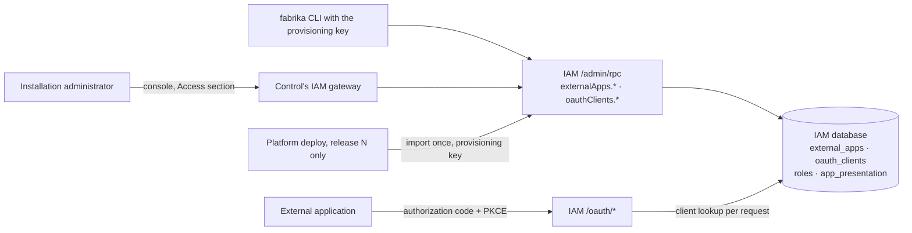

# Runtime registration of external applications — draft for review

A review draft for the ADR in this branch
([0089](../decisions/0089-oauth-clients-are-registered-in-iam-at-runtime.md)). It is deleted
before the ADR merges; the ADR is what stays.

## TLDR

- Today every external application (an app outside the installation that signs people in through IAM, ADR-0084) is a
  JSON entry in the deploy variable `FABRIKA_PLATFORM_MCP_CLIENTS_JSON`. Adding one, or changing its roles, needs a
  platform deploy; on Cloudflare the list must fit a 5,120-byte Worker variable. The name says MCP because the list was
  made for MCP authoring clients (ADR-0049); external apps reused it.
- Proposal: an external application becomes a **record in IAM's database**, with its OAuth clients and its roles,
  managed at runtime by an installation administrator in the console (Access section) or with the CLI. No deploy, no
  size cap. The MCP authoring clients (Claude, ChatGPT) move into the same registry; whether MCP authoring is on becomes
  an explicit deploy switch.
- Migration: release N imports the variable into the registry once and keeps reading it until then; release N+1
  refuses a deploy that still sets it.
- Needed from the owner: approve the ADR and answer five questions ([Decisions for the owner](#decisions-for-the-owner)).
  The main one: the brief says "a Control record"; I recommend **no Control row**, the record lives in IAM, and say why.
- Cost: four implementation PRs, about 10–13 h of agent time, plus one release between the third and the fourth.

## What is wrong today

Verified at `origin/main` 21c33d4:

- One variable carries two kinds of client. `FABRIKA_PLATFORM_MCP_CLIENTS_JSON` is a JSON array of managed OAuth
  clients (`packages/installation-init/src/mcp.ts`, `parseMcpClientsJson`). An entry without `identity` is an MCP
  authoring client and turns MCP authoring on (`mcpAuthoringOn`); an entry with `identity: { app, resource, roles? }`
  is an external application (ADR-0084).
- IAM reads the clients only from its boot configuration (`OAUTH_CONFIG`, `packages/iam/src/oauth-config.ts`), at most
  16. Every lookup is `config.clients.find(...)` (`packages/iam/src/oauth.ts` `establishClient`, `grantCeiling`).
- Cloudflare: the IAM stage writes the list into the `OAUTH_CONFIG` Worker variable (`packages/iam/fabrika.config.ts`,
  refused above 5,120 bytes), and the control-plane stage reconciles the roles with the provisioning key
  (`packages/provider-cloudflare/src/installation/identity-clients.ts`). Zerops: the installation deploy does both
  (`packages/provider-zerops/src/installation/deploy.ts`).
- So a new external app, a new redirect URI or a renamed role is a change to a GitHub Environment variable plus a
  platform deploy, done by whoever operates the installation, not by the IAM administrator who grants the roles.
- Open PRs #408 and #409 extend the same variable to MCP authoring on Cloudflare. This design changes where those
  clients live too (see [MCP authoring clients and the rename](#mcp-authoring-clients-and-the-rename)).

## The proposal in one picture



## The record

An external application is an application IAM knows that has no deploy target. Its record lives in IAM's database,
in both migration sets (D1 and Postgres):

| Table              | Holds                                                                                                                                                                  |
| ------------------ | ---------------------------------------------------------------------------------------------------------------------------------------------------------------------- |
| `external_apps`    | `app` (the IAM app id, primary key), `resource` (its identity resource, unique), `requires_role`, timestamps                                                           |
| `oauth_clients`    | `client_id` (the CIMD URL, primary key), `label` (`claude`, `chatgpt`, `external`), `redirect_uris`, `metadata_url`, `external_app` (null for an MCP authoring client) |
| `roles`            | the app's roles, as today: written by the same reconcile a deploy uses, each granting no action                                                                        |
| `app_presentation` | the app's display name (and locale), as for a contract app; IAM's consent page names the app with it                                                                   |
| `oauth_registry`   | one row: when the deploy variable was imported (release N only, see [Migration](#migration))                                                                           |

Rules, all of ADR-0084's, now checked when the record is written instead of at boot:

- `app` is lowercase, has no `@` (so it never meets a deployed app's `<app>@<env>`), is no platform audience, and names
  no app IAM already holds a vocabulary of, unless it is this record's.
- `resource` is an `https` URI on none of the installation's hosts (IAM's own, a registered resource's, a platform
  audience's return origin) and is no registered resource.
- `requires_role`: with roles, a person holding none is refused (ADR-0084 rule 4); without, every active user signs in.
- One external app may have several clients (a web app and a desktop app). The roles belong to the app, so ADR-0084's
  "two clients of one app must declare the same roles" check disappears: there is one list.

Control keeps no row. Why, and the alternative: [question 1](#q1-where-the-record-lives).

## Who manages it: console and CLI

- **Authority: `iam.admin`.** Registering a client decides where IAM sends people's identity, an installation-wide
  trust decision. A user administrator (ADR-0058) grants the app's roles to people, as today, but registers nothing.
- **IAM `/admin/rpc`** gains `externalApps.list | get | put | delete` and `oauthClients.list | put | delete`.
  `externalApps.put` takes the whole aggregate (`app`, `name`, `resource`, `roles` or none, `clients`) and replaces it
  in one transaction with its audit record. A client removed from the list, or a deleted app, has its OAuth grants
  revoked in the same transaction. `apps.list` marks an external app `external: true`.
- **Console**: an "External applications" page in the Access section: list, register, edit roles and clients, delete.
  The Applications page gets an "Add external application (no deploy)" entry that opens it, so adding one starts where
  adding an app starts. Granting its roles stays on the existing people and grant pages. The page shows, after a save,
  whether IAM could fetch each client's metadata document and whether its redirect URIs match: a hint, not a gate,
  because the application may publish its document after it is registered.
- **CLI**: `fabrika control external-apps list | put --file=<app.json> | delete <app>`, over IAM's `/admin/rpc` with
  the provisioning key as the bearer (the operator credential `fabrika control key issue` already takes, and the one
  Control's `iamProvisioningClient` calls `/admin/rpc` with). The CLI's OAuth device grant does not reach IAM's admin
  API, so a person's own CLI login cannot do it. `put` is declarative and idempotent, so an agent or an operator's
  repository can keep the record as a file.

## The OAuth client registration

Unchanged in meaning (ADR-0049 rule 2, ADR-0084 rule 1); only the source moves from `OAUTH_CONFIG` to the table:

- A client id is the `https` URL of its Client ID Metadata Document; `metadata_url` overrides where IAM fetches it.
- The registered redirect URIs are exact, and the fetched document can never widen them.
- Public client with S256 PKCE, or `private_key_jwt`, as the document declares; no client secret, no implicit grant.
- A client bound to an external app is served that app's identity resource alone, with the scope `identity`; its token
  names the person and carries no permission. An MCP authoring client (no `external_app`) is served `/mcp` as today.
- IAM looks the client up per authorization request, code exchange and refresh: one primary-key read, on requests that
  are rare. The metadata cache is already keyed by the whole registration, so an edit is never answered from the old
  document.
- An edit takes effect at once. Changing an app's `resource` ends its existing grants at their next refresh (at most
  300 s), because the grant names the old resource.

## Roles reconciliation

- `externalApps.put` writes the roles through the reconcile IAM already runs for a deploy's schema (`roles` rows of
  origin `app`, `app_schema_revisions` incremented, the guard against overwriting a custom policy), in the same
  transaction as the record. No provisioning key, no Control, no deploy.
- Semantics stay ADR-0084's: a removed role leaves its grants naming nothing, and the person's next refresh drops it
  (no role left: refused). The console says how many people hold a role before it is removed.
- Turning `requires_role` on refuses everyone until someone is granted a role; the console warns before saving.
- The deploy no longer reconciles these roles at all from release N+1 (`reconcileIdentityApps` is deleted).

## MCP authoring clients and the rename

- The MCP authoring clients (labels `claude`, `chatgpt`, or `external` without an app) move into the same
  `oauth_clients` table, as rows without `external_app`. Then IAM has one place it reads clients from, and the variable
  can go entirely.
- Whether MCP authoring is on is composition, not data: it decides the proxy's `/mcp` row and Control's mount. Today it
  is inferred from the list (`mcpAuthoringOn`; #408's `cloudflareMcpAuthoringOn`). It becomes an explicit deploy
  setting, `FABRIKA_PLATFORM_MCP_AUTHORING=on` (`--mcp-authoring` on Zerops). A registered authoring client on an
  installation with authoring off gets nothing: no resource is served to it.
- Vocabulary after the change: **external application** (an IAM app with no deploy target), **OAuth client** (a
  registered client id, bound to an external application or an MCP authoring client), **MCP** only where it is MCP
  (`/mcp`, the authoring clients, the switch). In code: `McpClient` and `parseMcpClientsJson` go; `installation-init`'s
  `mcp.ts` keeps only IAM's resources, renamed `oauth.ts`; the local stack's `FABRIKA_LOCAL_MCP_CLIENTS_JSON` becomes a
  seed in the new shape.

## Migration

The variable is read for one release, then dropped.

```mermaid
sequenceDiagram
  participant D as Platform deploy
  participant I as IAM
  Note over D,I: Release N
  D->>I: OAUTH_CONFIG with the variable's clients (as today)
  D->>I: oauthClients.importOnce(variable) with the provisioning key
  I->>I: no import yet: write every entry + the import mark, one transaction
  I-->>D: imported (or already_imported: warn, nothing written)
  Note over I: before the mark: clients from OAUTH_CONFIG; after it: the table only
  Note over D,I: Release N+1
  D->>D: variable still set: refuse, name the console and release N
  D->>I: OAUTH_CONFIG without clients
```

- **Release N.** IAM gains the tables, the procedures and the table lookup. Until the import mark exists it serves the
  clients of `OAUTH_CONFIG` as before, so nothing breaks between IAM's deploy and the import. The deploy (Zerops
  installation deploy; Cloudflare control-plane stage, where the roles reconcile runs today) calls
  `oauthClients.importOnce` with the variable; IAM writes every entry and the mark in one transaction, adopting the
  roles an earlier deploy reconciled under the same app id. Only the provisioning key may call it (like
  `grantApproval.set`). Later deploys of N get `already_imported` and warn that the variable is no longer read and
  should be deleted. The deploy keeps writing the clients into `OAUTH_CONFIG`, so rolling IAM back to N-1 keeps working.
  MCP authoring is on with the new switch, or (N only) with a non-identity entry in the variable.
- **Release N+1.** The deploy refuses while the variable is set, before it deploys anything: "register the clients in
  the console, or upgrade through release N, then delete the variable". `OAUTH_CONFIG` carries resources only; IAM
  drops the `OAUTH_CONFIG` client path, `parseMcpClientsJson`, `reconcileIdentityApps` and the variable's lines in the
  generated `platform.yml`.
- **Why import once and not every deploy:** after the import the console is the source. Importing again would undo
  an administrator's delete or edit with a stale variable.

## Rollout of an existing installation

1. **Generated files.** Cloudflare's `platform.yml` passes the variable to two stages. N keeps both lines; N+1's
   `platform upgrade` regenerates the workflow without them. Zerops generates no file for it.
2. **Environment variables.** N writes `OAUTH_CONFIG` / `FABRIKA_IAM_OAUTH_CONFIG` as before; N+1 writes it without
   clients (IAM's own variable, rewritten on every deploy). The GitHub Environment variable is the operator's: N warns,
   N+1 refuses, and the operator deletes it. New: `FABRIKA_PLATFORM_MCP_AUTHORING`, needed only where MCP authoring is
   on; N infers it from the variable when unset and warns.
3. **Provider state.** IAM migrations add tables only; N-1 ignores them. Roles that earlier deploys reconciled are
   adopted by the import under the same app id and keys, so every existing grant keeps working.
4. **Floating pins.** None.

An installation that jumps from N-1 to N+1 with the variable set is refused at deploy and told to go through N or
register by hand; one without the variable has nothing to migrate.

## Per-app OAuth resources: out of scope

Another session found that the OAuth device grant issues tokens only for the console's RPC resources
(`CONTROL_CLI_RESOURCES`), that the proxy verifies an OAuth bearer only on installation rows
(`proxy-core/src/authorize.ts`, `oauthBindingOf`), and that an application maps an OAuth caller to `no_caller`
(`packages/app/src/implement/principal.ts`). So no client, the CLI included, can call a deployed application's API
with an OAuth token.

That stays out of this design:

- **It is the opposite trust direction.** An external application's token carries no permission and no service accepts
  it (ADR-0084's invariant). A per-app resource issues a token that a deployed application accepts, with permissions.
- **It changes the enforcement point and the platform protocol.** It needs `oauth` rows on contract application
  entries in the proxy (ADR-0022), a new caller kind in the framework, and a claim an older framework release must
  tolerate (ADR-0062). None of that is in this design.
- **Its registration is not runtime data.** Which endpoints admit OAuth, and with which scope ceiling, is the
  application's contract, approved and published at deploy; the resource follows from a deployed environment's origin.
- **What it would reuse:** the `oauth_clients` table. A client that may call an app's API would be one more kind of row,
  so nothing here blocks it. It needs its own ADR.

## Alternatives

- **A Control `apps` row of kind `external`** (repository fields nullable, Control writes IAM with the provisioning
  key). Lost: `apps.repo_url` is `NOT NULL` and every deploy, run, webhook and workspace path reads it (16 non-test files of `packages/control/src`), so the change
  spreads through Delivery for an app Delivery never touches; two stores need a two-phase write; and Control's
  `app.manage` would decide an identity-plane trust question.
- **Keep the deploy variable, only renamed.** Lost: every change still needs a deploy and the 5,120-byte cap stays.
- **Move only external apps, keep authoring clients in the variable.** Workable and smaller (no switch), but IAM then
  reads clients from two places for good, and the variable stays. See [question 2](#q2-mcp-authoring-clients).
- **Applications register themselves (open dynamic registration, RFC 7591).** Lost: ADR-0049 refuses open
  registration; an administrator decides which applications receive people's identity.

## Decisions for the owner

### Q1 where the record lives

The brief says "the Control record for an external application". I recommend no row in Control's database.

```form
type: choice
id: q1-record
label: Where does the external application's record live?
required: true
options:
  - {value: iam, label: "IAM only (recommended)", description: "Tables in IAM's DB, managed through IAM's /admin/rpc from the console's Access section and the CLI. One store, one transaction, IAM's own authority."}
  - {value: control-and-iam, label: "A Control apps row of kind external, plus IAM storage", description: "Listed with deployed apps in Control. Costs a nullable repository through Delivery, a two-store write, and Control's app.manage deciding identity trust. About +4 h."}
```

### Q2 MCP authoring clients

```form
type: choice
id: q2-authoring
label: Do the MCP authoring clients (Claude, ChatGPT) move into the same registry?
required: true
options:
  - {value: move, label: "Yes, with an explicit FABRIKA_PLATFORM_MCP_AUTHORING switch (recommended)", description: "The variable disappears entirely; IAM reads clients from one place. Touches #408/#409's inference."}
  - {value: keep, label: "No, they stay in a deploy variable", description: "Smaller now; the variable stays for authoring clients only and IAM reads two sources."}
```

### Q3 who registers

```form
type: choice
id: q3-authority
label: Who may register or change an external application?
required: true
options:
  - {value: iam-admin, label: "Installation administrator (iam.admin) only (recommended)"}
  - {value: user-admin, label: "Also a user administrator (iam.users.manage)", description: "Wider: a user administrator would decide where people's identity goes."}
```

### Q4 per-app OAuth resources

```form
type: choice
id: q4-resources
label: Per-app OAuth resources (a token a deployed application accepts)?
required: true
options:
  - {value: out, label: "Out of scope, a separate ADR (recommended)"}
  - {value: in, label: "In this design", description: "Adds proxy rows on contract apps, a framework caller kind and a protocol change."}
```

### Q5 a deploy that still sets the variable in release N+1

```form
type: choice
id: q5-drop
label: What does release N+1 do when the variable is still set?
required: true
options:
  - {value: refuse, label: "Refuse the deploy with instructions (recommended)", description: "An installation that skipped release N cannot lose its clients silently."}
  - {value: ignore, label: "Ignore it with a warning"}
```

## PR plan

Effort is elapsed agent time, review rounds and CI included.

| PR | Content                                                                                                                                                                                            | Size         | Effort |
| -- | -------------------------------------------------------------------------------------------------------------------------------------------------------------------------------------------------- | ------------ | ------ |
| 0  | This ADR (0089), proposed. ADR-0084 and ADR-0049 are rewritten in place by PR 1, once approved (open PRs #408/#409 edit both now)                                                                  | docs         | done   |
| 1  | IAM: migrations (both engines), repository, `externalApps.*` and `oauthClients.*` incl. `importOnce`, table lookup with the pre-import `OAUTH_CONFIG` path, audit, `apps.list` flag; contract DTOs | ~1,000 lines | 3–4 h  |
| 2  | Deploys (both clouds) and local stack: import once, warnings, `FABRIKA_PLATFORM_MCP_AUTHORING`, adapt #408/#409's inference; reference docs                                                        | ~400 lines   | 2–3 h  |
| 3  | Console Access page and Applications entry, CLI `control external-apps`; before/after screenshots                                                                                                  | ~700 lines   | 3–4 h  |
| 4  | Release N+1: refuse the variable, drop the `OAUTH_CONFIG` client path, `parseMcpClientsJson`, `reconcileIdentityApps`, the `platform.yml` lines; rename leftovers                                  | ~−600 lines  | 1–2 h  |

PRs 1–3 form release N; PR 2 depends on 1, PR 3 on 1. PR 4 waits for release N to be tagged.

Waits on the owner: approval of this ADR; the tag of release N (PR 4 merges after it); on each installation, deleting
the variable after release N.
