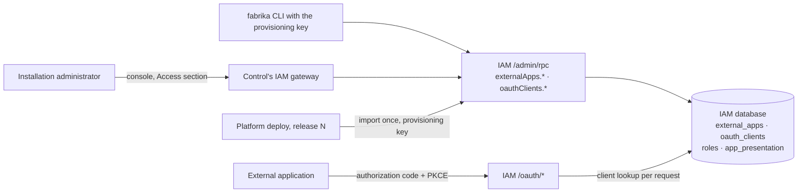

# Runtime registration of external applications — draft for review

A review draft for the ADR in this branch
([0089](../decisions/0089-oauth-clients-are-registered-in-iam-at-runtime.md)). It is deleted
before the ADR merges; the ADR is what stays.

## TLDR

- Today every external application (an app outside the installation that signs people in through IAM, ADR-0084) is a
  JSON entry in the deploy variable `FABRIKA_PLATFORM_MCP_CLIENTS_JSON`. Adding one, or changing its roles, needs a
  platform deploy; on Cloudflare the list must fit a 5,120-byte Worker variable. The name says MCP because the list was
  made for MCP authoring clients (ADR-0049); external apps reused it.
- Proposal: an external application becomes a **record in IAM's database**, with its OAuth clients and its roles,
  managed at runtime by an installation administrator in the console (Access section) or with the CLI. No deploy, no
  size cap. The MCP authoring clients (Claude, ChatGPT) move into the same registry but stay the operator's to write;
  whether MCP authoring is on becomes an explicit deploy switch.
- Migration: release N imports the variable into the registry once and stops reconciling from it; release N+1 refuses
  a deploy that still sets it; release N+2 drops it from the generated workflows.
- Needed from the owner: approve the ADR and answer five questions ([Decisions for the owner](#decisions-for-the-owner)).
  The main one: the brief says "a Control record"; I recommend **no Control row**, the record lives in IAM, and say why.
- Cost: five implementation PRs, about 10–14 h of agent time, spread over three releases.

## What is wrong today

Verified at `origin/main` 21c33d4:

- One variable carries two kinds of client. `FABRIKA_PLATFORM_MCP_CLIENTS_JSON` is a JSON array of managed OAuth
  clients (`packages/installation-init/src/mcp.ts`, `parseMcpClientsJson`). An entry without `identity` is an MCP
  authoring client and turns MCP authoring on (`mcpAuthoringOn`); an entry with `identity: { app, resource, roles? }`
  is an external application (ADR-0084).
- IAM reads the clients only from its boot configuration (`OAUTH_CONFIG`, `packages/iam/src/oauth-config.ts`), at most
  16. Every lookup is `config.clients.find(...)`: `establishClient` and `grantCeiling` in `packages/iam/src/oauth.ts`,
  and both client authentications in `packages/iam/src/oauth-client-auth.ts`.
- Cloudflare: the IAM stage writes the list into the `OAUTH_CONFIG` Worker variable (`packages/iam/fabrika.config.ts`,
  refused above 5,120 bytes), and the control-plane stage reconciles the roles with the provisioning key
  (`packages/provider-cloudflare/src/installation/identity-clients.ts`). Zerops: the installation deploy does both
  (`packages/provider-zerops/src/installation/deploy.ts`). Both generated sidecar workflows pass the variable to the
  deploy (each provider's `templates/platform.yml`).
- So a new external app, a new redirect URI or a renamed role is a change to a GitHub Environment variable plus a
  platform deploy, done by whoever operates the installation, not by the IAM administrator who grants the roles.
- Open PRs #408 and #409 extend the same variable to MCP authoring on Cloudflare. This design changes where those
  clients live too (see [MCP authoring clients and the rename](#mcp-authoring-clients-and-the-rename)).

## The proposal in one picture



## The record

An external application is an application IAM knows that has no deploy target. Its record lives in IAM's database,
in both migration sets (D1 and Postgres):

| Table              | Holds                                                                                                                                                                  |
| ------------------ | ---------------------------------------------------------------------------------------------------------------------------------------------------------------------- |
| `external_apps`    | `app` (the IAM app id, primary key), `resource` (its identity resource, unique), timestamps                                                                            |
| `oauth_clients`    | `client_id` (the CIMD URL, primary key), `label` (`claude`, `chatgpt`, `external`), `redirect_uris`, `metadata_url`, `external_app` (null for an MCP authoring client) |
| `roles`            | the app's roles, as today: written by the same reconcile a deploy uses, each granting no action                                                                        |
| `app_presentation` | the app's display name (and locale), as for a contract app; IAM's consent page names the app with it                                                                   |
| `oauth_registry`   | one row: when the deploy variable was imported (see [Migration](#migration))                                                                                           |

Rules, all of ADR-0084's, now checked when the record is written instead of at deploy and boot:

- `app` is lowercase, has no `@` (so it never meets a deployed app's `<app>@<env>`) and is no platform audience.
  Registering an id under which IAM already holds a vocabulary adopts it, with every grant of its roles, only when it
  has the shape an earlier deploy's reconcile of an external application wrote: roles alone, each granting no action,
  no scope and no action declared, and no registered return origin (IAM hands people off to such an app, so it is no
  external application). Any other vocabulary refuses the id, because the provisioning key's schema PUT can
  write any vocabulary under any id, and adopting one with permissions would let its roles be renamed into a token.
- `resource` is an `https` URI, is no registered resource, and is on none of the installation's hosts. IAM does not
  know all of them today (Operations' host, alias hosts), so the deploy writes the list its own check reads now into
  `OAUTH_CONFIG` as `hosts`.
- With roles, a person holding none is refused (ADR-0084 rule 4); without roles, the app has no vocabulary and every
  active user signs in. There is no separate switch: a leftover vocabulary of an app whose roles were dropped is
  cleared, where today it stays unnamed.
- One external app may have several clients (a web app and a desktop app). The roles belong to the app, so ADR-0084's
  "two clients of one app must declare the same roles" check disappears: there is one list.

Control keeps no row. Why, and the alternative: [question 1](#q1-where-the-record-lives).

## Who manages it: console and CLI

- **External applications: `iam.admin`.** Registering one decides where IAM sends people's identity, an
  installation-wide trust decision. A user administrator (ADR-0058) grants the app's roles to people, as today, but
  registers nothing.
- **Authoring clients: the provisioning key only.** Their tokens reach `/mcp` with authoring reach, and ADR-0049 trusts
  such a client as much as it trusts the operator who registers it. Today only the operator can, through the deploy
  variable; that stays so.
- **IAM `/admin/rpc`** gains `externalApps.list | get | put | delete` (`iam.admin`) and `oauthClients.list | put |
  delete` (list: `iam.admin`; writes: provisioning key, authoring clients only). `externalApps.put` takes the whole
  aggregate (`app`, `name`, `resource`, `roles` or none, `clients`), is the only writer of a bound client, and replaces
  it in one transaction with its audit record. Each writer refuses a client id the other one owns. A client removed
  from the list, or a deleted app, has its OAuth grants revoked in the same transaction. `apps.list` marks such an app `externalApplication: true` (not `external`, which
  already names ADR-0051's external principals and roles).
- **Console**: an "External applications" page in the Access section: list, register, edit roles and clients, delete;
  authoring clients listed read-only. The Applications page gets an "Add external application (no deploy)" entry that
  opens it, so adding one starts where adding an app starts. Granting its roles stays on the existing people and grant
  pages. After a save the page shows whether IAM could fetch each client's metadata document and whether its redirect
  URIs match: a hint, not a gate, because the application may publish its document after it is registered.
- **CLI**: `fabrika control external-apps list | put --file=<app.json> | delete <app>` and
  `fabrika control oauth-clients list | put --file=<client.json> | delete <client id>`, over IAM's `/admin/rpc` with the
  provisioning key as the bearer (the operator credential `fabrika control key issue` already takes, and the one
  Control's `iamProvisioningClient` calls `/admin/rpc` with). The CLI's OAuth device grant does not reach IAM's admin
  API, so a person's own CLI login cannot do it. `put` is declarative and idempotent, so an agent or an operator's
  repository can keep the record as a file.

## The OAuth client registration

Unchanged in meaning (ADR-0049 rule 2, ADR-0084 rule 1); only the source moves from `OAUTH_CONFIG` to the table:

- A client id is the `https` URL of its Client ID Metadata Document; `metadata_url` overrides where IAM fetches it.
- The registered redirect URIs are exact, and the fetched document can never widen them.
- Public client with S256 PKCE, or `private_key_jwt`, as the document declares; no client secret, no implicit grant.
- A client bound to an external app is served that app's identity resource alone, with the scope `identity`; its token
  names the person and carries no permission. An MCP authoring client (no `external_app`) is served `/mcp` as today.
- IAM looks the client up per authorization request, client authentication, code exchange and refresh: one
  primary-key read, on requests that are rare. The metadata cache is already keyed by the whole registration, so an
  edit is never answered from the old document.
- An edit takes effect at once. Changing an app's `resource` ends its existing grants at their next refresh (at most
  300 s), because the grant names the old resource.

## Roles reconciliation

- `externalApps.put` writes the roles through the reconcile IAM already runs for a deploy's schema (`roles` rows of
  origin `app`, `app_schema_revisions` incremented, the guard against overwriting a custom policy), in the same
  transaction as the record. No provisioning key, no Control, no deploy.
- Semantics stay ADR-0084's: a removed role leaves its grants naming nothing, and the person's next refresh drops it
  (no role left: refused). The console says how many people hold a role before it is removed.
- Adding roles to an app that had none refuses everyone until someone is granted one; the console warns before saving.
- The deploy stops reconciling these roles in release N: the import replaces that step, so no deploy of N can undo a
  console edit with a stale variable. `reconcileIdentityApps` is deleted.

## MCP authoring clients and the rename

- The MCP authoring clients (labels `claude`, `chatgpt`, or `external` without an app) move into the same
  `oauth_clients` table, as rows without `external_app`, written with the provisioning key. Then IAM has one place it
  reads clients from, and the variable can go entirely.
- Whether MCP authoring is on is composition, not data: it decides the proxy's `/mcp` row and Control's mount. Today it
  is inferred from the list (`mcpAuthoringOn`; #408's `cloudflareMcpAuthoringOn`). It becomes an explicit deploy
  setting, `FABRIKA_PLATFORM_MCP_AUTHORING=on` (`--mcp-authoring` on Zerops). A registered authoring client on an
  installation with authoring off gets nothing: no resource is served to it.
- Vocabulary after the change: **external application** (an IAM app with no deploy target), **OAuth client** (a
  registered client id, bound to an external application or an MCP authoring client), **MCP** only where it is MCP
  (`/mcp`, the authoring clients, the switch). In code: `McpClient` and `parseMcpClientsJson` go; `installation-init`'s
  `mcp.ts` keeps only IAM's resources, renamed `oauth.ts`; the local stack's `FABRIKA_LOCAL_MCP_CLIENTS_JSON` becomes a
  seed in the new shape, imported the same way.

## Migration

The variable is read for one release, refused in the next, and removed from the generated files in the one after.

```mermaid
sequenceDiagram
  participant D as Platform deploy
  participant I as IAM
  Note over D,I: Release N
  D->>I: OAUTH_CONFIG with the variable's clients and the installation's hosts
  D->>I: oauthClients.importOnce(variable, or [] when unset) with the provisioning key
  I->>I: no mark yet: write every entry, its roles and the mark, one transaction
  I-->>D: imported, or already_imported (nothing written)
  Note over I: before the mark: OAUTH_CONFIG's clients, registry writes refused; after it: the registry only
  Note over D,I: Release N+1
  D->>D: variable still set: refuse before deploying anything
  D->>I: OAUTH_CONFIG without clients
  Note over I: no import, no mark: the registry only, writes always accepted
  Note over D,I: Release N+2
  Note over D: generated workflows no longer pass the variable
```

- **Release N.** IAM gains the tables, the procedures and the table lookup.
  - Every deploy (Zerops installation deploy; Cloudflare control-plane stage, where the roles reconcile runs today)
    calls `oauthClients.importOnce` with the variable's entries, or with none when it is unset, and fails when the call
    fails. Only the provisioning key may call it, like `grantApproval.set`. The first call writes every entry, its
    vocabulary (adopting the roles earlier deploys reconciled under the same app id) and the mark in one transaction.
    Every later call answers `already_imported` and writes nothing; the deploy warns while the variable is set.
  - In release N only, until the mark exists, IAM serves the clients of `OAUTH_CONFIG` as before, and refuses registry
    writes, so an administrator's edit can never land before the import and be overwritten by it, and nothing breaks
    between IAM's deploy and the import.
  - The deploy no longer reconciles external applications' roles.
  - The deploy keeps writing the variable's clients into `OAUTH_CONFIG`, so rolling IAM back to N-1 serves them while
    the variable is still set.
  - MCP authoring is on with the new switch, or (N only) with an authoring entry in the variable.
- **Release N+1.** The deploy refuses while the variable is set, before it deploys anything, with: "upgrade through
  release N first; or delete the variable, deploy this release and register the applications in the console (which
  adopts their roles), and know that their sign-ins fail until then; set `FABRIKA_PLATFORM_MCP_AUTHORING` where MCP
  authoring was on". The generated workflows still
  pass the variable, so the refusal sees it even when the operator jumped from N-1 to N+1. `OAUTH_CONFIG` carries no
  clients. IAM drops the `OAUTH_CONFIG` client path, the import, the mark and the pre-import refusal, so it accepts
  registry writes whether or not an import ever ran: an installation that skipped release N, or never set the
  variable, registers its applications in the console. `parseMcpClientsJson` and `reconcileIdentityApps` go too.
- **Release N+2.** The variable's line leaves both generated workflows.
- **Why import once and not every deploy:** after the import the registry is the source. Importing again would undo an
  administrator's delete or edit with a stale variable.

## Rollout of an existing installation

1. **Generated files.** Both sidecar workflows pass the variable to the deploy (Cloudflare to two stages). N and N+1
   keep the lines; N+2 drops them. On Zerops `platform upgrade` regenerates the workflow; on Cloudflare re-running
   `platform init` refreshes `platform.yml`. An old line passing an unset variable is harmless.
2. **Environment variables.** N writes `OAUTH_CONFIG` / `FABRIKA_IAM_OAUTH_CONFIG` with the clients as before and the
   new `hosts`; N+1 writes it without clients (IAM's own variable, rewritten on every deploy). An older IAM refuses the
   `hosts` key at boot, so a rollback must be a deploy of the older release, which writes its own shape, never a
   re-activation of an older service version alone. The GitHub Environment variable is the operator's: N warns, N+1
   refuses, and the operator deletes it once release N is accepted. New: `FABRIKA_PLATFORM_MCP_AUTHORING`, needed only
   where MCP authoring is on; N infers it from the variable when unset and warns.
3. **Provider state.** IAM migrations add tables only; N-1 ignores them. Roles that earlier deploys reconciled are
   adopted by the import, or by a hand registration under the same id, with the same keys, so every existing grant
   keeps working.
4. **Floating pins.** None.

**Rollback window.** Rolling back to N-1 serves the variable's clients only while the variable is still set, and N-1's
deploy reconciles the variable's roles over whatever the registry holds. So the operator keeps the variable until
release N is accepted on the installation. A roll back and forward after an administrator's edit can leave the
registry and IAM's roles apart; saving the application again in the console realigns them.

## Per-app OAuth resources: out of scope

The current code issues the OAuth device grant only for the console's RPC resources (`CONTROL_CLI_RESOURCES`), verifies
an OAuth bearer in the proxy only on installation rows (`proxy-core/src/authorize.ts`, `oauthBindingOf`), and maps an
OAuth caller to `no_caller` in an application (`packages/app/src/implement/principal.ts`). So no client, the CLI
included, can call a deployed application's API with an OAuth token.

That stays out of this design:

- **It is the opposite trust direction.** An external application's token carries no permission and no service accepts
  it (ADR-0084's invariant). A per-app resource issues a token that a deployed application accepts, with permissions.
- **It changes the enforcement point and the platform protocol.** It needs `oauth` rows on contract application
  entries in the proxy (ADR-0022), a new caller kind in the framework, and a claim an older framework release must
  tolerate (ADR-0062). None of that is in this design.
- **Its registration is not runtime data.** Which endpoints admit OAuth, and with which scope ceiling, is the
  application's contract, approved and published at deploy; the resource follows from a deployed environment's origin.
- **What it would reuse:** the `oauth_clients` table. A client that may call an app's API would be one more kind of row,
  so nothing here blocks it. It needs its own ADR.

## Alternatives

- **A Control `apps` row of kind `external`** (repository fields nullable, Control writes IAM with the provisioning
  key). Lost: `apps.repo_url` is `NOT NULL` and every deploy, run, webhook and workspace path reads it (16 non-test
  files of `packages/control/src`), so the change spreads through Delivery for an app Delivery never touches; two
  stores need a two-phase write; and Control's `app.manage` would decide an identity-plane trust question.
- **Keep the deploy variable, only renamed.** Lost: every change still needs a deploy and the 5,120-byte cap stays.
- **Move only external apps, keep authoring clients in the variable.** Workable and smaller (no switch), but IAM then
  reads clients from two places for good, and the variable stays. See [question 2](#q2-mcp-authoring-clients).
- **Let `iam.admin` write authoring clients too.** Lost: it would widen who can hand out `/mcp` authoring reach from
  the operator to every installation administrator.
- **Applications register themselves (open dynamic registration, RFC 7591).** Lost: ADR-0049 refuses open
  registration; an administrator decides which applications receive people's identity.

## Decisions for the owner

### Q1 where the record lives

The brief says "the Control record for an external application". I recommend no row in Control's database.

```form
type: choice
id: q1-record
label: Where does the external application's record live?
required: true
options:
  - {value: iam, label: "IAM only (recommended)", description: "Tables in IAM's DB, managed through IAM's /admin/rpc from the console's Access section and the CLI. One store, one transaction, IAM's own authority."}
  - {value: control-and-iam, label: "A Control apps row of kind external, plus IAM storage", description: "Listed with deployed apps in Control. Costs a nullable repository through Delivery, a two-store write, and Control's app.manage deciding identity trust. About +4 h."}
```

### Q2 MCP authoring clients

```form
type: choice
id: q2-authoring
label: Do the MCP authoring clients (Claude, ChatGPT) move into the same registry?
required: true
options:
  - {value: move, label: "Yes, written with the provisioning key, plus an explicit FABRIKA_PLATFORM_MCP_AUTHORING switch (recommended)", description: "The variable disappears entirely; IAM reads clients from one place; who may register an authoring client does not change. Touches #408/#409's inference."}
  - {value: keep, label: "No, they stay in a deploy variable", description: "Smaller now; the variable stays for authoring clients only and IAM reads two sources."}
```

### Q3 who registers

```form
type: choice
id: q3-authority
label: Who may register or change an external application?
required: true
options:
  - {value: iam-admin, label: "Installation administrator (iam.admin) only (recommended)"}
  - {value: user-admin, label: "Also a user administrator (iam.users.manage)", description: "Wider: a user administrator would decide where people's identity goes."}
```

### Q4 per-app OAuth resources

```form
type: choice
id: q4-resources
label: Per-app OAuth resources (a token a deployed application accepts)?
required: true
options:
  - {value: out, label: "Out of scope, a separate ADR (recommended)"}
  - {value: in, label: "In this design", description: "Adds proxy rows on contract apps, a framework caller kind and a protocol change."}
```

### Q5 a deploy that still sets the variable in release N+1

```form
type: choice
id: q5-drop
label: What does release N+1 do when the variable is still set?
required: true
options:
  - {value: refuse, label: "Refuse the deploy with instructions; the workflows pass the variable until N+2 so it is seen (recommended)", description: "An installation that skipped release N cannot lose its clients silently."}
  - {value: ignore, label: "Ignore it with a warning, drop the workflow lines in N+1", description: "One release shorter; an installation jumping from N-1 to N+1 loses its external sign-ins until someone registers them."}
```

## PR plan

Effort is elapsed agent time, review rounds and CI included.

| PR | Release | Content                                                                                                                                                                                                                                    | Size         | Effort |
| -- | ------- | ------------------------------------------------------------------------------------------------------------------------------------------------------------------------------------------------------------------------------------------ | ------------ | ------ |
| 0  | —       | This ADR (0089), proposed. ADR-0084 and ADR-0049 are rewritten in place by PR 1, once approved (open PRs #408/#409 edit both now)                                                                                                          | docs         | done   |
| 1  | N       | IAM: migrations (both engines), repository, `externalApps.*` and `oauthClients.*` incl. `importOnce` and the pre-import refusal, table lookup with the pre-import `OAUTH_CONFIG` path, `OAUTH_CONFIG.hosts`, audit, `apps.list` flag; DTOs | ~1,000 lines | 3–4 h  |
| 2  | N       | Deploys (both clouds) and local stack: import once instead of the roles reconcile, `hosts`, warnings, `FABRIKA_PLATFORM_MCP_AUTHORING`, adapt #408/#409's inference; reference docs                                                        | ~400 lines   | 2–3 h  |
| 3  | N       | Console Access page and Applications entry, CLI `control external-apps` / `oauth-clients`; before/after screenshots                                                                                                                        | ~700 lines   | 3–4 h  |
| 4  | N+1     | Refuse a set variable; drop the `OAUTH_CONFIG` client path, the import, the mark and the pre-import refusal, `parseMcpClientsJson`, `reconcileIdentityApps`; rename leftovers                                                              | ~−600 lines  | 1–2 h  |
| 5  | N+2     | Remove the variable's line from both generated workflows                                                                                                                                                                                   | ~20 lines    | 0.5 h  |

PRs 2 and 3 depend on 1. PR 4 waits for release N to be tagged, PR 5 for release N+1.

Waits on the owner: approval of this ADR; the tags of releases N and N+1; on each installation, deleting the variable
after release N is accepted there.
