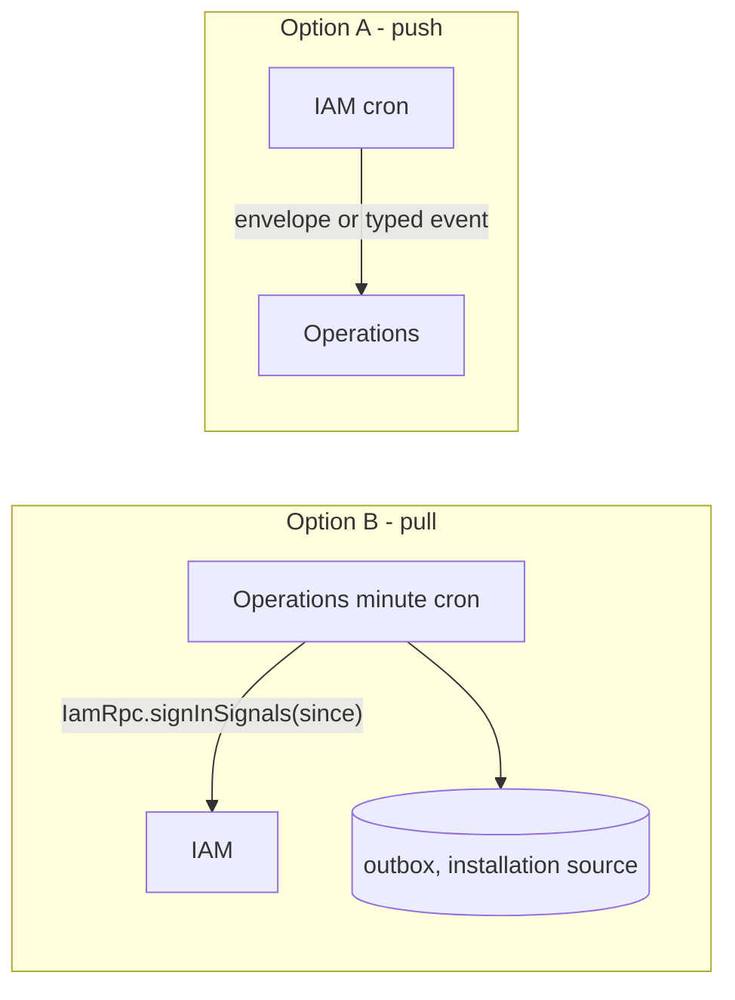

# Security alerts in Operations

An internal security review asked that the platform alert on three signals it records today but never raises: a
series of refused sign-ins, a privileged sign-in, and an exposure change (an application service that became reachable
past its proxy between deploys). This note lays out how sign-in data could cross from IAM into Operations, and the alert
model it would land in.

## TLDR

- Proposed: Operations' existing minute cron pulls a bounded sign-in summary from IAM over the IAM RPC channel it
  already holds, evaluates thresholds, and writes `security` alerts into a new **installation source** through the
  existing outbox and webhook channels.
- To decide: the IAM→Operations boundary (pull, push, or shared table), a new `security` alert kind versus reusing
  `new_issue`, what counts as a privileged sign-in, and the refused-sign-in thresholds.
- Recommendation: option B (pull), a new `security` kind, privileged = the existing `auth_log.privileged` flag,
  per-account 5 refusals in 15 minutes plus an installation-wide count. About 5-7 agent hours plus review and CI. The
  exposure alert from the parallel maintenance change stays a `new_issue` on the application's source; nothing here
  blocks it.

## What exists today

Verified at `origin/main` (`d9e4be7bc`) unless marked otherwise.

**IAM records sign-ins, refused sign-ins and privilege.**

- `auth_log` (`packages/iam/migrations-postgres/0001_init.sql:201`, plus `0008_durable_audit.sql` and
  `0023_terminals.sql`): `id` (identity on Postgres, rowid on D1), `request_id`, `app`, `kind`
  (`authenticate | logout`), `principal_id`, `credential_id`, `decision` (`allow | deny`), `reason`, `privileged`
  (0/1), `created_at` (unix seconds), `terminal_id`, `asserted_by`. **No client address column**, and no email.
- A refused password, OIDC, handoff, local or second-factor login writes a `deny` row through `refuseLogin`
  (`packages/iam/src/auth/sessions.ts:206`) with `app = 'propustka'` and a fixed `LoginRefusal` reason
  (`sessions.ts:188`: `password_invalid`, `password_throttled`, `oidc_*`, `second_factor_invalid`,
  `second_factor_throttled`, …). `principal_id` is null when the account is unknown (`auth/password.ts:229`).
- A completed login writes its `allow` row in the session's batch (`issueSession`, `sessions.ts:128-143`) with
  `privileged = administersIam(...)`: the principal holds `iam.admin` (installation administrator) or `iam.users.manage`
  in any scope (user administrator) at IAM (`iamAdministrationScope`, `packages/iam-contract/src/access.ts:32`). A
  terminal assertion is marked the same way (`identification.ts:164`). A login waiting for its second factor writes no
  `allow` row until the code is verified.
- Not marked privileged: a cross-app `admin` grant over applications without an IAM permission, and Control's deploy
  administrators unless they also hold an IAM permission.
- Throttles: 5 attempts per account per 15 minutes, then a 15-minute block (`auth/password.ts:22-43`); per-client
  buckets exist only where the composition names a client header. On Zerops IAM names none (`packages/iam/CLAUDE.md`,
  "IAM NEVER PICKS THE HEADER"), so a per-IP count is impossible there. Throttle keys are hashed.
- `audit_events` (`0001_init.sql:168`) holds changes and admin access, not sign-ins; the second-factor block writes
  `iam.second_factor.throttle` (`auth/second-factor.ts:139`). A refused `px_` key writes no row at all.
- `auth_log` is pruned daily after `FABRIKA_IAM_AUTH_LOG_RETENTION_DAYS` (default 30; `src/cron.ts`). The only reader
  is the admin procedure `listAuthLog` (`src/admin/rpc.ts:326`), paged backwards by `id`.
- IAM has a daily cron only (`0 3 * * *` in `fabrika.config.ts:334` and the Zerops crontab) and no binding or
  credential that reaches Operations.

**Operations alerts per source.**

- Kinds: `new_issue`, `regression`, `spike`, `failed_check`, `recovery`, `unhealthy_telemetry`
  (`packages/operations/src/operator-input.ts:6`; also `operations-contract/src/operator-api.ts` and the dashboard's
  `routes/operations/sources/alerts.tsx`).
- `alert_rules`, `notification_channels` (webhook only), `alert_claims` and `notification_outbox` are all keyed by
  `source_id` (`migrations-postgres/0001_init.sql:109-160`). The outbox has a UNIQUE `dedup_key`, leased claims, six
  attempts, and the dedup key as the webhook `Idempotency-Key` (`docs/reference/operations-errors.md`).
- A source is `(app_id, environment, service_key)`. Sources come only from Control's catalog projection of registered
  application environments (`packages/control/src/db/operations-catalog.ts:96`, pushed to
  `/private/catalog/reconcile` with `OPERATIONS_SYNC_KEY`); both insert paths write `origin = 'control'`, and the
  reconcile touches only `origin = 'control'` rows (`src/repositories/catalog.ts:36,62`). **There is no installation
  source today**; backlog [278](../backlog/278-control-alerts-when-iam-or-operations-is-down.md) needs one for IAM's
  health check too.
- Source access is the union of an app-scoped and an environment-scoped grant (`src/access.ts:17`).
- Operations runs a maintenance pass every minute on both runtimes (`triggers.crons: ['* * * * *']`;
  Zerops crontab `bun packages/operations/src/node/cron.ts`).
- Operations already calls IAM: a service binding to the full IAM entrypoint on Cloudflare
  (`fabrika.config.ts`, `IAM: new ServiceReference(...)`), HTTP with `FABRIKA_IAM_RPC_KEY` on Zerops
  (`provider-zerops/src/installation/topology/setups.ts`, "used only for Operations → IAM management RPC").

**How other planes feed Operations.**

- Control → catalog and releases over the private reconcile routes (sync key).
- Control → an application's own ingest project as a Sentry envelope (`WorkloadKeyExpiring`,
  `packages/control/src/workload-key-expiry.ts`). The same path carries the parallel change's
  `FabrikaExposureDetected` (in progress on its own branch, not on `main`).
- Operations' own health checks produce `failed_check` / `recovery` / `unhealthy_telemetry`.

**Database ownership.** Each service has its own repositories and ledger (ADR-0017). No package outside `iam` reads
`auth_log` or `audit_events` (grep). On Cloudflare each service has its own D1. On Zerops IAM and Control point at the
same `${db_*}` database (separate tables and ledgers); Operations has its own `operationsdb`, except a light
installation created before that existed.

## Options for the IAM→Operations boundary

### A. Push from IAM

IAM detects and sends. Two variants: (A1) a Sentry envelope to an installation ingest project, as Control does for
workload keys; (A2) a typed event to a new private Operations route.

- **Cost.** 6-8 agent hours. IAM needs a frequent schedule it does not have (a new cron trigger on Cloudflare, a new
  crontab line on Zerops), a way to reach Operations (a new binding on Cloudflare; on Zerops the private URL), and a
  credential: the installation source's DSN (A1) or a new shared secret (A2). Detection state (what was already
  reported) becomes a new IAM table.
- **Isolation.** IAM gains an outbound dependency and a credential it does not hold today. Detecting inline on the
  login path is ruled out: it would put Operations' availability in front of a sign-in or force best-effort
  `waitUntil` delivery.
- **Failures.** Operations down: IAM must retry from its own state. IAM down: nothing to report anyway. Duplicates:
  A1 relies on fingerprinting, A2 on an idempotency key.
- **Semantics (A1).** `new_issue` fires once per fingerprint; a second attack on the same account while the issue is
  open alerts nobody, and the public ingest key is browser-safe, so anyone holding it can forge the event.
- **Upgrade.** New env var or secret on IAM on both providers, a changed Zerops crontab (`zerops.yaml` is a generated
  file, so `upgrade` must rewrite it), and a new Cloudflare binding. Every question of "the rollout path" applies.

### B. Pull by Operations (recommended)

Operations' minute pass calls one new `IamRpc` method, say `signInSignals({ since, until })`, on the full IAM entrypoint
only (never `PropustkaApplication`, which every application binds). IAM answers a bounded summary from `auth_log`:
refusal counts per known principal and in total for the window, and the `privileged = 1` `allow` rows (id, principal,
reason, time). Operations evaluates thresholds and enqueues.

- **Cost.** 5-7 agent hours: the IAM method and query on both dialects with tests (~1.5 h); in Operations the
  installation source, a `security` kind, a high-water-mark row, the evaluator and payloads, on both dialects
  (~2.5-3 h); the kind in the dashboard's alert settings (~0.5-1 h); reference docs (~0.5 h).
- **Isolation.** No new credential, binding, env var or cron: both already exist in this direction. IAM's login path is
  untouched. Operations learns principal ids, reasons and the privileged flag, never an email or address; it can
  already list people through IAM. On Zerops the RPC key is shared with Control, so Control could call it too.
- **Failures.** IAM down: the pass skips and the next one asks again from the stored high-water mark (data waits in
  `auth_log` for the retention period, at least 1 day). Operations down: nothing is lost, IAM is unaffected.
  Duplicates: each query overlaps the previous window by a couple of minutes, and the outbox `dedup_key` (the
  `auth_log` id for a privileged sign-in, account plus claim window for a series) absorbs the overlap. Ordering: the
  Postgres identity is not commit-ordered, so Operations reads by `created_at` with that overlap, never `id > cursor`.
- **Runtimes.** The same shared code on both: the binding on Cloudflare, `HttpIamRpc` on Zerops.
- **Protocol and upgrade.** Installation-internal, not the application↔platform protocol, so ADR-0062's window does
  not apply. During a rollout a newer Operations may call an older IAM: an unknown method is "not yet", logged once,
  retried next pass. Operations creates the installation source itself (a migration or first pass), so an existing
  installation converges on upgrade with no operator step; alerts stay silent until someone adds a `security`
  channel.

### C. A shared event table or outbox

IAM writes `security_events`; Operations reads them from IAM's database.

- **Cost.** 3-4 agent hours: the cheapest on paper.
- **Why not.** Operations would need IAM's database credential (on Zerops a full read-write URL to the database IAM
  shares with Control), or on Cloudflare a second binding to IAM's D1. Either breaks per-service ownership (ADR-0017),
  couples Operations to IAM's schema and both dialects, and makes IAM's migrations Operations' problem. Not
  recommended.

## The alert model

**Where they land.** Sign-in signals belong to the installation, not to an application: every login happens at IAM
(`app = 'propustka'`). They go to an installation source, `origin = 'installation'`, which the catalog reconcile
leaves alone. Its access must not go through the environment-scope union: a person with `operations.read` on an
environment called, say, `prod` must not see it. Proposed: only an app-scoped grant at `propustka` (an installation
administrator's global grant passes) reads or manages it. The same source can carry backlog 278's IAM health check.

**A new kind.** Add `security` beside the six kinds: one rule and its own channels per source, so an operator can send
security alerts to a different target from error noise. Proposed: the outbox claims it ahead of other rows, with the health kinds.
Reusing `new_issue` would mean faking issues, inherits its once-per-fingerprint and ten-per-ten-minutes cap, and
mixes security into triage.

**Refused sign-ins (proposal).**

| Signal            | Rule                                                          | Repeat                        |
| ----------------- | ------------------------------------------------------------- | ----------------------------- |
| One account       | ≥ 5 `deny` rows for one `principal_id` in 15 minutes          | one alert per account per 1 h |
| Installation-wide | ≥ 50 `deny` rows in 15 minutes, unknown accounts included     | one alert per 1 h             |
| Per IP            | not possible: no address in `auth_log`, none at all on Zerops | —                             |

The account rule matches the existing account throttle, so an alert means "this account is now blocked". The
installation-wide rule catches spraying across accounts and against unknown emails, which have no `principal_id`.
Payloads carry principal ids, counts and reasons, never an email.

**Privileged sign-in.** Every `allow` row with `privileged = 1` at `propustka`, one alert each, deduplicated by the
`auth_log` id. Today that flag means an installation administrator or a user administrator. On a small installation
this may be a handful of alerts a day; see question 3.

**The exposure change.** The parallel maintenance change sends `FabrikaExposureDetected` to the application's own
ingest project. That is the right home (the exposure is one application environment's), and it works today as a
`new_issue` without anything from this note. Two caveats: a fixed fingerprint alerts again only once the issue is
resolved, and the public ingest key is browser-safe, so a forged event is possible (a false alarm, nothing more). If
`security` lands, Control could later report the exposure over its existing sync-key route as a `security` alert on
the application's source; that is a follow-up, not a dependency.

## Recommendation

Option B with a `security` kind and an installation source: 5-7 agent hours plus one review round and CI, in one PR
touching `iam`, `auth-core` (the `IamRpc` type), `operations`, `operations-contract` and `dashboard`. Witnesses: an IAM
test for the summary query on both dialects; an Operations test that 5 refusals for one account in 15 minutes enqueue
one `security` alert and a second pass over the overlapping window enqueues none; a privileged sign-in enqueues one;
IAM unavailable leaves the high-water mark where it was.

Unverified: how Operations' minute pass budget copes with one more RPC per minute on Cloudflare (expected small), and
whether a second-factor completion keeps the original `reason` on its `allow` row.

## Questions

1. **Boundary.** (a) B, pull by Operations (recommended); (b) A, push from IAM, if IAM should stay the only service that
   interprets its log; (c) C, shared table (not recommended).
2. **Where and which kind.** (a) A new `security` kind on a new installation source (recommended); (b) `new_issue` on
   an installation source with synthetic issues; (c) no installation source, alerts only through each application's
   source (sign-ins have no application, so this loses them).
3. **Privileged sign-in.** (a) The existing flag: installation and user administrators (recommended, no IAM change);
   (b) installation administrators (`iam.admin`) only, quieter; (c) also Control's deploy administrators, which needs
   IAM to know Control's permissions.
4. **Thresholds.** (a) Fixed: 5 per account and 50 per installation in 15 minutes (recommended); (b) per-installation
   settings on the source, like the spike threshold; (c) alert on every refusal and leave filtering to the webhook
   receiver.
