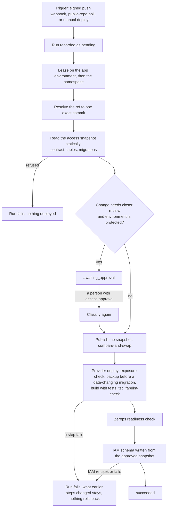

# Deployment gates: how a change reaches production

What a deploy of an application must pass before it serves traffic, and who or what approves it. Each gate says what it
checks, where, and what happens on failure. The runtime side is in [`security-runtime.md`](security-runtime.md); the
deploy flow itself is in [`overview.md`](overview.md#how-a-deploy-works). What follows from both for an organization
that runs its applications on fabrika is in [`security-guarantees.md`](security-guarantees.md).

Markers: **Built**: the code does it at this commit. **Decided, not built**: an ADR, spec or backlog item decides it,
and the code does not do it yet. **Known gap**: a backlog item names a hole in what is built.

Every gate below runs in Control or in the provider's deploy. None of them is a setting of the repository host.

## The deploy path

## Gates, in order

| #  | Gate                                      | Checks                                                                                                                                                                                                                                                                                                                                                                                                                                                                                          | Where                                                                                                                                                                                                                                                                                                 | On failure                                                                     | Status                              |
| -- | ----------------------------------------- | ----------------------------------------------------------------------------------------------------------------------------------------------------------------------------------------------------------------------------------------------------------------------------------------------------------------------------------------------------------------------------------------------------------------------------------------------------------------------------------------------- | ----------------------------------------------------------------------------------------------------------------------------------------------------------------------------------------------------------------------------------------------------------------------------------------------------- | ------------------------------------------------------------------------------ | ----------------------------------- |
| 1  | Push webhook                              | HMAC `X-Hub-Signature-256` with that GitHub connection's own secret, constant time; installation and repository owner match; only `push`, never a deletion                                                                                                                                                                                                                                                                                                                                      | [`push-event.ts`](../../packages/control/src/github/triggers/push-event.ts), [`webhook.ts`](../../packages/control/src/github/triggers/webhook.ts)                                                                                                                                                    | 401, no run                                                                    | Built                               |
| 2  | Trigger ref                               | Exact full ref or a `*` glob; a ref under `refs/heads/fabrika/` (MCP workspaces) is refused and never matched                                                                                                                                                                                                                                                                                                                                                                                   | [`ref-match.ts`](../../packages/control/src/ref-match.ts)                                                                                                                                                                                                                                             | 400 on write; no run                                                           | Built                               |
| 3  | Manual deploy                             | `deploy.trigger` at the coordinates (roles `deployer`, `operator`, `admin`). On a protected environment a person in the console (a user principal on a request without `Authorization`) names a full ref or a 40-hex commit. Any bearer, a person's own `px_` key included, asks under `deploy-request`: `person` takes a 40-hex commit, merged into the trigger ref by default, and parks the run for a person; `off` deploys it; `refuse` answers 403. A workspace ref is refused to everyone | [`api/runs.ts`](../../packages/control/src/api/runs.ts), [`approval/human.ts`](../../packages/control/src/approval/human.ts), [`fabrika.schema.ts`](../../packages/control/fabrika.schema.ts)                                                                                                         | 404 without the action; 403/400; re-checked at start, run fails                | Built                               |
| 4  | Registry edits of a protected environment | A key cannot repoint its trigger ref, domain or public origin, or change the app's repository, source, build command or config path                                                                                                                                                                                                                                                                                                                                                             | [`approval/human.ts`](../../packages/control/src/approval/human.ts) (`requirePersonToRedirect`, `requirePersonToPointDomain`, `requirePersonToPointPublicOrigin`)                                                                                                                                     | 403                                                                            | Built                               |
| 5  | Lease and supersede                       | One run per app environment at a time; a run older than one that already succeeded never starts                                                                                                                                                                                                                                                                                                                                                                                                 | [`lease.ts`](../../packages/control/src/lease.ts), [`run-lifecycle.ts`](../../packages/control/src/run-lifecycle.ts)                                                                                                                                                                                  | Deferred and re-queued; superseded runs fail                                   | Built                               |
| 6  | Preconditions                             | Environment open (no data operation running), namespace resource claims held, every declared secret has a value                                                                                                                                                                                                                                                                                                                                                                                 | [`run-lifecycle.ts`](../../packages/control/src/run-lifecycle.ts) (`assertDeclaredSecretsSet`)                                                                                                                                                                                                        | Run fails                                                                      | Built                               |
| 7  | Exact commit                              | The ref resolves to one commit. On Cloudflare the runner fetches that commit, detaches HEAD and compares before any install, with no mutable-ref fallback; a pushed branch that moved on is refused. On Zerops Control streams that commit's archive and re-checks the `zerops.yaml` digest                                                                                                                                                                                                     | [`run-lifecycle.ts`](../../packages/control/src/run-lifecycle.ts), [`runner.ts`](../../packages/runner-container/src/runner.ts), [ADR-0048](../decisions/0048-bind-cloudflare-delivery-to-the-recorded-commit.md), [ADR-0043](../decisions/0043-validate-and-render-one-zerops-descriptor-meaning.md) | Run fails                                                                      | Built                               |
| 8  | Source archive (Zerops)                   | Regular files only: symlinks, `.gitmodules` and other entries refused; at most 50,000 entries and 512 MiB. Control executes no repository code                                                                                                                                                                                                                                                                                                                                                  | [`source/archive.ts`](../../packages/control/src/github/source/archive.ts)                                                                                                                                                                                                                            | `archive_rejected`, run fails                                                  | Built                               |
| 9  | Contract required                         | A commit without `fabrika.contract.ts`                                                                                                                                                                                                                                                                                                                                                                                                                                                          | [`approval/read.ts`](../../packages/control/src/approval/read.ts), [`approval/publish.ts`](../../packages/control/src/approval/publish.ts)                                                                                                                                                            | `ContractMissing`, run fails before any provider call                          | Built                               |
| 10 | Framework window                          | The `@fabrika/app` release pinned in the application's `bun.lock` is one this platform release serves                                                                                                                                                                                                                                                                                                                                                                                           | [`approval/readers.ts`](../../packages/control/src/approval/readers.ts), [ADR-0062](../decisions/0062-a-platform-release-serves-older-framework-releases.md)                                                                                                                                          | `FrameworkReleaseRefused`, run fails                                           | Built                               |
| 11 | Static snapshot and migrations            | The contract is read by the static reader, which executes nothing. A migration file an earlier succeeded run applied must not change; a statement the runner's classifier refuses fails                                                                                                                                                                                                                                                                                                         | [`approval/read.ts`](../../packages/control/src/approval/read.ts)                                                                                                                                                                                                                                     | `AppliedMigrationsChanged` or `migrations-refused`, run fails before the build | Built                               |
| 12 | Refusals no approval overrides            | Connector edges that would break a consumer, mounts promised `backward` compatibility, relation fields an older framework would ignore, the provider's placement check                                                                                                                                                                                                                                                                                                                          | [`approval/publish.ts`](../../packages/control/src/approval/publish.ts), [`approval/enforcement.ts`](../../packages/control/src/approval/enforcement.ts)                                                                                                                                              | Run fails                                                                      | Built                               |
| 13 | Access approval                           | See [below](#who-approves)                                                                                                                                                                                                                                                                                                                                                                                                                                                                      | [`approval/`](../../packages/control/src/approval/)                                                                                                                                                                                                                                                   | `awaiting_approval`, nothing published                                         | Built                               |
| 14 | Publication                               | Compare-and-swap on the environment's generation and protection revision, under the lease; a lost swap classifies again (3 attempts)                                                                                                                                                                                                                                                                                                                                                            | [`approval/publish.ts`](../../packages/control/src/approval/publish.ts)                                                                                                                                                                                                                               | Run fails                                                                      | Built                               |
| 15 | Reserved names                            | An authored variable or secret under, or referencing, a framework variable name                                                                                                                                                                                                                                                                                                                                                                                                                 | [`run-lifecycle.ts`](../../packages/control/src/run-lifecycle.ts), [`managed-env.ts`](../../packages/provider-zerops/src/managed-env.ts)                                                                                                                                                              | Run fails                                                                      | Built                               |
| 16 | Exposure (Zerops)                         | Every service reads back without subdomain access; every bucket is one the platform created. Checked at deploy only                                                                                                                                                                                                                                                                                                                                                                             | [`provider-zerops/src/provider.ts`](../../packages/provider-zerops/src/provider.ts) (`verifyExposure`)                                                                                                                                                                                                | Operations alert, run fails                                                    | Built                               |
| 17 | Backup before data-changing migrations    | A migration that deletes, overwrites or may change stored data runs only after a backup is stored. Zerops: a `backup-database` step. Cloudflare: a `migrate` data operation (restrict, backup, verify, deploy, migrate, open); without the barrier the run is refused                                                                                                                                                                                                                           | [`provider-zerops/src/plan.ts`](../../packages/provider-zerops/src/plan.ts), [`run-lifecycle.ts`](../../packages/control/src/run-lifecycle.ts), [ADR-0050](../decisions/0050-approved-access.md), [ADR-0070](../decisions/0070-data-protection-of-an-application-environment-on-cloudflare.md)        | Run fails, nothing deployed                                                    | Built (not for `dev`)               |
| 18 | Build checks                              | The application's own tests, then a clean reinstall, `tsc`, `fabrika-check` at the approved checker release, and the schema check                                                                                                                                                                                                                                                                                                                                                               | [`build-recipe.ts`](../../packages/app/src/build-recipe.ts), [`provider-zerops/src/execution.ts`](../../packages/provider-zerops/src/execution.ts), [`provider-cloudflare/src/plan.ts`](../../packages/provider-cloudflare/src/plan.ts)                                                               | Build fails, run fails                                                         | Built                               |
| 19 | Readiness (Zerops)                        | The contract's health endpoint answers within 180 s before Zerops activates the version                                                                                                                                                                                                                                                                                                                                                                                                         | [`provider-zerops/src/execution.ts`](../../packages/provider-zerops/src/execution.ts)                                                                                                                                                                                                                 | Version not activated, run fails                                               | Built; Cloudflare has no equivalent |
| 20 | IAM schema                                | Written from the approved snapshot, never from the build artifact                                                                                                                                                                                                                                                                                                                                                                                                                               | [`run-lifecycle.ts`](../../packages/control/src/run-lifecycle.ts) (`applyApprovedSchema`)                                                                                                                                                                                                             | Run fails; the new version is already live                                     | Built                               |

Gate 18 guards against mistakes, not a hostile build: on Cloudflare the authored `pipeline.build` runs before it, and a
tamper-proof build needs a sandboxed runner ([`packages/provider-cloudflare/CLAUDE.md`](../../packages/provider-cloudflare/CLAUDE.md)).
The build has no database, so a Postgres-backed application test skips there
([backlog 232](../backlog/232-the-platform-build-runs-no-postgres-backed-test.md)).

## Who approves

Control reads each run's access snapshot and classifies it against the environment's published one
([ADR-0050](../decisions/0050-approved-access.md), [`approval/diff.ts`](../../packages/control/src/approval/diff.ts)). A
line **needs closer review** when the change steps off the paved road, for example: a new or widened `sql`, `unscoped`,
`connect` or link-issuing site, a contract that leaves the staged kit, an added or changed access view, database code
in a migration, or a migration statement not known to keep every stored value.

- **Only a protected environment waits.** `prod` is protected by default; staging and `dev` are not, and `dev` cannot
  be. A closer-review line on a protected environment parks the run in `awaiting_approval`. Any other change, a plain
  widening included, publishes at once.
- **Only a person approves.** `approvals.complete` needs `access.approve` at the coordinates, which lies outside
  `deploy.*`, so of the built-in roles only `admin` holds it. The caller must be a user principal on a console session:
  a key, a service principal, an OAuth or MCP token, a share link and a request with `Authorization` are refused
  ([`approval/human.ts`](../../packages/control/src/approval/human.ts) `requireHumanApprover`,
  [`approval/api.ts`](../../packages/control/src/approval/api.ts)). The proxy's `Sec-Fetch-Site` check admits the
  request from the console itself.
- **An approval is bound to one change.** It records the candidate's and the baseline's digests, so a different
  candidate or a moved baseline needs a new one. The approver sees the change, the endpoint surface and the access by
  role ([`approval/surface.ts`](../../packages/control/src/approval/surface.ts),
  [`approval/access-map.ts`](../../packages/control/src/approval/access-map.ts)).
- **Turning approval off** is `apps.environments.protect` under the same rule, in the console only, and approves no
  parked run.
- **A rollback is a new deploy** of an older commit, classified like any other
  ([ADR-0050 §6](../decisions/0050-approved-access.md#6-a-rollback-is-a-new-deploy)).

What approval does not cover:

- **A widening on the paved road.** A role that gains a declared action, a role opened to external people, a CSP
  that allows another origin, or a signed-in SPA that becomes public is a widening without closer review, and publishes
  at once even on a protected environment ([`approval/diff.ts`](../../packages/control/src/approval/diff.ts)). A
  procedure that becomes public does need closer review.
- **Configuration.** Variables (`app.manage`), secrets (`secret.manage`), an environment's domain and its cross-origin
  list are not access changes: whoever holds the action writes them, without approval, at the application's scope
  (not per environment). A Zerops secret is written to the live service at once; the rest reaches the environment at
  its next deploy; on Zerops a domain or cross-origin change also republishes the namespace proxy at once. Of the built-in roles only `admin`
  holds these actions, and a builder key may hold `app.manage` ([`control-rpc.ts`](../../packages/control/src/control-rpc.ts),
  [`fabrika.schema.ts`](../../packages/control/fabrika.schema.ts)). On a protected environment only a person names a
  new domain, as its trigger ref ([`approval/human.ts`](../../packages/control/src/approval/human.ts)); a key may still
  clear it. Control presents an environment's ops key only at the domain a provider deployed it to, so a domain no
  deploy reached receives none ([`ops-key.ts`](../../packages/control/src/ops-key.ts)).
- **Which commit.** A person's manual deploy of a protected environment from the console may name any branch, tag or
  commit of the repository; Control does not check that it descends from the trigger ref. Approval judges the access
  the commit declares, not how the commit was reviewed.

A non-person's manual deploy of a protected environment is its own approval request
([ADR-0050 §4](../decisions/0050-approved-access.md), [`approval/request.ts`](../../packages/control/src/approval/request.ts)):

- **Every bearer is a non-person.** A person is a user principal on a console request, one without `Authorization`
  ([`approval/human.ts`](../../packages/control/src/approval/human.ts) `isConsolePerson`). The run records it in
  `runs.by_person`; a run created before the column reads as its actor did (`user:` is a person).
- **The mode is the environment's `deploy-request`.** Under `person` (the default) the request names a 40-hex commit
  and parks in `awaiting_approval` whatever its lines, with nothing to compare when its contract is unchanged. Under
  `off` it deploys as a person's would; under `refuse` it answers 403. Push and poll runs never ask.
- **The commit must be merged by default.** Under `deployRequestCommits: merged` Control asks GitHub's compare whether
  the commit is reachable from the trigger branch or tag, or from the default branch when the trigger ref is a
  pattern or absent, and answers 400 when it cannot show it, a source error included. `any` admits any commit.
  The compare also carries the changed files with their patches (up to 300) between the commit and the branch, and
  Control reads at most 7 MiB of it. A commit far enough behind the branch exceeds that and is refused as a source that
  did not answer (`archive_rejected`): a person deploys it from the console, or the environment chooses `any`.
- **It expires.** The run's `approval_deadline` is its park time plus `requestTtlHours` (1–168, 24 by default), and
  every park sets a fresh one. A decision past it answers 410; the maintenance sweep fails the run with
  `failure_cause = 'expired'` and deploys nothing. A run parked before the column gets its deadline at the first
  sweep. An approval itself does not expire.
- **One or two people decide.** `approvers` (1 or 2 per category) applies the strictest of the run's waiting
  categories, `deploy-request` included for a request. With 2, the first approval is partial, a different person
  completes it, either may reject, and the same person twice changes nothing.
- **The restart check applies the same rule** when the run starts, under the mode then in force; a restore's own deploy
  is exempt.
- **The requester's person may approve by default.** `requesterMayApprove: false` (per category, the strictest of the
  waiting categories winning) makes someone other than the requester's person decide: the person behind an OAuth
  token or a person's own key cannot approve, only refuse. A service key has no person behind it that Control can
  name, since no token carries its issuer, so under `false` nobody approves its request and anyone may refuse it.

Any other action of a non-person that waits for a person is an **approval request**
([ADR-0083 §8](../decisions/0083-an-environment-chooses-what-waits-for-approval.md#8-an-approval-request-is-the-pending-registry-write),
[`approval/requests/`](../../packages/control/src/approval/requests/)). **Built:** the store, its decision and its
execution. No action goes through one yet: every kind is refused when a request is created (400), the procedures that
no request may ever name with their reason, every other one as not requestable yet.

- **Only a non-person asks.** `approvals.requests.create` takes a bearer (an agent's OAuth token or a key); a person in
  the console gets 409 and makes the change directly. The requester must hold the kind's action at the application,
  or `access.request` where the kind is one the requester cannot execute itself (only `admin` holds it, and no
  command-line preset carries it). The environment's mode for the kind's category is checked when the request is
  created: `refuse` answers 403.
- **Inert and exact.** The row holds the kind, the canonical input and its SHA-256, the coordinates, the requester
  (principal, credential, OAuth client and grant id from the verified token), the before-state the action depends on
  with its digest, and an absolute deadline `requestTtlHours` after creation. Nothing reads a pending row as authority.
- **The decision** (`approvals.requests.decide`) is a person's in the console with `access.approve` at the
  coordinates (or the IAM administration the kind names), posting the input digest the page showed (409 when it is
  not the stored one, 410 past the deadline). It is one conditional update on `pending`, so a second tap changes
  nothing. `requesterMayApprove` and `approvers` apply as they do to a parked deploy request.
- **Execution** follows the final approval in the same call, under the environment's deployment lease (409 while
  it is busy), with the approver's authority and the requester recorded beside them. Control judges the policy as it
  stands now and the before-state again; a stricter policy or a changed before-state closes the request `stale` and
  nothing runs. The operation id is recorded before the kind's first external effect; an execution that throws leaves
  the request `unknown`. A Control whose kind reads the stored input back to another digest (a release rolled back
  under the request, which drops a key it does not know) shows the request as one it cannot describe and closes an
  approved one `failed`: it never executes less than the person approved. A request whose kind or input this Control
  cannot describe can only be refused: the page offers no Approve, and an approval answers 409 and changes nothing.
- **The lifecycle** is `pending → approved | rejected | expired`, then `executing → executed | failed | unknown`, and
  `stale`. The maintenance sweep expires a pending request past its deadline, closes an approved one whose execution
  never started `failed` (nothing changed; the agent asks again), and follows an `unknown` one through its kind until
  it settles. It decides and executes nothing anew.
- **Audit.** A decision writes `auth.audit` (`access.approve` on the request, with the decision) under the person;
  an execution writes the kind's action with its outcome, the operation id and the requester.
- **Reading it.** The agent reads the state with `approvals.requests.get`, `fabrika control requests get <id> [--wait]`
  or the MCP tool `get_approval_request`; the person decides at `<console>/approvals/requests/<id>`, where text the
  agent wrote is escaped and marked. Fabrika sends no notification. The requester reads its request only through the
  credential that asked (the same principal and OAuth client, or no client for a key), so another agent of the same
  person does not; a person who may decide it reads any at those coordinates.

Known gap: an edited statement inside an already-declared `sql` site produces no closer-review line, so it publishes on
a protected environment without approval
([backlog 239](../backlog/239-a-changed-sql-statement-shows-no-closer-review-line.md)).

### A passkey on deciding

`stepUp` (`none` or `webauthn`, per category but `grants`, which IAM decides) makes deciding a pending item take a
passkey assertion bound to the decision ([ADR-0050 §5](../decisions/0050-approved-access.md),
[`approval/step-up.ts`](../../packages/control/src/approval/step-up.ts)). It is `webauthn` for `credentials` by default
and `none` elsewhere; the permissive preset sets `none` everywhere. A parked run or a request takes it when any category
it waits in says `webauthn` (`requiredStepUp`, beside `requiredApprovers`); a request of a category this Control does not
know takes it. `ApprovalDto.stepUp` and `ApprovalRequestDto.stepUp` say which applies.

- **The challenge.** The approval page asks `approvals.challenge` (a run: its id, the decision and both digests) or
  `approvals.requests.challenge` (a request: its id, the decision and its input digest). The same person, right and
  checks as the decision apply, so nobody is asked for a passkey for a decision Control would refuse; an item that
  takes none answers 409. Control builds the binding from the stored item,
  `control:approval:["run",<id>,<decision>,<candidate digest>,<baseline digest>]` or
  `control:approval:["request",<id>,<decision>,<input digest>]`, and asks IAM's `passkeys.challenge` with the
  approver's console token, over IAM's admin transport (`IAM_ADMIN`, the console's IAM gateway's). A person with no
  passkey gets `{ kind: 'no-passkey' }`, and the page links Account → Passkeys.
- **The check.** `approvals.complete` and `approvals.requests.decide` take the answer as `stepUp`. Before anything is
  written, Control rebuilds the binding from the item it decides and asks IAM's `passkeys.verify` with the approver's
  token, then checks that the verified person is the approver. A missing assertion answers 403 ("this decision takes a
  passkey"); a refusal by IAM, IAM out of reach, or another person's assertion answers 403 ("the passkey check
  failed"). Approving and refusing both take it: the binding names the decision, so an assertion for one never makes
  the other, nor decides another item. IAM consumes the challenge on its first use, so an assertion decides once; a
  decision that then fails (the lease busy, another decision first) takes a new one.
- **The record.** An approval of a run keeps `stepUp: { credentialId, at }` in its approval JSON (the partial one too);
  a request keeps `decided_step_up_credential_id`/`_at` and `partial_step_up_credential_id`/`_at`. The audit row of
  every decision carries the same. A passkey removed later does not touch a decided item. A request approved by its
  first approver before `stepUp` became `webauthn` closes `stale` at execution, as any stricter policy does.

## What is not a gate

- **The repository host's checks.** Control reads no CI status, check run or branch protection before it deploys. A
  team that relies on reviewed merges sets that up on GitHub, outside fabrika.
- **Anything after activation.** No health verdict follows a deploy, and nothing rolls back by itself; a cancellation
  never rolls back ([ADR-0044](../decisions/0044-zerops-delivery-ownership-and-recovery.md)). When the IAM schema write
  fails after the version went live, IAM keeps the previous roles, so a narrowing the new version declared is not in
  force and fresh tokens keep the old authority until a later deploy writes it
  ([backlog 226](../backlog/226-a-failed-iam-reconcile-leaves-a-narrowing-unapplied.md)).

## The platform's own releases

A platform release is a `v*` tag of this repository. `.github/workflows/release.yml` runs the full CI workflow
(`ci.yml`: quality, sharded backend tests on PostgreSQL 18, deployable builds, release artifacts) and publishes only when
it passes. `release:validate` requires the tag to equal the source version and to clear the relation-field floors, and
npm trusted publishing with provenance is bound to that workflow
([`release-process.md`](release-process.md)). An installation upgrades by moving the `fabrika.ref` of its own platform
repository, whose workflow deploys IAM and Operations, then the proxy, then Control; whoever may push that repository
approves an upgrade.

The release workflow's assurance covers the npm packages. An installation runs the git checkout its `fabrika.ref`
names, not those tarballs, so it relies on that ref (a tag of this repository) and on whoever may push the sidecar
repository, not on npm provenance. On Cloudflare the installation builds its runner image itself; no CI job builds it
([backlog 99](../backlog/99-no-check-builds-the-runner-image.md)). A platform upgrade does not upgrade applications:
each keeps the `@fabrika/*` release it pins until it raises the pin and deploys
([ADR-0062](../decisions/0062-a-platform-release-serves-older-framework-releases.md),
[backlog 266](../backlog/266-fleet-wide-framework-upgrades.md)).

## Decided, not built

| What                                                                               | Where it is decided                                                                                        |
| ---------------------------------------------------------------------------------- | ---------------------------------------------------------------------------------------------------------- |
| The access diff posted as a GitHub check on a pull request                         | [spec](../specs/access-diff-as-a-github-check.md)                                                          |
| A release watch window after a deploy, with a manual rollback                      | [spec](../specs/release-watch-window-and-rollback.md)                                                      |
| Automatic rollback of a suspect release                                            | [backlog 273](../backlog/273-automatic-rollback-of-a-suspect-release.md)                                   |
| Browser journeys as a stage gate and production checks                             | [backlog 268](../backlog/268-opice-journeys-as-a-stage-gate-and-production-checks.md)                      |
| Destructive-change rules for application migrations                                | [backlog 98](../backlog/98-application-migrations-have-no-destructive-change-rules.md)                     |
| A Cloudflare deploy that keeps the account token away from repository code         | [backlog 86](../backlog/86-a-cloudflare-deploy-holds-the-account-token-beside-the-repositorys-code.md)     |
| A redelivered push webhook that does not create a second run                       | [backlog 204](../backlog/204-a-redelivered-push-webhook-creates-a-second-run.md)                           |
| An environment's default branch checked like a trigger ref                         | [backlog 297](../backlog/297-control-accepts-any-default-branch.md)                                        |
| A narrowing applied to IAM when its reconcile fails after the version went live    | [backlog 226](../backlog/226-a-failed-iam-reconcile-leaves-a-narrowing-unapplied.md)                       |
| Secrets, variables, data, registry, grant and key writes through approval requests | [ADR-0083 §8 and its rollout](../decisions/0083-an-environment-chooses-what-waits-for-approval.md#rollout) |
