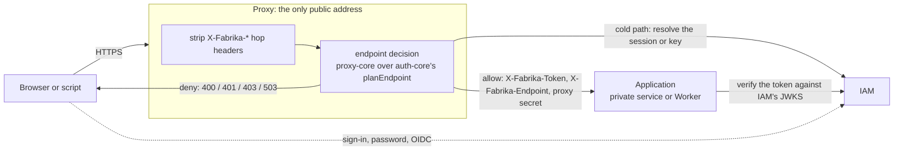

# Runtime security: how a request reaches an application

What stops an application from doing something it should not while it serves requests. Each section says what is
checked, where, and what happens on failure, and points to the code or ADR. The deploy side is in
[`security-deployment.md`](security-deployment.md). What follows from both for an organization that runs its
applications on fabrika, scenario by scenario, is in [`security-guarantees.md`](security-guarantees.md).

Markers: **Built**: the code does it at this commit. **Decided, not built**: an ADR, spec or backlog item decides it,
and the code does not do it yet. **Known gap**: a backlog item names a hole in what is built.

The vocabulary (enforcement, authorization, admission) is defined in
[`overview.md`](overview.md#how-auth-works). The decision itself is
[ADR-0022](../decisions/0022-the-proxy-is-the-only-enforcement-point.md).

## The request path

## 1. The proxy is the only public address

**Built.** Every request to an application passes one proxy, which makes the one enforcement decision.

| Provider   | The proxy                                                                                                                                                                        | How the application stays private                                                                                                                                                                                                                                                                                                                                                                                                                           |
| ---------- | -------------------------------------------------------------------------------------------------------------------------------------------------------------------------------- | ----------------------------------------------------------------------------------------------------------------------------------------------------------------------------------------------------------------------------------------------------------------------------------------------------------------------------------------------------------------------------------------------------------------------------------------------------------- |
| Zerops     | Caddy plus a Bun auth service on loopback, one per deployment namespace ([`packages/proxy/`](../../packages/proxy/src/main.ts))                                                  | The application service has no public subdomain. The deploy step `verify-exposure` reads back every declared service and fails the run, with an Operations alert, when one has subdomain access or a bucket lacks the platform's provenance ([`provider.ts`](../../packages/provider-zerops/src/provider.ts)). The manifest compiler refuses `enableSubdomainAccess` and a public bucket ([`manifest.ts`](../../packages/provider-zerops/src/manifest.ts)). |
| Cloudflare | A proxy Worker per application environment, running the same `@fabrika/proxy-core` code in-process ([`proxy-worker.ts`](../../packages/provider-cloudflare/src/proxy-worker.ts)) | The application Worker has no route and `workers_dev`/`preview_urls` off; the deployer refuses a generated config otherwise ([`bounds.ts`](../../packages/provider-cloudflare/src/bounds.ts)). It is reachable only through the proxy's `APP` service binding.                                                                                                                                                                                              |

- **The manifest is baked into the proxy's deploy artifact and fails closed.** A manifest that does not parse stops the
  Zerops proxy from starting; a Cloudflare proxy without a manifest, an IAM binding or an issuer answers a fixed 503
  ([`proxy-worker.ts`](../../packages/provider-cloudflare/src/proxy-worker.ts)). Endpoint rows are never compiled into
  Caddy route matchers ([ADR-0022 rule 2](../decisions/0022-the-proxy-is-the-only-enforcement-point.md#2-caddy-owns-http-correctness-and-gets-no-vote-on-authorization)).
- **The proxy holds no durable state.** Its token cache is in memory, per process
  ([ADR-0022 rule 1](../decisions/0022-the-proxy-is-the-only-enforcement-point.md#1-only-the-proxy-is-publicly-routed)).
  A process that holds a token minted from a session or a key reuses it until 30 s before it expires, but only while
  its last read of IAM's revocation feed is under 5 s old and lists no revocation of the token's subject that could postdate
  its minting; otherwise it mints again. So after a revocation a warm process may still admit that caller for up
  to 5 s, and a proxy whose feed read fails admits nothing from its cache
  ([`revocations.ts`](../../packages/proxy-core/src/revocations.ts), [`authorize.ts`](../../packages/proxy-core/src/authorize.ts)).
- **Exposure is refused at each deploy and watched between deploys.** `verify-exposure` refuses a deploy
  ([`plan.ts`](../../packages/provider-zerops/src/plan.ts)); Control's maintenance pass (every five minutes on Zerops)
  runs the same read-back through the provider's `exposure.check` and raises one `FabrikaExposureDetected` error event
  in the application's own Operations when what is exposed changes, so a subdomain or a bucket made public in the
  Zerops GUI between deploys is reported within a pass. The pass does not undo the exposure; the next deploy refuses it
  ([`exposure-watch.ts`](../../packages/control/src/exposure-watch.ts)).
- **A caller cannot forge what the proxy asserts.** Before the decision, the proxy deletes every `X-Fabrika-*` hop
  header (`FABRIKA_HOP_HEADERS`: token, client address, endpoint, delegation grant, proxy secret), `X-Request-Id` and
  the forwarding headers ([`wire.ts`](../../packages/auth-core/src/wire.ts),
  [`caddy.ts`](../../packages/proxy/src/caddy.ts)).
- **Known gap ([backlog 86](../backlog/86-a-cloudflare-deploy-holds-the-account-token-beside-the-repositorys-code.md)).**
  On Cloudflare the deploy runs repository code beside the account-wide API token, so that code could bind or route the
  application Worker itself. The private Worker is a strong default there, not a boundary.

## 2. The endpoint contract, checked at the proxy

**Built.** The contract (`fabrika.contract.ts`) compiles to an endpoint table; the proxy reads only that table
(`contractProxyTable`, [`packages/proxy-core/src/manifest.ts`](../../packages/proxy-core/src/manifest.ts)). The decision
is [`authorize.ts`](../../packages/proxy-core/src/authorize.ts) over `planEndpoint`
([`endpoints.ts`](../../packages/auth-core/src/endpoints.ts)). In order:

| Check                                                                                                            | On failure                                                                                                                                                                                                                               |
| ---------------------------------------------------------------------------------------------------------------- | ---------------------------------------------------------------------------------------------------------------------------------------------------------------------------------------------------------------------------------------- |
| The raw path is canonical, and the forwarded method, host and URI are present                                    | 400 `non_canonical_path`, 403 `bad_forward`                                                                                                                                                                                              |
| One endpoint is selected: the most specific row wins, with no fall-through                                       | 403 `no_endpoint`                                                                                                                                                                                                                        |
| A cross-origin preflight, planned for the requested method, comes from an origin the environment lists           | 403 `cross_origin`                                                                                                                                                                                                                       |
| An anonymous row (health, webhook, public procedure): the `Content-Type`, then the origin of a form post         | 400 `content_type`, 403 `cross_origin`                                                                                                                                                                                                   |
| A credential: a `px_` key in `Authorization` is exchanged at IAM; otherwise the session cookie                   | an invalid key: 401; a principal IAM refuses: 403; no session on a row a person may call: 302 to sign-in for a navigation, 401 with `loginUrl` for a fetch; no credential on any other row, or from a listed origin: 401 `no_credential` |
| The caller kind (person, machine, another app, share link) is one the row admits                                 | 403 `caller_kind`                                                                                                                                                                                                                        |
| The caller's grants meet the row's requirement (`satisfies`)                                                     | 403 `insufficient_permission`                                                                                                                                                                                                            |
| Admission: a session request that is not `GET` carries `Sec-Fetch-Site: same-origin`; the `Content-Type` matches | 403 `cross_site`, 400 `content_type`                                                                                                                                                                                                     |
| A row that manages members or creates scopes gets a fresh single-use delegation grant from IAM                   | 403 `delegation_refused`                                                                                                                                                                                                                 |
| Any exception in the decision                                                                                    | 403 `internal_error`; IAM unreachable: 503                                                                                                                                                                                               |

An installation service's row that admits an OAuth resource token (Control's MCP endpoint) verifies it locally instead
of exchanging a key: 401 `invalid_token`, 403 `insufficient_scope`.

On allow, the proxy names the selected row and the digest of its rules in `X-Fabrika-Endpoint`
([`endpoint-digest.ts`](../../packages/auth-core/src/endpoint-digest.ts)), injects the token, and applies the response
header policy ([`packages/proxy-core/src/headers.ts`](../../packages/proxy-core/src/headers.ts)). The manifest parser
recomputes each row's digest and refuses a mismatch.

**Abuse limits.** A public procedure takes the rate buckets (per client, per caller, per endpoint, bytes per hour), the
challenge and the time budget its contract declares. Without a declaration a public mutation gets 10 requests a minute
per client and 100 per endpoint, a public query no bucket; every request has a body byte budget and the 10 s time
budget ([`build.ts`](../../packages/app/src/contract/build.ts), [`defaults.ts`](../../packages/app/src/contract/defaults.ts),
[`public.ts`](../../packages/app/src/implement/public.ts), [`bounded.ts`](../../packages/app/src/implement/bounded.ts)).
On Zerops the balancer does not pass an IPv4 client's address, so an application's per-client bucket there is one
bucket for every IPv4 caller: by default they share 10 mutations a minute
([`client-address.ts`](../../packages/app/src/implement/client-address.ts)). IAM throttles sign-in and recovery per
account and per installation, and per client only where the ingress reports the client's address, which on Zerops it
does not ([`human-authentication.md`](human-authentication.md)).

**Files.** A file kind that asks for a malware scan is refused on Cloudflare, where `clamscan` cannot run
([backlog 215](../backlog/215-file-scanning-on-cloudflare.md)).

### The application checks the proxy's word

**Built.** The application makes no enforcement decision; its generated entry (`boot`) refuses a request the proxy did
not admit, in this order ([`dispatch.ts`](../../packages/app/src/implement/dispatch.ts)):

1. **Proxy secret.** On Zerops a sibling service in the namespace can dial the application, so a request without the
   environment's `X-Fabrika-Proxy-Secret` is a 403 before anything else (only a `health` row is exempt). On Cloudflare
   the Worker forwards to the environment's Durable Object with the secret, and the object answers an empty 404
   without it ([`application.ts`](../../packages/app/src/cloudflare/application.ts)). The application does not boot
   without a secret of at least 32 characters ([`boot.ts`](../../packages/app/src/implement/boot.ts)).
2. **Canonical path** (400), then **`X-Fabrika-Endpoint`** must name the row the application's own `planEndpoint`
   selects, with the same digest (503 otherwise).
3. **Token**, verified locally against IAM's JWKS for issuer and audience
   ([`packages/jwks/src/verifier.ts`](../../packages/jwks/src/verifier.ts)), then caller kind, requirement, admission
   and strict input.
4. **Authorization** inside the handler: the access form (`on`, `in`, `over`, `app`) checks the action on the object
   and its containers, and answers 404 for both "missing" and "not yours". `@fabrika/db` adds the scope to every
   statement and refuses an unscoped query tree ([`packages/db/src/guard.ts`](../../packages/db/src/guard.ts)). The
   data layer is a guard against mistakes, not a boundary against hostile code in the same process
   ([`packages/db/CLAUDE.md`](../../packages/db/CLAUDE.md)).

## 3. Identity lives in IAM; the application never sees a person's credential

**Built.**

- **Sign-in happens at IAM's host only.** Passwords and OIDC never reach an application
  ([`human-authentication.md`](human-authentication.md)). A browser reaches an application through a one-time code
  that only the proxy redeems, bound to a browser-held S256 verifier; no cookie is shared between hosts
  ([`handoff.ts`](../../packages/proxy-core/src/handoff.ts), [ADR-0023](../decisions/0023-one-session-per-host.md),
  [`cross-host-sso.md`](cross-host-sso.md)).
- **The proxy removes every Fabrika session cookie** (`__Host-px_*`) before the application and keeps the
  application's own cookies ([`caddy.ts`](../../packages/proxy/src/caddy.ts),
  [`handoff.ts`](../../packages/proxy-core/src/handoff.ts)).
- **A `px_` API key never reaches the application.** On a credentialed endpoint the proxy replaces `Authorization` with
  the minted token; on an anonymous endpoint it deletes it. Two rows keep the caller's `Authorization`: a webhook row
  declared `authorization: 'forward'`, never with a value carrying `px_`; and on Cloudflare the platform's ops row
  (`POST /__fabrika/ops/*`), which reaches only framework code that authenticates the ops key and never boots the
  application ([ADR-0069](../decisions/0069-control-reaches-an-application-environments-object.md))
  ([`caddy.ts`](../../packages/proxy/src/caddy.ts), [`proxy-worker.ts`](../../packages/provider-cloudflare/src/proxy-worker.ts),
  [`credentials.ts`](../../packages/proxy-core/src/credentials.ts)).
- **A token is good for one application in one environment.** Its audience is `<app>@<env>` and it lives 300 s
  ([`token.ts`](../../packages/auth-core/src/token.ts),
  [ADR-0022 rule 6](../decisions/0022-the-proxy-is-the-only-enforcement-point.md#6-an-application-token-is-minted-for-one-application-in-one-environment)).
  A removed member or revoked link keeps access until its cached token expires.
- **The proxy's logs do not carry credentials.** Caddy's access log drops the token, delegation, proxy secret,
  `Cookie` and `Authorization` headers and redacts the handoff code; Cloudflare proxy invocation logs are off
  ([`caddy.ts`](../../packages/proxy/src/caddy.ts), [`proxy.ts`](../../packages/provider-cloudflare/src/proxy.ts)).
  This is the proxy's guarantee, not every service's: three service log lines print a provider's error text without
  redaction ([backlog 207](../backlog/207-three-service-log-lines-skip-redaction.md)).
- **Jobs, webhooks, public procedures and connectors hold only declared authority, for at most 30 days.** Each gets a
  key from the approved contract and exchanges it for a token carrying only its declared actions. A deploy reissues a
  key with less than half of its 30 days left, and so does Control's maintenance pass, which writes it to the running
  version without a deploy where the provider can (Cloudflare); the replaced key stays valid until its own expiry. On
  another provider an environment not deployed for 30 days loses its workloads' keys. A week before a key the running
  version holds expires, Control warns the application's Operations daily, and a refused key is an Operations issue of its
  own ([operations errors](operations-errors.md#application-server-reports),
  [`packages/control/src/workload-credentials.ts`](../../packages/control/src/workload-credentials.ts),
  [`workload-key-rotation.ts`](../../packages/control/src/workload-key-rotation.ts),
  [ADR-0063](../decisions/0063-a-public-procedure-runs-as-its-own-workload.md)).
- **Sessions.** A password login lasts 30 days, an OIDC login the cap below
  ([`sessions.ts`](../../packages/iam/src/auth/sessions.ts)); an application
  session is its child, and revoking the login ends every child at once. A disabled principal mints no token
  ([`tokens.ts`](../../packages/iam/src/tokens.ts)), but keeps its sessions, so enabling it again can restore an
  unexpired one ([`human-authentication.md`](human-authentication.md)). An OIDC login, and every application session
  derived from it, is usable only for the installation's cap after its sign-in (`FABRIKA_IAM_OIDC_SESSION_HOURS`,
  12 h by default, [`auth.ts`](../../packages/iam/src/auth.ts)); then IAM sends the browser back to the provider. A
  token minted from it ends at the cap too. So a person disabled only at the OIDC provider keeps their sign-in until the
  cap, unless an administrator disables or signs out the principal first; a key they issued or approved (up to 30 days)
  lasts until it is revoked or the person is disabled in IAM.
- **Only an enrolled administrator has a second factor in IAM.** An administrator may enrol an authenticator app
  (TOTP); every later sign-in then asks for a code, an OIDC one included
  ([`human-authentication.md`](human-authentication.md#two-step-sign-in-for-administrators)). Enrolment is optional,
  and nobody else can enrol. Everyone else has a second factor only where an OIDC provider requires one; a password
  login is one factor. The minimum password length is an installation
  administrator's setting, at least 4 on Bun and 15 on a Worker, and a Worker hashes with a lower PBKDF2 cost
  ([`human-authentication.md`](human-authentication.md),
  [backlog 201](../backlog/201-cloudflare-passwords-are-hashed-below-the-owasp-work-factor.md)). Approving an access
  change needs a console session, not a fresh sign-in ([`approval/human.ts`](../../packages/control/src/approval/human.ts)).
- **A terminal signs a person in on an application's word.** On an enrolled shared computer, an application that
  declares an identification page asserts who stands there, and IAM signs that person in under the terminal's ceiling
  ([ADR-0067](../decisions/0067-a-terminal-signs-a-person-in-on-an-application-s-word.md)). Such an application is
  trusted to identify people; a membership change made from a terminal outlives the terminal session
  ([backlog 223](../backlog/223-terminal-authority-outlives-the-terminal-in-a-membership-change.md)).

### What an application environment holds

An application never receives a person's password, session cookie or `px_` key. It does hold these machine
credentials, as environment variables of its own service or Worker, so code running in it can use them:

| Credential                                       | What it allows                                                                         | Lifetime and rotation                                                                                 | Where                                                                           |
| ------------------------------------------------ | -------------------------------------------------------------------------------------- | ----------------------------------------------------------------------------------------------------- | ------------------------------------------------------------------------------- |
| Proxy secret (`FABRIKA_PROXY_SECRET`)            | Proves a request came from the proxy, to this environment only                         | No rotation verb; by hand ([runbook](key-rotation.md#the-proxy-secret-of-an-application-environment)) | [`proxy-secret.ts`](../../packages/control/src/proxy-secret.ts)                 |
| Workload keys (`FABRIKA_<KIND>_<NAME>_KEY`)      | A token with the declared actions of one job, webhook or public procedure              | 30 days, reissued past half-life by a deploy, or by maintenance on Cloudflare                         | [`workload-credentials.ts`](../../packages/control/src/workload-credentials.ts) |
| Connector keys (`FABRIKA_CONNECT_<IMPORT>_KEY`)  | Calls to the procedures another application exports to it                              | As workload keys; revoked when the last import goes                                                   | [`connectors.ts`](../../packages/control/src/connectors.ts)                     |
| Membership transport key (`FABRIKA_IAM_RPC_KEY`) | Pins IAM's membership calls to this application; adds no authority, mints nothing      | As workload keys                                                                                      | [`membership-transport.ts`](../../packages/control/src/membership-transport.ts) |
| Signed-token keys (`FABRIKA_TOKEN_KEYS`)         | Sign and verify the application's own signed tokens (`ctx.tokens.sign`, a token input) | Rotated on request (`apps.environments.rotateTokenKey`)                                               | [`tokens.ts`](../../packages/app/src/implement/tokens.ts)                       |
| Its own database credentials (Zerops)            | Its own role family and schema                                                         | Provisioned per application                                                                           | [ADR-0017](../decisions/0017-service-owned-postgres-migrations.md)              |
| Its declared secrets                             | Whatever the secret is for                                                             | Set by a person with `secret.manage`                                                                  | [§6](#6-secrets)                                                                |

The ops key, which drives backups and data operations on Cloudflare, is not among them: the application holds only its
SHA-256 digests ([`ops-key.ts`](../../packages/control/src/ops-key.ts),
[ADR-0069](../decisions/0069-control-reaches-an-application-environments-object.md)). Code that takes over an
application process therefore acts as that application: with its data, its secrets and its declared machine authority.
It also sees each caller's token for that application and can keep it until it expires (at most 5 minutes), spending
it on what IAM accepts
from it without a delegation grant: issuing and revoking share links the caller could issue
([`membership-http.ts`](../../packages/iam/src/membership-http.ts)). The known gaps in §5 name what may reach further.

## 4. Audit

| What                                                                                                                                                                                                                                                                                                                                                         | Status                     | Where                                                                                                                                                    |
| ------------------------------------------------------------------------------------------------------------------------------------------------------------------------------------------------------------------------------------------------------------------------------------------------------------------------------------------------------------ | -------------------------- | -------------------------------------------------------------------------------------------------------------------------------------------------------- |
| Sign-in, refused sign-in and sign-out, written before the answer (`auth_log`)                                                                                                                                                                                                                                                                                | Built, always on           | [`repositories/audit.ts`](../../packages/iam/src/repositories/audit.ts), [`packages/iam/CLAUDE.md`](../../packages/iam/CLAUDE.md)                        |
| Every change IAM owns (grants, members, links, principals, credentials) in the change's own transaction (`audit_events`); every `/admin/*` request of an administrator, before it runs                                                                                                                                                                       | Built, always on           | [`packages/iam/CLAUDE.md`](../../packages/iam/CLAUDE.md)                                                                                                 |
| Retention: `auth_log` 30 days by default; `audit_events` forever unless `AUDIT_RETENTION_DAYS` is set                                                                                                                                                                                                                                                        | Built                      | [`retention.ts`](../../packages/iam/src/retention.ts)                                                                                                    |
| Control's and Operations' own mutations (registry, secrets, deploys) through `IamRpc.audit`, filed under the caller's verified application                                                                                                                                                                                                                   | Built, best effort         | [`packages/auth-core/src/rpc.ts`](../../packages/auth-core/src/rpc.ts), [`packages/control/src/api/vault.ts`](../../packages/control/src/api/vault.ts)   |
| An application's own audit: opt-in. The application writes its audit rows into its own table in the invocation's transaction, so a row commits only with the change (an audited export keeps its row only when its file goes out). There is no framework audit API, and the rows live in the application's own database, which its own code can also change. | Built (as ordinary tables) | [`table-and-migration.md`](../../packages/app/skill/references/table-and-migration.md), [`endpoint.md`](../../packages/app/skill/references/endpoint.md) |
| Durable, idempotent delivery of Control's and Operations' events (an outbox)                                                                                                                                                                                                                                                                                 | Decided, not built         | [backlog 71](../backlog/71-deliver-domain-audit-events-durably.md)                                                                                       |

What the audit records prove, and what they do not:

- **A domain event's application is verified; its actor is the caller's word.** `IamRpc.audit` files an event under
  the application of the caller's verified token, but takes the principal, credential and action fields as sent, so
  code running in an application (or in Control or Operations) can write a misleading actor into its own stream. IAM's
  own `audit_events` and `auth_log` rows are written by IAM from what it changed
  ([`packages/iam/src/rpc.ts`](../../packages/iam/src/rpc.ts), [`packages/iam/CLAUDE.md`](../../packages/iam/CLAUDE.md)).
- **Audit rows live in IAM's own database.** Whoever administers that database, or controls the IAM service, can
  change or delete them; fabrika keeps no independent append-only copy. An organization that needs one exports the
  rows (`audit.list`) to storage it controls.
- **"Always on" has one known exception:** an OIDC discovery or token request that throws skips the refusal path, so
  that failed sign-in may answer 500 without an `auth_log` row
  ([backlog 206](../backlog/206-iam-token-and-oidc-hardening.md)).

Known gaps: on Zerops a caller-supplied `cf-ray` can become an SDK audit event's request id
([backlog 92](../backlog/92-an-app-audit-event-takes-its-correlation-id-from-a-caller-cf-ray-on-zerops.md)), and a
secret edited in the Zerops GUI leaves no trace in fabrika's audit
([ADR-0004](../decisions/0004-secrets-live-in-the-platform.md#consequences)).

## 5. Isolation

**Between installations. Built.** An installation is single-tenant: one client, one cloud account or project, its own
IAM, database, vault key and signing keys, generated by its own `init`/`install`
([`overview.md`](overview.md#why-it-exists-in-this-shape),
[`install-secrets.ts`](../../packages/provider-zerops/src/installation/install-secrets.ts)). Two installations share no
service.

**Inside an installation, between services.** Hops inside a Zerops project are plain HTTP on the project's private
network: the proxy to an application, which the proxy secret authenticates
([§2](#the-application-checks-the-proxys-word)), and IAM to Control's `http://control:3000`, which the installation's
mail key authenticates ([ADR-0064](../decisions/0064-applications-reach-the-platform-over-a-receiver-verified-transport-key.md)).
Their confidentiality rests on Zerops' network isolation.

**Between applications in one installation:**

| Boundary                                                                                                                                                                                                                                                                                                                                                                                                             | Status                                                                                                                                               | Where                                                                                                                                                                                                                                       |
| -------------------------------------------------------------------------------------------------------------------------------------------------------------------------------------------------------------------------------------------------------------------------------------------------------------------------------------------------------------------------------------------------------------------- | ---------------------------------------------------------------------------------------------------------------------------------------------------- | ------------------------------------------------------------------------------------------------------------------------------------------------------------------------------------------------------------------------------------------- |
| A token's audience is one `<app>@<env>`; an application token cannot issue or revoke keys                                                                                                                                                                                                                                                                                                                            | Built                                                                                                                                                | [`token.ts`](../../packages/auth-core/src/token.ts), [`packages/iam/src/rpc.ts`](../../packages/iam/src/rpc.ts)                                                                                                                             |
| A proxy secret per application environment                                                                                                                                                                                                                                                                                                                                                                           | Built                                                                                                                                                | [`packages/control/src/proxy-secret.ts`](../../packages/control/src/proxy-secret.ts)                                                                                                                                                        |
| Zerops: variables at service level only (`envIsolation: 'service'`); a reference may name only the application's own or shared services                                                                                                                                                                                                                                                                              | Built; does not bound application code on Zerops ([backlog 198](../backlog/198-an-in-container-env-write-may-reach-another-services-credentials.md)) | [`compile.ts`](../../packages/provider-zerops/src/compile.ts), [`packages/provider-zerops/CLAUDE.md`](../../packages/provider-zerops/CLAUDE.md)                                                                                             |
| Zerops Postgres: a role family per application; the serving process drops the provisioning credential before application code loads                                                                                                                                                                                                                                                                                  | Built; does not bound application code on Zerops ([backlog 198](../backlog/198-an-in-container-env-write-may-reach-another-services-credentials.md)) | [`application-postgres-migrations.ts`](../../packages/platform-node/src/application-postgres-migrations.ts), [`packages/app/src/bun.ts`](../../packages/app/src/bun.ts), [ADR-0017](../decisions/0017-service-owned-postgres-migrations.md) |
| Cloudflare: one Durable Object with its own SQLite per environment; another application's resource names are refused at deploy                                                                                                                                                                                                                                                                                       | Built (names are a rule, not an ownership record)                                                                                                    | [ADR-0065](../decisions/0065-an-application-on-cloudflare-runs-in-one-durable-object-per-environment.md), [`bounds.ts`](../../packages/provider-cloudflare/src/bounds.ts)                                                                   |
| Deployment namespaces: `cheap` and `mid` share one project and its proxy between applications; `cheap` also shares one Postgres service, where a contract application's SQL runs as its own role family and reaches only its `app_<id>` schema; only `full` is one application's own project                                                                                                                         | Built, by preset                                                                                                                                     | [`deployment-namespaces.md`](deployment-namespaces.md#presets), [ADR-0014](../decisions/0014-provider-owned-deployment-namespaces.md)                                                                                                       |
| Outbound calls: a handler's request starts only at a declared `egress` origin; a cron job's `egress: 'public'` reaches only public hosts, each redirect hop checked again. A declared site's redirect is followed only to an origin it declares; between two declared origins a hop drops `Authorization`, `Proxy-Authorization` and `Cookie`, not a custom credential header, and a 307 or 308 sends the body again | Built, not a sandbox                                                                                                                                 | [`egress.ts`](../../packages/app/src/implement/egress.ts), [`public-egress.ts`](../../packages/auth-core/src/public-egress.ts), [ADR-0075](../decisions/0075-a-cron-job-may-reach-the-public-web.md)                                        |

Known gaps:

- On Zerops, code in a container obtains every variable of every service in its project through an in-container
  environment write, so applications in a `cheap` or `mid` namespace are not isolated from each other, and the
  launcher's protection does not hold against an application that has `sudo`
  ([backlog 198](../backlog/198-an-in-container-env-write-may-reach-another-services-credentials.md)).
- Deleting an application or environment leaves its vault rows and IAM keys valid
  ([backlog 203](../backlog/203-deleting-an-app-or-env-leaves-its-secrets-and-iam-keys.md)).
- A `dev` sandbox's launcher runs authored commands as root with the application's secrets
  ([backlog 251](../backlog/251-the-launcher-runs-authored-commands-as-root.md)).
- On Cloudflare, repository code holds the account token at deploy (backlog 86, above).
- A bootstrap admin mailbox (`IAM_BOOTSTRAP_ADMINS`) holds installation administration whatever its grants say, until
  the list is emptied ([`resolve.ts`](../../packages/iam/src/resolve.ts),
  [backlog 64](../backlog/64-close-the-bootstrap-admission-hatch-automatically.md)).
- A user administrator scoped to some applications reads every principal and session of the installation
  ([backlog 175](../backlog/175-a-scoped-user-administrator-lists-every-principal.md)).
- A public procedure accepts any ID a verified token carries for any table it reaches
  ([backlog 209](../backlog/209-a-public-procedure-binds-a-token-id-to-its-purpose.md)).
- Operations' webhooks and health checks resolve DNS without refusing private addresses
  ([backlog 38](../backlog/38-add-dns-safe-operations-egress.md)).
- A Worker on the same Cloudflare account can start its own runner containers
  ([backlog 89](../backlog/89-another-worker-can-still-start-its-own-runner-containers.md)).
- IAM's and Control's hosts send no HSTS, and a cross-origin list admits `http://` for any host
  ([backlog 163](../backlog/163-the-installation-hosts-send-no-hsts.md),
  [backlog 189](../backlog/189-cross-origin-endpoints-review-follow-ups.md), item 1).

## 6. Secrets

**Built** ([ADR-0004](../decisions/0004-secrets-live-in-the-platform.md)).

- **A secret enters as a value and is never read back over the API.** Every secret route needs `secret.manage` on the
  application; responses carry only a reference ([`control-rpc.ts`](../../packages/control/src/control-rpc.ts),
  [`packages/control/src/api/vault.ts`](../../packages/control/src/api/vault.ts)). No API accepts a reference.
- **Zerops: the platform holds the value**, written as a sensitive service-level variable; fabrika stores only a
  `zerops:` reference ([`packages/provider-zerops/src/control.ts`](../../packages/provider-zerops/src/control.ts)).
  **Invariant:** fabrika never writes an application secret at project level; the compiled project entry has no
  variables ([`compile.ts`](../../packages/provider-zerops/src/compile.ts)). An application-scoped secret (all
  environments) is refused there ([backlog 10](../backlog/10-app-scope-secrets-on-zerops.md)).
- **Cloudflare and `dev` environments: Control's vault holds the value**, AES-256-GCM with a data key per value wrapped
  by the installation's KEK ([`packages/control/src/vault.ts`](../../packages/control/src/vault.ts)). A deploy hands
  declared secrets to the Worker as Worker secrets
  ([`managed-secrets.ts`](../../packages/provider-cloudflare/src/managed-secrets.ts)). Losing the KEK is unrecoverable.
  The envelope carries no associated data: what ties a value to its application and name is the row's scope and label,
  checked on every read (`getSecretForPurpose`), so a writer of Control's database who moves a sealed value into
  another row moves the secret with it; binding the value to its row is deferred
  ([backlog 300](../backlog/300-a-vault-value-is-not-bound-to-its-row.md)). The KEK is rotated with Control stopped by
  `rotate-vault-key`, which re-wraps every row in one transaction and succeeds only when every row opens with the new
  key and none with the old one ([runbook](key-rotation.md#the-vault-key-kek)). It runs on Zerops only: on Cloudflare
  no command rotates the KEK.
- **Not every credential is in the vault.** Queued IAM mail (reset, enrollment and invitation links) is stored in
  plain text in Control's database until it is sent
  ([backlog 202](../backlog/202-relayed-mail-content-is-plaintext-at-rest.md)).
- **A deploy whose declared secrets lack a value fails before any provider step** (Zerops: Control,
  `assertDeclaredSecretsSet` in [`run-lifecycle.ts`](../../packages/control/src/run-lifecycle.ts); Cloudflare: the
  runner, before its first step, `assertDeclaredSecrets` in
  [`provider.ts`](../../packages/provider-cloudflare/src/provider.ts)). Run logs pass through `redactKnownSecrets`. The application's framework
  variables leave `process.env` before its code loads, and its error reports are scrubbed of secret values
  ([`packages/app/CLAUDE.md`](../../packages/app/CLAUDE.md)).
- **An application cannot name a platform variable.** Authored variables and secrets under a framework name, or
  referencing one, are refused ([`packages/control/src/api/registry/validation.ts`](../../packages/control/src/api/registry/validation.ts)).
