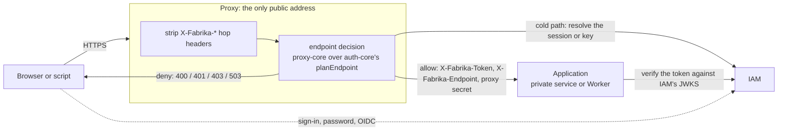

# Runtime security: how a request reaches an application

What stops an application from doing something it should not while it serves requests. Each section says what is
checked, where, and what happens on failure, and points to the code or ADR. The deploy side is in
[`security-deployment.md`](security-deployment.md).

Markers: **Built**: the code does it at this commit. **Decided, not built**: an ADR, spec or backlog item decides it,
and the code does not do it yet. **Known gap**: a backlog item names a hole in what is built.

The vocabulary (enforcement, authorization, admission) is defined in
[`overview.md`](overview.md#how-auth-works). The decision itself is
[ADR-0022](../decisions/0022-the-proxy-is-the-only-enforcement-point.md).

## The request path

## 1. The proxy is the only public address

**Built.** Every request to an application passes one proxy, which makes the one enforcement decision.

| Provider   | The proxy                                                                                                                                                                        | How the application stays private                                                                                                                                                                                                                                                                                                                                                                                                                           |
| ---------- | -------------------------------------------------------------------------------------------------------------------------------------------------------------------------------- | ----------------------------------------------------------------------------------------------------------------------------------------------------------------------------------------------------------------------------------------------------------------------------------------------------------------------------------------------------------------------------------------------------------------------------------------------------------- |
| Zerops     | Caddy plus a Bun auth service on loopback, one per deployment namespace ([`packages/proxy/`](../../packages/proxy/src/main.ts))                                                  | The application service has no public subdomain. The deploy step `verify-exposure` reads back every declared service and fails the run, with an Operations alert, when one has subdomain access or a bucket lacks the platform's provenance ([`provider.ts`](../../packages/provider-zerops/src/provider.ts)). The manifest compiler refuses `enableSubdomainAccess` and a public bucket ([`manifest.ts`](../../packages/provider-zerops/src/manifest.ts)). |
| Cloudflare | A proxy Worker per application environment, running the same `@fabrika/proxy-core` code in-process ([`proxy-worker.ts`](../../packages/provider-cloudflare/src/proxy-worker.ts)) | The application Worker has no route and `workers_dev`/`preview_urls` off; the deployer refuses a generated config otherwise ([`bounds.ts`](../../packages/provider-cloudflare/src/bounds.ts)). It is reachable only through the proxy's `APP` service binding.                                                                                                                                                                                              |

- **The manifest is baked into the proxy's deploy artifact and fails closed.** A manifest that does not parse stops the
  Zerops proxy from starting; a Cloudflare proxy without a manifest, an IAM binding or an issuer answers a fixed 503
  ([`proxy-worker.ts`](../../packages/provider-cloudflare/src/proxy-worker.ts)). Endpoint rows are never compiled into
  Caddy route matchers ([ADR-0022 rule 2](../decisions/0022-the-proxy-is-the-only-enforcement-point.md#2-caddy-owns-http-correctness-and-gets-no-vote-on-authorization)).
- **The proxy holds no state a decision depends on.** Its token cache is in memory, per process
  ([ADR-0022 rule 1](../decisions/0022-the-proxy-is-the-only-enforcement-point.md#1-only-the-proxy-is-publicly-routed)).
- **A caller cannot forge what the proxy asserts.** Before the decision, the proxy deletes every `X-Fabrika-*` hop
  header (`FABRIKA_HOP_HEADERS`: token, client address, endpoint, delegation grant, proxy secret), `X-Request-Id` and
  the forwarding headers ([`wire.ts`](../../packages/auth-core/src/wire.ts),
  [`caddy.ts`](../../packages/proxy/src/caddy.ts)).
- **Known gap ([backlog 86](../backlog/86-a-cloudflare-deploy-holds-the-account-token-beside-the-repositorys-code.md)).**
  On Cloudflare the deploy runs repository code beside the account-wide API token, so that code could bind or route the
  application Worker itself. The private Worker is a strong default there, not a boundary.

## 2. The endpoint contract, checked at the proxy

**Built.** The contract (`fabrika.contract.ts`) compiles to an endpoint table; the proxy reads only that table
(`contractProxyTable`, [`packages/proxy-core/src/manifest.ts`](../../packages/proxy-core/src/manifest.ts)). The decision
is [`authorize.ts`](../../packages/proxy-core/src/authorize.ts) over `planEndpoint`
([`endpoints.ts`](../../packages/auth-core/src/endpoints.ts)). In order:

| Check                                                                                                            | On failure                                             |
| ---------------------------------------------------------------------------------------------------------------- | ------------------------------------------------------ |
| The raw path is canonical, and the forwarded method, host and URI are present                                    | 400 (non-canonical path), 403 `bad_forward`            |
| One endpoint is selected: the most specific row wins, with no fall-through                                       | 403 `no_endpoint`                                      |
| A cross-origin preflight or form post comes from an origin the environment lists (`admission.origins`)           | 403 `cross_origin`                                     |
| A credential is presented where the row needs one; a key is valid                                                | navigation: 302 to sign-in; fetch: 401 with `loginUrl` |
| The caller kind (person, machine, another app, share link) is one the row admits                                 | 403 `caller_kind`                                      |
| The caller's grants meet the row's requirement (`satisfies`)                                                     | 403 `insufficient_permission`                          |
| Admission: a session request that is not `GET` carries `Sec-Fetch-Site: same-origin`; the `Content-Type` matches | 403 `cross_site`, 400 `content_type`                   |
| Any exception in the decision                                                                                    | 403 `internal_error`; IAM unreachable: 503             |

On allow, the proxy names the selected row and the digest of its rules in `X-Fabrika-Endpoint`
([`endpoint-digest.ts`](../../packages/auth-core/src/endpoint-digest.ts)), injects the token, and applies the response
header policy ([`packages/proxy-core/src/headers.ts`](../../packages/proxy-core/src/headers.ts)). The manifest parser
recomputes each row's digest and refuses a mismatch.

### The application checks the proxy's word

**Built.** The application makes no enforcement decision; its generated entry (`boot`) refuses a request the proxy did
not admit, in this order ([`dispatch.ts`](../../packages/app/src/implement/dispatch.ts)):

1. **Proxy secret.** On Zerops a sibling service in the namespace can dial the application, so a request without the
   environment's `X-Fabrika-Proxy-Secret` is a 403 before anything else (only a `health` row is exempt). On Cloudflare
   the Worker forwards to the environment's Durable Object with the secret, and the object answers an empty 404
   without it ([`application.ts`](../../packages/app/src/cloudflare/application.ts)). The application does not boot
   without a secret of at least 32 characters ([`boot.ts`](../../packages/app/src/implement/boot.ts)).
2. **Canonical path** (400), then **`X-Fabrika-Endpoint`** must name the row the application's own `planEndpoint`
   selects, with the same digest (503 otherwise).
3. **Token**, verified locally against IAM's JWKS for issuer and audience
   ([`packages/jwks/src/verifier.ts`](../../packages/jwks/src/verifier.ts)), then caller kind, requirement, admission
   and strict input.
4. **Authorization** inside the handler: the access form (`on`, `in`, `over`, `app`) checks the action on the object
   and its containers, and answers 404 for both "missing" and "not yours". `@fabrika/db` adds the scope to every
   statement and refuses an unscoped query tree ([`packages/db/src/guard.ts`](../../packages/db/src/guard.ts)). The
   data layer is a guard against mistakes, not a boundary against hostile code in the same process
   ([`packages/db/CLAUDE.md`](../../packages/db/CLAUDE.md)).

## 3. Identity lives in IAM; the application never holds a credential

**Built.**

- **Sign-in happens at IAM's host only.** Passwords and OIDC never reach an application
  ([`human-authentication.md`](human-authentication.md)). A browser reaches an application through a one-time code
  that only the proxy redeems, bound to a browser-held S256 verifier; no cookie is shared between hosts
  ([`handoff.ts`](../../packages/proxy-core/src/handoff.ts), [ADR-0023](../decisions/0023-one-session-per-host.md),
  [`cross-host-sso.md`](cross-host-sso.md)).
- **The proxy removes every Fabrika session cookie** (`__Host-px_*`) before the application and keeps the
  application's own cookies ([`caddy.ts`](../../packages/proxy/src/caddy.ts),
  [`handoff.ts`](../../packages/proxy-core/src/handoff.ts)).
- **A `px_` API key never reaches the application.** On a credentialed endpoint the proxy replaces `Authorization` with
  the minted token; on an anonymous endpoint it deletes it. The one exception is a webhook row declared
  `authorization: 'forward'`, and never with a value carrying `px_`
  ([`caddy.ts`](../../packages/proxy/src/caddy.ts), [`proxy-worker.ts`](../../packages/provider-cloudflare/src/proxy-worker.ts),
  [`credentials.ts`](../../packages/proxy-core/src/credentials.ts)).
- **A token is good for one application in one environment.** Its audience is `<app>@<env>` and it lives 300 s
  ([`token.ts`](../../packages/auth-core/src/token.ts),
  [ADR-0022 rule 6](../decisions/0022-the-proxy-is-the-only-enforcement-point.md#6-an-application-token-is-minted-for-one-application-in-one-environment)).
  A removed member or revoked link keeps access until its cached token expires.
- **Logs do not carry credentials.** Caddy's access log drops the token, delegation, proxy secret, `Cookie` and
  `Authorization` headers and redacts the handoff code; Cloudflare proxy invocation logs are off
  ([`caddy.ts`](../../packages/proxy/src/caddy.ts), [`proxy.ts`](../../packages/provider-cloudflare/src/proxy.ts)).
- **Jobs and webhooks hold no standing authority.** Each gets a key from the approved contract and exchanges it for a
  token carrying only its declared actions ([`packages/control/src/workload-credentials.ts`](../../packages/control/src/workload-credentials.ts),
  [ADR-0063](../decisions/0063-a-public-procedure-runs-as-its-own-workload.md)).

## 4. Audit

| What                                                                                                                                                                                                                                                                | Status                     | Where                                                                                                                                                    |
| ------------------------------------------------------------------------------------------------------------------------------------------------------------------------------------------------------------------------------------------------------------------- | -------------------------- | -------------------------------------------------------------------------------------------------------------------------------------------------------- |
| Sign-in, refused sign-in and sign-out, written before the answer (`auth_log`)                                                                                                                                                                                       | Built, always on           | [`packages/iam/src/rpc.ts`](../../packages/iam/src/rpc.ts)                                                                                               |
| Every change IAM owns (grants, members, links, principals, credentials) in the change's own transaction (`audit_events`); every `/admin/*` request                                                                                                                  | Built, always on           | [`packages/iam/CLAUDE.md`](../../packages/iam/CLAUDE.md)                                                                                                 |
| Retention: `auth_log` 30 days by default; `audit_events` forever unless `AUDIT_RETENTION_DAYS` is set                                                                                                                                                               | Built                      | [`retention.ts`](../../packages/iam/src/retention.ts)                                                                                                    |
| Control's and Operations' own mutations (registry, secrets, deploys) through `IamRpc.audit`, filed under the caller's verified application                                                                                                                          | Built, best effort         | [`packages/auth-core/src/rpc.ts`](../../packages/auth-core/src/rpc.ts), [`packages/control/src/api/vault.ts`](../../packages/control/src/api/vault.ts)   |
| An application's own audit: opt-in. The application writes its audit rows into its own table in the invocation's transaction, so a row commits only with the change (an audited export keeps its row only when its file goes out). There is no framework audit API. | Built (as ordinary tables) | [`table-and-migration.md`](../../packages/app/skill/references/table-and-migration.md), [`endpoint.md`](../../packages/app/skill/references/endpoint.md) |
| Durable, idempotent delivery of Control's and Operations' events (an outbox)                                                                                                                                                                                        | Decided, not built         | [backlog 71](../backlog/71-deliver-domain-audit-events-durably.md)                                                                                       |

Known gaps: on Zerops a caller-supplied `cf-ray` can become an SDK audit event's request id
([backlog 92](../backlog/92-an-app-audit-event-takes-its-correlation-id-from-a-caller-cf-ray-on-zerops.md)), and a
secret edited in the Zerops GUI leaves no trace in fabrika's audit
([ADR-0004](../decisions/0004-secrets-live-in-the-platform.md#consequences)).

## 5. Isolation

**Between installations. Built.** An installation is single-tenant: one client, one cloud account or project, its own
IAM, database, vault key and signing keys, generated by its own `init`/`install`
([`overview.md`](overview.md#why-it-exists-in-this-shape),
[`install-secrets.ts`](../../packages/provider-zerops/src/installation/install-secrets.ts)). Two installations share no
service.

**Between applications in one installation:**

| Boundary                                                                                                                                                                                                                                                                                     | Status                                            | Where                                                                                                                                                                                                                                       |
| -------------------------------------------------------------------------------------------------------------------------------------------------------------------------------------------------------------------------------------------------------------------------------------------- | ------------------------------------------------- | ------------------------------------------------------------------------------------------------------------------------------------------------------------------------------------------------------------------------------------------- |
| A token's audience is one `<app>@<env>`; an application token cannot issue or revoke keys                                                                                                                                                                                                    | Built                                             | [`token.ts`](../../packages/auth-core/src/token.ts), [`packages/iam/src/rpc.ts`](../../packages/iam/src/rpc.ts)                                                                                                                             |
| A proxy secret per application environment                                                                                                                                                                                                                                                   | Built                                             | [`packages/control/src/proxy-secret.ts`](../../packages/control/src/proxy-secret.ts)                                                                                                                                                        |
| Zerops: variables at service level only (`envIsolation: 'service'`); a reference may name only the application's own or shared services                                                                                                                                                      | Built                                             | [`compile.ts`](../../packages/provider-zerops/src/compile.ts), [`packages/provider-zerops/CLAUDE.md`](../../packages/provider-zerops/CLAUDE.md)                                                                                             |
| Zerops Postgres: a role family per application; the serving process drops the provisioning credential before application code loads                                                                                                                                                          | Built                                             | [`application-postgres-migrations.ts`](../../packages/platform-node/src/application-postgres-migrations.ts), [`packages/app/src/bun.ts`](../../packages/app/src/bun.ts), [ADR-0017](../decisions/0017-service-owned-postgres-migrations.md) |
| Cloudflare: one Durable Object with its own SQLite per environment; another application's resource names are refused at deploy                                                                                                                                                               | Built (names are a rule, not an ownership record) | [ADR-0065](../decisions/0065-an-application-on-cloudflare-runs-in-one-durable-object-per-environment.md), [`bounds.ts`](../../packages/provider-cloudflare/src/bounds.ts)                                                                   |
| Deployment namespaces: `cheap` and `mid` share one project and its proxy between applications; `cheap` also shares one Postgres service, where a contract application's SQL runs as its own role family and reaches only its `app_<id>` schema; only `full` is one application's own project | Built, by preset                                  | [`deployment-namespaces.md`](deployment-namespaces.md#presets), [ADR-0014](../decisions/0014-provider-owned-deployment-namespaces.md)                                                                                                       |
| Outbound calls: a handler reaches only its declared `egress` origins; a cron job's `egress: 'public'` reaches only public hosts                                                                                                                                                              | Built, not a sandbox                              | [`egress.ts`](../../packages/app/src/implement/egress.ts), [`public-egress.ts`](../../packages/auth-core/src/public-egress.ts), [ADR-0075](../decisions/0075-a-cron-job-may-reach-the-public-web.md)                                        |

Known gaps:

- An in-container environment write on Zerops may resolve another service's credentials
  ([backlog 198](../backlog/198-an-in-container-env-write-may-reach-another-services-credentials.md)).
- Deleting an application or environment leaves its vault rows and IAM keys valid
  ([backlog 203](../backlog/203-deleting-an-app-or-env-leaves-its-secrets-and-iam-keys.md)).
- A `dev` sandbox's launcher runs authored commands as root with the application's secrets
  ([backlog 251](../backlog/251-the-launcher-runs-authored-commands-as-root.md)).
- On Cloudflare, repository code holds the account token at deploy (backlog 86, above).

## 6. Secrets

**Built** ([ADR-0004](../decisions/0004-secrets-live-in-the-platform.md)).

- **A secret enters as a value and is never read back over the API.** Every secret route needs `secret.manage` on the
  application; responses carry only a reference ([`control-rpc.ts`](../../packages/control/src/control-rpc.ts),
  [`packages/control/src/api/vault.ts`](../../packages/control/src/api/vault.ts)). No API accepts a reference.
- **Zerops: the platform holds the value**, written as a sensitive service-level variable; fabrika stores only a
  `zerops:` reference ([`packages/provider-zerops/src/control.ts`](../../packages/provider-zerops/src/control.ts)).
  **Invariant:** fabrika never writes an application secret at project level; the compiled project entry has no
  variables ([`compile.ts`](../../packages/provider-zerops/src/compile.ts)). An application-scoped secret (all
  environments) is refused there ([backlog 10](../backlog/10-app-scope-secrets-on-zerops.md)).
- **Cloudflare and `dev` environments: Control's vault holds the value**, AES-256-GCM with a data key per value wrapped
  by the installation's KEK ([`packages/control/src/vault.ts`](../../packages/control/src/vault.ts)). A deploy hands
  declared secrets to the Worker as Worker secrets
  ([`managed-secrets.ts`](../../packages/provider-cloudflare/src/managed-secrets.ts)). Losing the KEK is unrecoverable.
- **A deploy whose declared secrets lack a value fails before any provider step**, and run logs pass through
  `redactKnownSecrets` ([`run-lifecycle.ts`](../../packages/control/src/run-lifecycle.ts)). The application's framework
  variables leave `process.env` before its code loads, and its error reports are scrubbed of secret values
  ([`packages/app/CLAUDE.md`](../../packages/app/CLAUDE.md)).
- **An application cannot name a platform variable.** Authored variables and secrets under a framework name, or
  referencing one, are refused ([`packages/control/src/api/registry/validation.ts`](../../packages/control/src/api/registry/validation.ts)).
