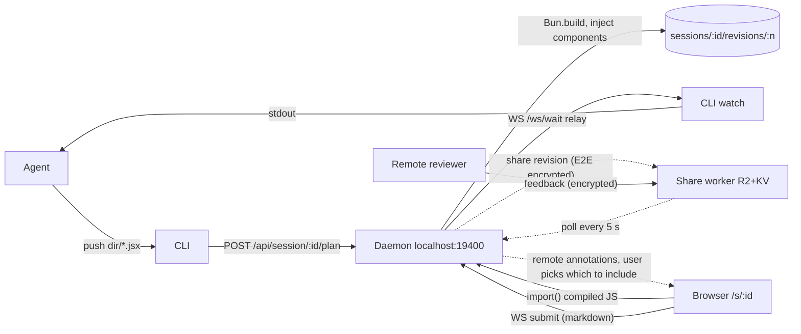
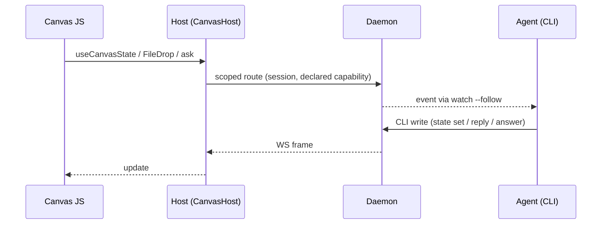

# Artifact-style features for agent-canvas

Status: reviewed 2026-11-12, answers in §5. Written against the standalone agent-canvas repository (0.2.1, now
retired) and moved here; paths are relative to `packages/`. The local-boundary hardening of §4 is done:
[#153](https://github.com/contember/fabrika-platform/pull/153).

**Decisions.** The work targets `fabrika-platform/packages/agent-canvas` (Q1). The first PR hardens the local boundary
(Q7). The first feature round is F2 + F7, F3e, F3f and F5 (Q6). The default share endpoint stays (Q2), the agent only
prepares shares (Q3), and the CSP allows `https:` images and fonts (Q5). Q4 is unanswered, so today's behaviour stays.

**TLDR.** Most hosted-artifact features fit agent-canvas only once they go through the agent's loop. Here that means
the page asks and the agent answers, rather than the page calling a model or a database. The three features worth doing
are per-comment threads the agent answers, a streaming `watch --follow` and files the user drops for the agent. A small
agent-fed state hook and a project theme come after them. Before the page gets any new power, close the gaps in the
daemon's local trust boundary: no Origin or Host check, absolute file paths and no CSP. Accounts, shared databases
between remote viewers, model calls and connectors from the page, and pages that republish themselves do not belong.
Recommended direction: D1 (local-first loop) now, then D2 (extend the existing share worker) when people actually
review shared canvases.

## 1. Agent-canvas today

This section covers the parts that matter here, as they stood before the hardening.



- **Canvas.** The agent writes `.jsx` files into a temp directory and runs `agent-canvas push <dir>`. The daemon
  compiles each file with `Bun.build()`, injects the component imports and strips any other imports
  (`canvas-kernel/src/engine/compiler.ts`). Each push becomes a new revision, stored under
  `~/.claude/agent-canvas/sessions/<id>/revisions/<n>/` with the source, the compiled JS, `feedback.md`,
  `responses.json` and `remote_feedback.json`.
- **Feedback loop.** The user annotates text, blocks or image regions and answers interactive components (`Choice`,
  `UserInput`, `RangeInput`, …). Custom components add entries with `useFeedback`. One **Submit** per revision sends
  one markdown document over the WebSocket to the waiting `agent-canvas watch`, which prints it and exits. A push is
  refused (409) while feedback is unconsumed. The agent replies to the whole batch with the next revision and its
  `--response` banner. It cannot reply to a single comment.
- **Drafts.** Unsubmitted annotations and answers live in the browser's `localStorage`, keyed by session and revision.
  They carry over to the next revision.
- **Local files.** `FilePreview` and the file browser read through `/api/file` and `/api/tree`. Relative paths are
  confined to the project root. Absolute paths are accepted (`agent-canvas/daemon/src/handlers/files.ts`).
- **Uploads.** Annotation images go to one global uploads directory under random names (`agent-canvas/daemon/src/handlers/uploads.ts`).
- **Secrets.** `SecretInput` stores a value in daemon memory. Only the CLI can read it back, using a token in a 0600
  file (`agent-canvas exec`). Canvas JS can set a secret but cannot resolve one. This is the one place where the
  codebase already holds a capability in the daemon rather than in the page. The rest of this design builds on that
  pattern.
- **Share.** "Share" uploads one revision to a Cloudflare Worker (`canvas-share`). The payload is encrypted
  with AES-GCM in the daemon, and the key travels only in the URL fragment. The link is a capability URL with a
  96-bit id. An owner token allows revoke, and a share expires after 30 days by default. Each share gets a new URL.
  Reviewers type a name, which nobody verifies. The daemon polls their feedback and shows it to the local user, who
  chooses which items go into the next submit. The local user therefore stands between untrusted reviewers and the
  agent.
- **Host seam.** `CanvasHost` (`canvas-kernel/src/client/hostContext.tsx`) is the interface a host implements to serve
  canvases: session id, shared or not, file access and `uploadUrl: (() => string) | null`. A capability that is absent
  is `null`, and the UI hides it. New capabilities should follow the same convention.
- **Prior art in the same package.** Review mode (`agent-canvas/daemon/src/review/`) puts comments on running
  applications. It keeps threads with `review reply <thread-id> --resolve` and a
  streaming `review watch --follow` meant for Claude Code's Monitor. F2 and F7 should reuse that model, not invent a
  second one.

Not present today: per-comment replies, a streaming watcher, page-level persistent state, generic file intake, CSP,
an Origin or Host check on HTTP and WebSocket, and canvas isolation. Canvas JS runs in the daemon's own origin and
can reach every route the UI can.

## 2. Features

Each item states whether the feature fits, the smallest design that fits, what it costs and what to drop. Costs are
estimates from reading the code, not measurements. "Kernel" means a change in a `fabrika-platform` package, followed
by a dependency bump here.

### F1 Publish to a stable URL, private by default, versions

**Fit: partial.** Local canvases are already private (localhost) and already have a stable URL (`/s/<id>` shows the
latest revision). What is missing is a stable _shared_ URL that follows republishing. Today each share is a separate
snapshot with its own URL.

**Design.** Make a share a channel, not a snapshot:

- `ShareEntry` gains `revisions: number[]`. "Update share" (UI) or `agent-canvas share --update` (CLI) uploads a new
  revision under the same `shareId` and the same key. AES-GCM with a random IV per field stays sound when a key is
  reused.
- The worker stores `shares/<id>/rev/<n>/…`. `/s/<id>` shows the latest revision and has a revision picker. Revoke
  removes them all.
- Per-recipient links: one share per person, so revoking one person does not break the others. This is already
  possible. The UI needs a label per share.
- The agent may _prepare_ a share. Only the user's click in the UI publishes or updates it, because publishing is
  outward-facing (decided, Q3).

**Cost.** Worker schema and routes, about 150 lines plus tests. Daemon `share.ts` and the kernel `ShareEntry` type,
about 80 lines. Old single-revision shares must stay readable. No new dependencies. Security surface: unchanged
(capability URL, ciphertext at rest).

**Drop.** Accounts, invitations by e-mail, organisation or ACL sharing, and "private" in the sense of "only these
signed-in people". All of these need identity on the worker, which turns it into a hosting platform. The capability
URL plus E2E encryption is the right ceiling.

### F2 Comments as threads the agent answers

**Fit: strong.** This is the core loop at a finer grain. Today the agent can only answer a whole batch with a new
revision.

**Design.**

- An annotation already has a stable `id`. Add replies: `{ id, annotationId, author: "agent" | "user", body,
  createdAt }` stored in `sessions/<id>/threads.json` (session-level, so threads outlive revisions). An annotation
  gets `status: open | resolved`.
- The submit markdown gains each annotation's id. Today it carries none (`canvas-kernel/src/client/generateMarkdown.ts`),
  so the agent has nothing to reply to.
- The agent answers with `agent-canvas reply <annotation-id> "<text>" [--resolve]`, or in bulk together with the next
  push (`push --replies replies.json`). The sidebar shows replies under the comment, live over the existing WS.
- The user can reply in the thread. That counts as new feedback for the next submit or for the streaming watcher
  (F7).
- Thread carry-over: when the next revision no longer contains the anchored text, the thread stays visible as
  "detached" in the sidebar instead of disappearing.
- Port the thread model and markdown from review mode (`agent-canvas/daemon/src/review/threads.ts`,
  `model.ts`). Better still, move it into `@fabrika/annotations` so canvases and app review share one model.

**Cost.** Medium. Annotations package: reply list and status, about 200 lines. Daemon store and routes, about 120
lines. CLI `reply`, about 60 lines. Instructions topic. No dependencies. Security: replies from the agent are rendered
as text or markdown with the existing sanitising renderer, never as HTML.

**Drop.** Mentions, notifications by e-mail, reactions.

### F3 Runtime capabilities

Hosted artifacts grant a page powers that the page then exercises on its own. In agent-canvas the agent is already
the most capable actor in the room. The page should mostly _ask the agent_, or use data the agent placed for it, and
not reach past it. Every item below goes through one mechanism:



Capabilities are declared per canvas (see §4) and are `null` on a host that does not offer them, as `uploadUrl` is
today.

#### F3a Persistent state shared between viewers (a small database)

**Fit: local yes, remote no.** Locally there is one human, sometimes in several tabs, plus the agent. Shared state
between that human and the agent is useful, for example a checklist both of them tick or a tracker that outlives
revisions. Answers to interactive components are already persisted per revision (`responses.json`).

**Design.** `useCanvasState(key, initial)` backed by `sessions/<id>/state.json` through daemon routes and WS
broadcast. The agent uses `agent-canvas state get|set <key> [json]`. Each value is JSON, at most 64 KiB, with a cap
per session. Last write wins, plus a revision counter per key so the UI can tell it lost a race. State changes appear
in `watch --follow` as events.

**Cost.** About 150 lines in the kernel and daemon, plus a CLI command. Zod schema for stored records.

**Drop.** State shared between remote viewers on a share. It needs worker storage, encryption of every write,
conflict handling and moderation. A remote viewer's input already returns as feedback, and that is enough. Also drop
query or collection APIs. A key-value store is all the use cases need.

#### F3b Knowing who is viewing

**Fit: no.** Locally the viewer is always the user. On a share the viewer types a name that nobody verifies, and that
is the honest level. Keep it and label it "unverified" in the UI and in the feedback markdown. Real identity needs
accounts. Drop.

#### F3c The page asks the model a question

**Fit: only as "the page asks the agent".** agent-canvas has no model access of its own, and adding an API key path
would be a second, unsupervised agent. The driving agent is the model.

**Design.** `useAsk()` returns `ask(question, context?)`. It creates a thread (F2) whose origin is the page, not an
annotation. The streaming watcher delivers it, the agent answers with `reply`, and the answer arrives back in the
page. Example: an "Explain this line" button in a code walkthrough. Latency is one agent turn, so this is not a chat.
The UI must say "waiting for the agent" and work while nobody is listening, using the existing `watcher-status`
frame.

**Cost.** Small once F2 and F7 exist, about 60 lines. Without them it does not exist.

**Drop.** Direct LLM calls from the daemon or the page, model choice and streaming tokens.

#### F3d Reading live or connected data

**Fit: through the agent.** The agent can already read anything the user can, including MCP connectors. The page
should not get a second path to those sources.

**Design.** Live data is state the agent feeds (F3a: `agent-canvas state set metrics '…'` from a loop, with the page
subscribed). One cheap local addition: `FilePreview live` re-renders when the referenced file changes on disk. The
daemon watches only files the canvas named.

**Drop.** Network fetches from canvas JS (see §4, CSP), connectors or MCP from the page, scheduled refresh in the
daemon.

#### F3e Storing files people add (assets)

**Fit: strong.** Handing the agent a screenshot, a CSV, a log or a PDF from the page is a common need. Today only
annotation images are possible.

**Design.** A `FileDrop id label accept maxBytes` component. Files go to `sessions/<id>/assets/<uuid>-<name>`, and the
feedback lists their absolute paths, which the agent then reads with its own tools. Annotation image uploads move into
the same per-session directory instead of the global one. Assets are served back with `Content-Disposition:
attachment` and `X-Content-Type-Options: nosniff`. The only exceptions are images shown inline. Assets are never
served as HTML or JS.

**Cost.** About 120 lines plus a component in the kernel. Assets are deleted with the session.

**Drop.** Asset libraries, listing or deleting from the page, and uploads from remote viewers beyond the existing
annotation images.

#### F3f Handing the viewer a file to download

**Fit: yes, nearly free.** A page can already build a `Blob` and use `<a download>`. Add `<Download path="…" />` for
a file the agent produced, for example a generated report or a patch. The daemon serves only paths the compiler saw
in that canvas (see §4, admission). That makes this a read the agent explicitly authorised, not a general file read.

**Cost.** About 50 lines.

#### F3g Camera, microphone, location

**Fit: low.** Localhost is a secure context, so canvas JS can call these browser APIs today and the browser prompts
the user. Nothing to build. If canvases move into an isolated frame (§4), these APIs stay off unless the canvas
declares them. A possible later component: a voice note attached to an annotation (Web Speech API, transcript only).
Do not build it until someone asks.

### F4 The page edits itself and saves a new version

**Fit: the merge direction yes, self-republish no.** A revision in agent-canvas is the agent's statement, compiled
from JSX the agent wrote. A page that republishes itself would create revisions whose source nobody wrote, and the
revision history and "address the feedback first" rule would lose their meaning.

**Design.** "Suggest mode": editable components (`EditableText`, `EditableTable`, `SortableList`) report the user's
changes as a diff through `useFeedback`. The agent applies the diff to the JSX, which is the merge, and pushes. This is
already possible with a custom component and `useFeedback`. Ship one generic `Editable` wrapper and an instructions
topic, not a framework.

**Cost.** Small, about 150 lines in the kernel and one instructions topic.

**Drop.** A page writing its own source or revision, and concurrent editing.

### F5 Typed starting points and design systems

**Fit: yes, mostly already here.** Flows (`feature`, `plan`, `explain`, `review`, `decision`, `runbook`) are the
typed starting points for an agent. Theming is CSS variables with light and dark modes.

**Design.**

- **Project theme.** If `<projectRoot>/.agent-canvas/theme.css` exists, the daemon serves it after the base theme. It
  may only override `--color-*` and `--font-*` variables; the daemon rejects anything else. That gives a project its
  brand without code.
- **Templates.** Add `template-dashboard` and `template-slides` instructions topics, each with an example JSX. That
  is a cheap cost-free trial before building components.
- **Slides.** A `Slides`/`Slide` component with keyboard navigation and annotations per slide. Build it only if the
  template shows people want decks from the agent.
- **Project components** (`.agent-canvas/components.jsx` compiled and injected next to `HOST_COMPONENTS`): defer. It
  is the "design system" feature proper, but it adds a compile step and a second source of components to keep
  consistent.

**Cost.** Theme: about 60 lines. Templates: documentation only. Slides: about 250 lines in the kernel.

### F6 Watching: the agent is notified on change or comment

Covered by F7, which is how F2, F3a and F3c reach the agent.

### F7 Streaming watcher

**Fit: strong.** Today `watch` returns one submit and exits. Remote feedback reaches only the browser.

**Design.** `agent-canvas watch --follow` keeps one WS open and prints one event per block: `submit`, `thread-reply`
(user), `ask` (F3c), `state-changed` (F3a, only for keys the canvas marks `notify`), `remote-feedback-arrived`
(count and reviewer name, not the content), and `render-error`. This matches the review mode's `--follow` and Claude
Code's Monitor tool. The one-shot `watch` stays as it is for other hosts.

Remote reviewers' content still reaches the agent only after the local user includes it, as it does today. An opt-in
`--include-remote` is an open question (Q4). Until it is answered, `--follow` delivers only the arrival event.

**Cost.** About 150 lines in the CLI and daemon. `daemon-kit`'s channel already supports waiters and presence.

## 3. Directions

### D1 Local-first loop (recommended now)

Everything stays on the machine: threads (F2), `watch --follow` (F7), `FileDrop` and `Download` (F3e, F3f), the
project theme and templates (F5), then `useCanvasState` (F3a), `ask` (F3c) and suggest mode (F4) when a concrete
canvas needs them. No new hosted surface.

Right choice when the user is the only human in the loop, which describes most use today. Cost: about 1,000 lines
across `agent-canvas` and the shared packages, spread over independent PRs. Each one can be reverted on its own.

### D2 Extend the existing share worker

D1 plus F1 (share channels with versions) and threads on shared pages. A remote reviewer sees the agent's replies,
and their replies come back E2E encrypted with the share key. Still capability URLs, still no accounts. The worker
stays self-hostable (`oblaka.ts` plus `wrangler`).

Right choice when canvases are regularly sent to colleagues for review. Cost: worker code and tests (about 400
lines), encryption of thread messages, and above all **operations**. A default hosted endpoint is a public service
with storage, abuse and rate-limit work that someone must own. The default endpoint stays on (decided, Q2), so D2
grows that service.

### D3 Pluggable runtime API

A `canvas.use(name)` registry with providers: local daemon, share worker and third-party hosts that embed the kernel.

Right choice only when a second host needs the same capability through a different backend. Today `CanvasHost`
already serves this role: add each capability as a nullable member of `CanvasHost`, as `uploadUrl` is. That gives
D3's portability without a registry. Building the registry now would be an abstraction without a current need.

### Recommended order

Decided on 2026-11-12. All of it lands in `fabrika-platform`.

1. **Harden the local boundary** (§4, rules 1–3), as its own PR now (Q7). It must keep the review-mode widget
   working: that widget calls the daemon from the review proxy's port, and in snippet mode from the application's
   own origin.
2. **F2 threads + F7 `watch --follow`**, together. Extend the review mode's thread model instead of adding a second
   one.
3. **F3e `FileDrop`**, **F3f `Download`**.
4. **F5 project theme and templates**.
5. Deferred, each until a real canvas needs it: **F3a `useCanvasState`**, **F3c `ask`**, **F4 suggest mode**.
6. Deferred: **D2** (F1 share channels, threads on shares).

## 4. Security and privacy

### Who is trusted

- **The agent**, and the JSX it writes, as much as the agent itself. The agent already runs shell commands, so canvas
  JS gains it nothing new on this machine. The risk is indirect: an agent that read hostile content (a README, an
  issue, a web page) can write hostile JSX. Canvas JS must therefore not be able to _send data off the machine_ or
  _speak as the user_.
- **The local user** fully.
- **Remote reviewers** not at all. Their text is untrusted input to the agent. Today the local user filters it, and
  that should stay the default.
- **Other websites the user visits** not at all. They must not reach the daemon.

### Observed gaps (from reading the code, not tested by an exploit)

All four are closed by #153: a Host allow-list, Origin and `Sec-Fetch-Site` checks, a CLI capability on CLI-only
routes, file admission and a CSP on the canvas page. The cross-share `localStorage` point in 4 is the share worker's
and stays open (rule 7).

1. The WebSocket upgrade (`agent-canvas/daemon/src/server.ts`) does not check `Origin`. Browsers do not apply CORS to WebSockets.
   Any website could connect to `/ws/session/<id>` and send a `submit` frame, which the agent receives as the user's
   feedback. Today's mitigation is that session ids from the hook are random UUIDs. A guessable id such as
   `planner-demo` has no protection.
2. HTTP routes do not check `Host`. A DNS-rebinding page could then read responses, including `/api/file`
   (hypothesis, not tested).
3. Handlers call `req.json()` without checking `Content-Type`. A cross-site `text/plain` POST skips the CORS preflight
   and reaches the handler, for example to overwrite a secret field's value (needs the session id).
4. `/api/file` accepts absolute paths. Canvas JS can therefore read any file the user can read, and with no CSP it
   can send it anywhere. The same code serves every share on one worker origin, so one share's JS can read another
   share's `localStorage` (reviewer name, drafts) in the reviewer's browser.

### Rules for the design

1. **Origin and Host checks** on every HTTP route and on the WS upgrade: allow only `localhost:<port>` and
   `127.0.0.1:<port>`. Require `application/json` on JSON routes. This is small and needs no further design.
2. **File admission.** `/api/file` and `Download` serve paths inside the project root, plus absolute paths the
   compiler saw in that canvas's `FilePreview`, `Markdown file` or `Download` props. The kernel already has an
   `assertReadable` hook in `file-admission.ts`. The file browser stays confined to the project root. As built (#153):
   the list comes from string literals in the session's canvases, symlinks are resolved, and no directory outside the
   root is listed. The canvas author writes that list, so it stops reads of paths no canvas names, not a hostile canvas.
3. **CSP on the canvas page**: `connect-src 'self'`, with scripts and styles only from the daemon. Images and fonts
   from any `https:` URL are allowed (decided, Q5). This removes exfiltration through `fetch` and `WebSocket`. An
   image URL remains a narrow leak, accepted for convenience. So do stylesheets, media and navigation, which CSP does not
   govern. Every other daemon response carries an inert policy, so a same-origin frame cannot bypass the page's.
4. **Capabilities are declared per canvas and held by the daemon.** A canvas declares what it uses, for example a
   module export `export const capabilities = ["state", "files", "ask"]`. The compiler records the list on the
   revision. Routes for a capability refuse a revision that did not declare it. The UI shows the declared
   capabilities in the revision header, so the user sees what the page can do. The CLI never needs a grant, because
   it is the agent.
5. **What canvas JS can never do:** resolve secrets (already the case), submit feedback without a user gesture in the
   host UI, read files outside admission, reach the network, or publish a share.
6. **What never leaves the machine by default:** canvas source, compiled JS, feedback, threads, state, assets and
   project files. Leaving requires a share, which is a user action. A share's content stays encrypted with a key the
   worker never sees, including thread messages under D2. Identifying metadata that stays in the clear is limited to
   what routing needs (revision numbers, file names, timestamps).
7. **Share isolation (D2).** Serve each share from its own origin, for example `<shareId>.<worker host>`, or render
   the canvas in a sandboxed iframe, so that shares cannot read each other's storage.
8. **Full canvas isolation**, meaning canvas JS in a cross-origin iframe with the annotation runtime inside it and the
   sidebar talking to it by `postMessage`, is the strong version of 3–5. It is a large refactor of the annotations
   package, because annotations work directly on the canvas DOM today. Defer it until the page holds capabilities
   that CSP and admission cannot cover.

## 5. Open questions

### Q1 Where does this work land?

agent-canvas existed twice: the standalone repository (0.2.x, consumes the packages) and `packages/agent-canvas`
(0.9.0-dev, already has review threads and `--follow`). Designing F2 and F7 here duplicates that work unless one line
is retired.

**Decided (2026-11-12): fabrika-platform package.** The work lands in `fabrika-platform/packages/agent-canvas`, which is also where the npm `agent-canvas` package is published from (`latest` 0.8.2, `next` 0.9.0-dev). The standalone repository is retired (Q8).

### Q2 Default share endpoint

Sharing is on by default and points at a hosted worker. D2 makes that service bigger.

**Decided (2026-11-12): keep the default endpoint.** Sharing stays on by default. Whoever runs the hosted worker owns its operation and abuse handling.

### Q3 May the agent publish?

**Decided (2026-11-12): prepare only.** The agent may stage a share. Only the user's click in the UI publishes or updates it.

### Q4 Remote feedback straight to the agent

Unanswered in the 2026-11-12 review. Until it is answered, today's behaviour stays: the local user includes remote
feedback.

```form
type: choice
id: q4-remote
label: Should watch --follow ever deliver remote reviewers' text without the local user including it?
options:
  - {value: never, label: "Never", description: "the user stays the filter (today's behaviour)"}
  - {value: optin, label: "Opt-in per share", description: "for trusted colleagues; text is marked untrusted"}
```

### Q5 External images and fonts on canvases

**Decided (2026-11-12): allow any https.** The CSP allows images and fonts from any `https:` URL. `connect-src` stays `'self'`. Accepted residual risk: an image URL can still carry data out.

### Q6 Scope check

**Decided (2026-11-12):** F2 threads + F7 `watch --follow`, F3e `FileDrop`, F3f `Download`, F5 project theme + templates. Deferred: F3a `useCanvasState`, F3c `ask`, F4 suggest mode, F1 share channels.

### Q7 Hardening as its own task

The gaps in §4 exist today, independent of this design.

**Decided (2026-11-12): yes, a separate PR now**, before any feature work.

### Q8 The standalone repository after Q1

**Decided (2026-11-12): retire it.** The standalone repository is archived; development and the npm package are
here.
