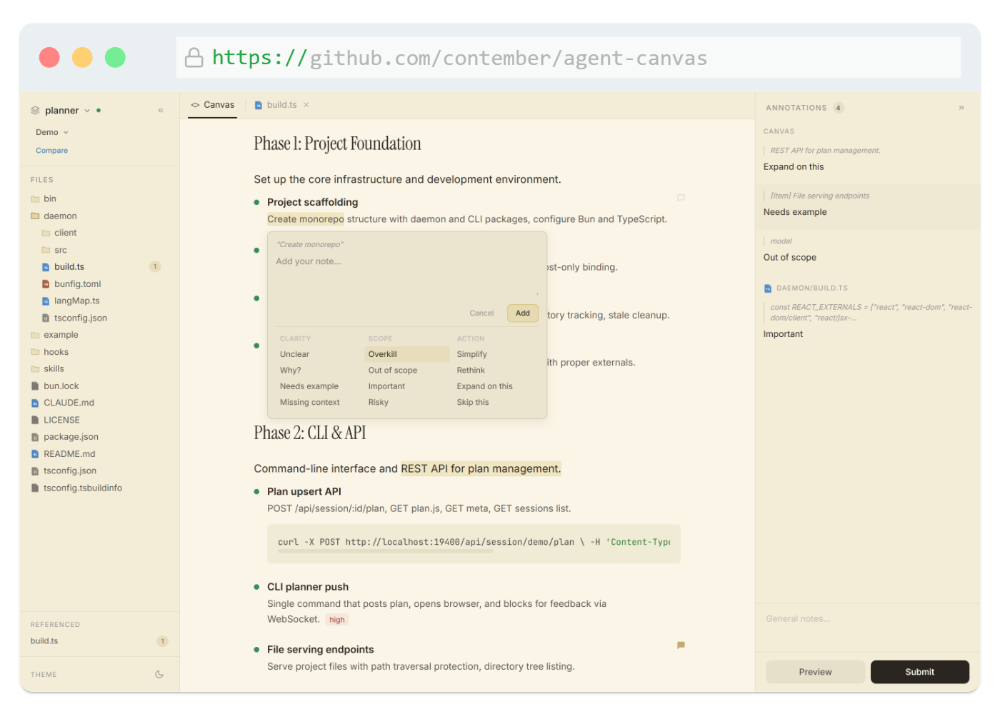
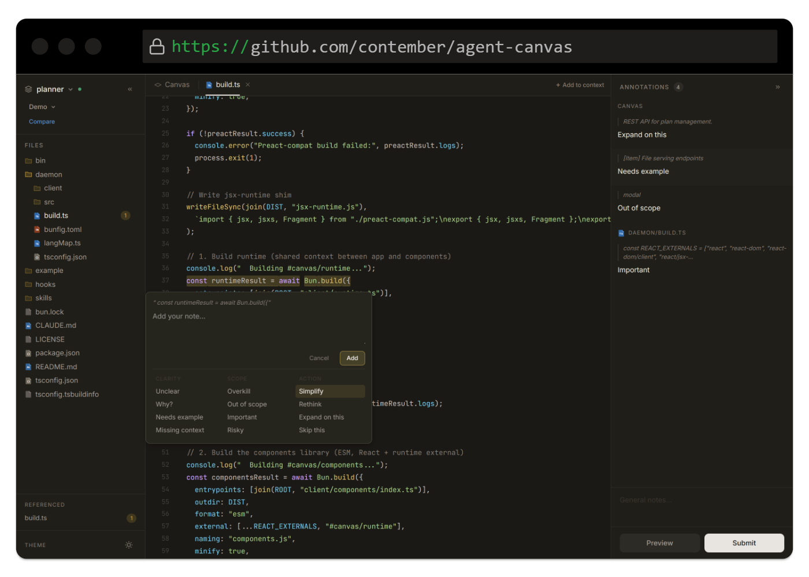

# Agent Canvas

Interactive browser-based visual canvas for [Claude Code](https://docs.anthropic.com/en/docs/claude-code). Create rich, annotatable JSX documents that render in the browser — with revision history, inline annotations, and structured feedback that flows back to Claude.




## What it does

When Claude needs to present a plan, review, explanation, or decision — instead of dumping markdown in the terminal — it renders a full interactive canvas in your browser. You can:

- **Annotate** any element with inline comments
- **Choose options**, fill inputs, rate with sliders
- **Browse files** referenced in the canvas
- **Review revisions** as Claude iterates
- **Send structured feedback** back to Claude in one click
- **Hand off secrets locally** without placing values in model context or feedback

## Install

```bash
# Register the skill and hooks in Claude Code
bunx agent-canvas install global    # for all projects
bunx agent-canvas install local     # for current project only
```

This installs:

- The `/canvas` skill so Claude knows how to use it
- A `SessionStart` hook that sets up session IDs automatically

**Requires [Bun](https://bun.sh/) runtime.**

## Usage in Claude Code

Once installed, use the `/canvas` command to create a canvas:

```
> /canvas Plan the authentication refactor
> /canvas Show me an architecture overview
> /canvas Review this PR
```

Claude creates a JSX document, pushes it to a local daemon, and opens it in your browser at `http://localhost:19400/s/<session-id>`.

### Flow patterns

Claude uses different canvas flows depending on the task:

| Flow         | When                                                | Rounds                                                     |
| ------------ | --------------------------------------------------- | ---------------------------------------------------------- |
| **Feature**  | Vague requests ("add auth")                         | Discovery → Requirements → Plan → Implementation → Summary |
| **Plan**     | Clear requirements                                  | Plan → Implementation → Summary                            |
| **Explain**  | "How does X work?"                                  | Single canvas                                              |
| **Review**   | Code/architecture review                            | Findings → Fix Plan → Summary                              |
| **Decision** | Choosing between options                            | Single canvas with comparison                              |
| **Runbook**  | User must complete manual setup or provide a secret | Instructions → secure handoff → command → result           |

### Local secret handoff

Runbooks can use `SecretInput` when a command needs a token that must stay out of feedback and model context. The browser stores the value only in the local daemon's memory. Feedback contains the field ID and environment variable name, not the value.

The agent then runs the target command through the local wrapper:

```bash
bunx agent-canvas exec \
  --session <session-id> \
  --secret SERVICE_TOKEN=service-token \
  -- service-cli deploy
```

Secret resolution requires a daemon capability available to the CLI but not to canvas JavaScript. A new canvas revision, daemon shutdown, or session cleanup clears the value. The target command must not print its environment or credentials.

### Review mode

Review mode puts the same comment loop on a running web application: a prototype, a mock or any dev server. Open the
application through the daemon's review proxy:

```bash
bunx agent-canvas review open http://localhost:5173/ --project my-app
```

The daemon serves the application on a port of its own with the widget added to every HTML page (hot reload passes
through) and opens it in the browser. To keep the application's own address, add the widget's tag to its page in
development instead: `bunx agent-canvas review snippet --project my-app`.

The widget mounts a toolbar in its own shadow root. The reviewer clicks **Comment**, picks an element or selects text,
and saves the comment as a note or sends it to the agent. The agent waits with `bunx agent-canvas review watch` (`--follow` keeps waiting),
receives each thread with its page URL, the element's role and accessible name, a CSS path, the React components that
own it with their source positions (resolved through the dev server's source maps), the trimmed markup and, when the
reviewer attaches one, a screenshot of the tab, changes the code and answers with `bunx agent-canvas review reply <thread> "<text>" --resolve`. The answer and
the thread's state show up next to the element.

Threads are stored per project under the daemon's data directory. The daemon accepts widget requests only from loopback
origins (`localhost`, `127.0.0.1`, `*.localhost`) and agent requests only from clients that send no `Origin`, so a web
page cannot queue work for the agent.

#### Remote review

The same loop works on a deployed application. `bunx agent-canvas review share https://prototype.example.com --project my-app`
creates a project on the share worker and prints a `<script>` tag for the application and a link for the reviewer. The
link carries the project and an AES-GCM key in its fragment, which never reaches a server: the widget seals every
anchor, comment and screenshot before sending it, the CLI opens them, and the worker stores and relays ciphertext. The
widget mounts only for a browser that opened the link, so the tag can stay in a public deployment. The worker accepts
widget requests only from the origin the project was shared for, and agent requests only with the token `share`
stored on this machine. `watch`, `reply`, `fetch` and `list` work as above.

## Theming

Agent Canvas supports light and dark themes, automatically matching your system preference.

**Dark mode**



## Development

### Reusable packages

| Package                                                                                                    | Use without the Agent Canvas shell                                     |
| ---------------------------------------------------------------------------------------------------------- | ---------------------------------------------------------------------- |
| [`@fabrika/daemon-kit`](https://github.com/contember/fabrika-platform/tree/main/packages/daemon-kit)       | Bun daemon lifecycle, HTTP routing, WebSocket channels and CLI waiters |
| [`@fabrika/annotations`](https://github.com/contember/fabrika-platform/tree/main/packages/annotations)     | Annotation state, editors and text/block/region locators               |
| [`@fabrika/canvas-kernel`](https://github.com/contember/fabrika-platform/tree/main/packages/canvas-kernel) | JSX compiler, revisions, renderer and interactive canvas components    |

The kernel depends on the other two; neither depends on the kernel. All ship as
TypeScript sources and are released together with `agent-canvas` from the
[`fabrika-platform`](https://github.com/contember/fabrika-platform) repository.

### Local commands

```bash
bun install
bun run build                  # build client assets
bun daemon/build.ts --watch    # watch mode

# Test with demo canvas
bun bin/agent-canvas.ts daemon start
CANVAS_SESSION_ID=demo bun bin/agent-canvas.ts push example --label "Demo"
# Open http://localhost:19400/s/demo
```

## License

MIT
