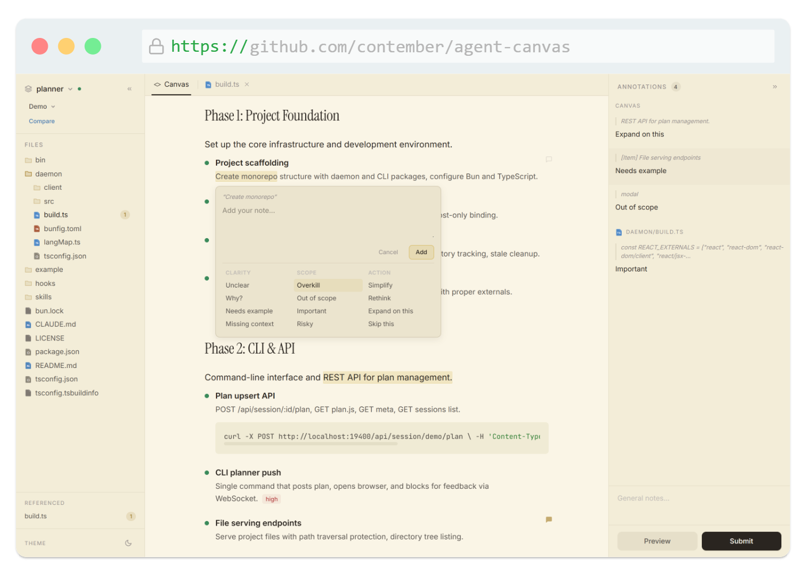
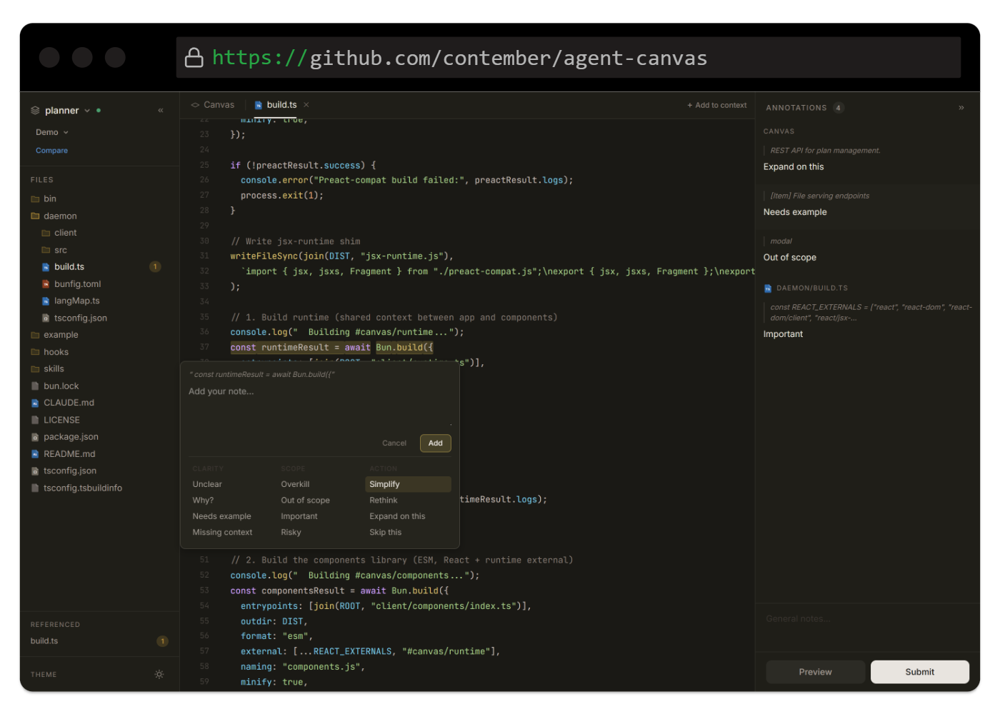

# Agent Canvas

Interactive browser-based visual canvas for [Claude Code](https://docs.anthropic.com/en/docs/claude-code). Create rich, annotatable JSX documents that render in the browser — with revision history, inline annotations, and structured feedback that flows back to Claude.




## What it does

When Claude needs to present a plan, review, explanation, or decision — instead of dumping markdown in the terminal — it renders a full interactive canvas in your browser. You can:

- **Annotate** any element with inline comments
- **Choose options**, fill inputs, rate with sliders
- **Browse files** referenced in the canvas
- **Review revisions** as Claude iterates
- **Send structured feedback** back to Claude in one click
- **Hand off secrets locally** without placing values in model context or feedback

## Install

```bash
# Register the skill and hooks in Claude Code
bunx agent-canvas install global    # for all projects
bunx agent-canvas install local     # for current project only
```

This installs:

- The `/canvas` skill so Claude knows how to use it
- A `SessionStart` hook that sets up session IDs automatically

**Requires [Bun](https://bun.sh/) runtime.**

## Usage in Claude Code

Once installed, use the `/canvas` command to create a canvas:

```
> /canvas Plan the authentication refactor
> /canvas Show me an architecture overview
> /canvas Review this PR
```

Claude creates a JSX document, pushes it to a local daemon, and opens it in your browser at `http://localhost:19400/s/<session-id>`.

### Flow patterns

Claude uses different canvas flows depending on the task:

| Flow         | When                                                | Rounds                                                     |
| ------------ | --------------------------------------------------- | ---------------------------------------------------------- |
| **Feature**  | Vague requests ("add auth")                         | Discovery → Requirements → Plan → Implementation → Summary |
| **Plan**     | Clear requirements                                  | Plan → Implementation → Summary                            |
| **Explain**  | "How does X work?"                                  | Single canvas                                              |
| **Review**   | Code/architecture review                            | Findings → Fix Plan → Summary                              |
| **Decision** | Choosing between options                            | Single canvas with comparison                              |
| **Runbook**  | User must complete manual setup or provide a secret | Instructions → secure handoff → command → result           |

### Files from the user

`<FileDrop id label accept maxBytes required>` lets the user hand the agent a file from the canvas. The daemon stores it with the session (`sessions/<id>/assets/<field>/`, mode 0600), caps a file at 25 MB and a session at 100 files and 250 MB, and keeps the files until the session directory is removed; nothing deletes them automatically. A field's files stay listed on later revisions. The feedback lists their absolute paths; the agent reads them with its own tools. No route serves them back, so an upload is never rendered as a page or run as a script.

### Threads and following a session

Submitted feedback labels each of the user's own annotations with its id; a remote reviewer's has none and opens no
thread. The agent can answer one annotation with `bunx agent-canvas reply <annotation-id> "<text>" [--resolve]`; the
reply appears under the annotation in the sidebar, where the user can answer back. The thread stays visible on later
revisions and is kept until the session directory is removed; nothing deletes it automatically. The user's answer
reaches the agent through `watch` and `fetch` like a submit. Answering a thread whose reply the agent has not read yet
is refused until `watch` hands that reply over.

`bunx agent-canvas watch --follow` keeps watching instead of exiting after the first answer. It prints one block per
submit, thread reply, render error and remote-feedback arrival, for hosts that turn each output line into an event
(Claude Code's Monitor). For remote feedback it prints only the count and the reviewers' self-typed names; their text
reaches the agent when the user includes it in a submit. A remote-feedback arrival is a best-effort notice: one that
comes while the watcher is reconnecting is not repeated.

### Local secret handoff

Runbooks can use `SecretInput` when a command needs a token that must stay out of feedback and model context. The browser stores the value only in the local daemon's memory. Feedback contains the field ID and environment variable name, not the value.

The agent then runs the target command through the local wrapper:

```bash
bunx agent-canvas exec \
  --session <session-id> \
  --secret SERVICE_TOKEN=service-token \
  -- service-cli deploy
```

Secret resolution requires a daemon capability available to the CLI but not to canvas JavaScript. A new canvas revision, daemon shutdown, or session cleanup clears the value. The target command must not print its environment or credentials.

The daemon answers only requests addressed to `localhost`, `127.0.0.1` or `[::1]` on its port. It refuses state-changing requests and WebSocket upgrades from any origin other than its own UI, requires the CLI capability on the routes only the CLI calls (push, feedback, secret resolution, thread replies and claims, review agent routes), and never serves its own temporary or data directory through the file routes. The file routes serve a session's project root and, outside it, only the files its canvases name in `FilePreview path`, `Markdown file`, `ImageView src` or `Download path`, symlinks resolved; they list no directory outside it. `/api/download`, behind `<Download path>`, serves only a named file, inside the root too, as an `application/octet-stream` attachment. The canvas author controls that list, so it stops reads of paths no canvas names, not a hostile canvas. The canvas page carries a Content-Security-Policy that lets canvas JavaScript connect only to the daemon. Images, fonts, stylesheets and media may come from any https origin, and such a URL, like a navigation, can still carry data out. Every other daemon response carries an inert policy, so a frame or window of it cannot be scripted past the page's.

### Review mode

Review mode puts the same comment loop on a running web application: a prototype, a mock or any dev server. Open the
application through the daemon's review proxy:

```bash
bunx agent-canvas review open http://localhost:5173/ --project my-app
```

The daemon serves the application on a port of its own with the widget added to every HTML page (hot reload passes
through) and opens it in the browser. To keep the application's own address, add the widget's tag to its page in
development instead: `bunx agent-canvas review snippet --project my-app`.

The widget mounts a toolbar in its own shadow root. The reviewer clicks **Comment**, picks an element or selects text,
and saves the comment as a note or sends it to the agent. The agent waits with `bunx agent-canvas review watch` (`--follow` keeps waiting),
receives each thread with its page URL, the element's role and accessible name, a CSS path, the React components that
own it with their source positions (resolved through the dev server's source maps), the trimmed markup and, when the
reviewer attaches one, a screenshot of the tab, changes the code and answers with `bunx agent-canvas review reply <thread> "<text>" --resolve`. The answer and
the thread's state show up next to the element.

Threads are stored per project under the daemon's data directory. The daemon accepts widget requests only from loopback
origins (`localhost`, `127.0.0.1`, `*.localhost`) and agent requests only from clients that send no `Origin`, so a web
page cannot queue work for the agent.

#### Remote review

The same loop works on a deployed application. `bunx agent-canvas review share https://prototype.example.com --project my-app`
creates a project on the share worker and prints a `<script>` tag for the application and a link for the reviewer. The
link carries the project and an AES-GCM key in its fragment, which never reaches a server: the widget seals every
anchor, comment and screenshot before sending it, the CLI opens them, and the worker stores and relays ciphertext. The
widget mounts only for a browser that opened the link, so the tag can stay in a public deployment. The worker accepts
widget requests only from the origin the project was shared for, and agent requests only with the token `share`
stored on this machine. `watch`, `reply`, `fetch` and `list` work as above.

## Theming

Agent Canvas supports light and dark themes, automatically matching your system preference.

A project can set its own colours and fonts in `.agent-canvas/theme.css` at its root. The daemon accepts only
`--color-*` and `--font-*` variables on `:root`, `[data-theme="light"]` and `[data-theme="dark"]`, and serves its own
rebuild of them, so a theme cannot load a URL or style the page otherwise. A file that breaks a rule is not applied;
the daemon log and the browser console say why. The `template-dashboard` and `template-slides` instructions topics
are starting points for a status dashboard and a deck.

**Dark mode**



## Development

### Reusable packages

| Package                                                                                                    | Use without the Agent Canvas shell                                     |
| ---------------------------------------------------------------------------------------------------------- | ---------------------------------------------------------------------- |
| [`@fabrika/daemon-kit`](https://github.com/contember/fabrika-platform/tree/main/packages/daemon-kit)       | Bun daemon lifecycle, HTTP routing, WebSocket channels and CLI waiters |
| [`@fabrika/annotations`](https://github.com/contember/fabrika-platform/tree/main/packages/annotations)     | Annotation state, editors and text/block/region locators               |
| [`@fabrika/canvas-kernel`](https://github.com/contember/fabrika-platform/tree/main/packages/canvas-kernel) | JSX compiler, revisions, renderer and interactive canvas components    |

The kernel depends on the other two; neither depends on the kernel. All ship as
TypeScript sources and are released together with `agent-canvas` from the
[`fabrika-platform`](https://github.com/contember/fabrika-platform) repository.

### Share client

`agent-canvas/share` shares a compiled canvas from another host through the same share worker and wire format the
daemon uses, with end-to-end encryption on by default. `agent-canvas/share/responses` holds only the schema of the
structured answers, for code that must not load the encryption helpers.

```ts
import { compileJsx } from '@fabrika/canvas-kernel/server'
import {
	createShare,
	decryptFeedbackEntry,
	fetchShareFeedback,
	importShareKey,
	revokeShareOnWorker,
} from 'agent-canvas/share'

const endpoint = 'https://canvas.example.com'
const compiled = await compileJsx(jsx)
if (!compiled.ok) throw new Error(compiled.error)
const share = await createShare({
	version: 1,
	origin: {
		sessionId: 'doc-1',
		revision: 1,
		createdAt: new Date().toISOString(),
	},
	canvasFiles: [{ filename: 'plan.jsx', compiledJs: compiled.js }],
	runtime: { componentsVersion: '<agent-canvas version>' },
}, { endpoint })
// share.url carries the key in its #k= fragment; keep it and share.ownerToken secret.
if (!share.encryptionKey || !share.ownerToken) {
	throw new Error('expected an encrypted share with an owner token')
}

const key = await importShareKey(share.encryptionKey)
let since = '' // keep it between polls
const page = await fetchShareFeedback(endpoint, share.shareId, since)
for (const wire of page.entries) {
	try {
		const entry = await decryptFeedbackEntry(wire, key)
		// entry.responses: structured answers to Choice, MultiChoice, UserInput and RangeInput;
		// entry.droppedResponses: how many did not fit the wire shape and were left out.
	} catch {
		// One entry that does not decrypt; the others still count.
	}
}
// page.malformed: ids of entries that did not match the wire format.
since = page.latestAt ?? since

await revokeShareOnWorker(endpoint, share.shareId, share.ownerToken)
```

Compile with the `@fabrika/canvas-kernel` of the same release: the worker serves the runtime it was deployed with.

### Local commands

```bash
bun install
bun run build                  # build client assets
bun daemon/build.ts --watch    # watch mode

# Test with demo canvas
bun bin/agent-canvas.ts daemon start
CANVAS_SESSION_ID=demo bun bin/agent-canvas.ts push example --label "Demo"
# Open http://localhost:19400/s/demo
```

## License

MIT
